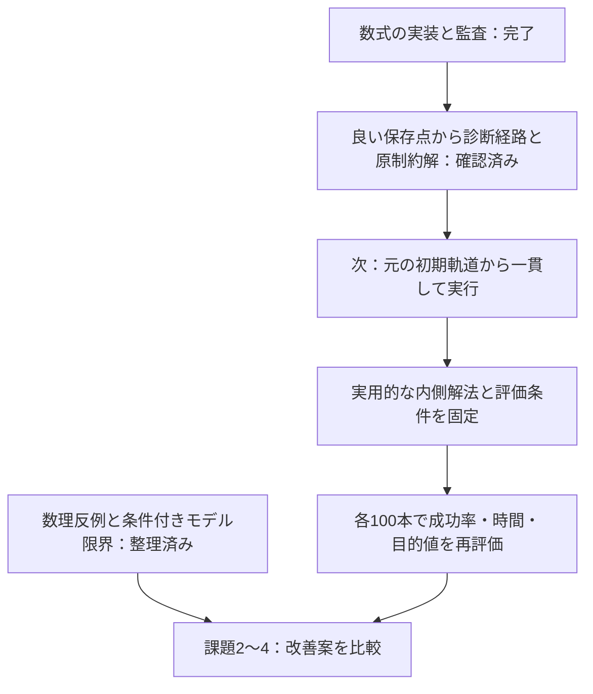

# 全体ロードマップ：論文再現・問題点の検証・改善案

更新日：2026-11-15。実験結果の基準コミット：`bdb9e7c`。
**今後の優先順位と達成状況はこのファイルに集約する。**
実験ごとの条件・数値は各REPORT.md、作業の履歴は[WORK_LOG.md](WORK_LOG.md)に残す。
この整理のための新しい求解は行っていない。

## 現在地

**数式の独自実装、解と残差の検証、診断用解法による良い解の構成まではできた。
元の初期軌道から安定して解く実装と、論文の数値実験全体の再現はまだできていない。**

直近では、保存した良い経路を出発点として、各段階の共通尺度KKTを確認しながら最終問題へ進めた。
最終時間は **1.879132289 h**。元の制約で位置も再最適化すると、
**1.882589424 h・電池非負・原制約違反が丸め誤差内**の解を得た。
論文の読取値約1.8932 hとの差は約38.2秒だが、次の依存が残る。

- 初期値は、以前の後処理で作った良い解を使っている。
- 第1〜4段階の個別診断・保存点をつないでいる。全13段階を最初から単一ランナーで、各段階のKKTを満たして通した結果ではない。
- 内側は診断用Newton。著者のMATLAB/L-BFGSの実行ではない。
- 残差尺度・AL更新・段階間リセットなどに独自の補完条件がある。
- 1.882589424 hは原制約で別に再最適化した点。平滑化KKT点そのものではない。

したがって、**「解ける具体例は得たが、入力からの安定した求解と著者の性能分布の再現は未達」**が総括になる。

## 何ができて、何ができていないか

| 対象 | 状況 | 達成した範囲／残る条件 |
|---|---|---|
| 数理式の独自実装 | 実装・検査済み | Rustで平滑化NLP・ホモトピー・AL・L-BFGSを実装。勾配・Jacobian・原制約の照合あり。未指定条件の補完や定義域外の拡張を含み、著者コードとの一致は未確認 |
| 最終平滑化NLPのKKT点の存在 | 具体例を確認済み | 図1相当で複数の最終KKT点を得た。現在「全条件KKTが0」という状態ではない。大域最適性の証明ではない |
| 近似を段階的に鋭くして最終問題へ進む経路 | 診断経路では達成 | 保存点をつないだ第1〜4段階と、直近の第5〜13段階で共通尺度KKTを確認。初期化からの単一実行で、全段階のKKTを確認して進む経路は未達 |
| 図1相当の原制約・電池を満たす解 | 復元により達成 | 直近は1.882589424 h。別の直接開始経路では以前に約1.779030001 hも得た |
| 直近の平滑化点の物理変数での同じKKT許容値 | 未達 | 共通stat約9.77e-8に対し物理変数stat約3.22e-6。独自の追加目標1e-6には未達で、著者の許容値は不明 |
| 良い保存済み初期解に依存しない同じ診断経路 | 次の検証 | 元の初期軌道から、条件を固定して最初から比較する必要がある |
| 本体L-BFGSによる安定した求解 | 未達 | 診断用Newtonの成果は本体へ移していない。ライブラリ交換だけでは解決しなかった |
| 独自入力で各100本の基準測定 | 測定済み | 1〜9タスク各100本、計900本を保存。成功率の再現とは別 |
| 改善後の各100本評価 | 未実施 | 直近の診断経路・本体修正後の900本を測り直していない |
| 著者の図1・図3の実験の再実行 | 未達 | 著者コード・元データ・seed・N・AL等の条件が揃っていない。MATLAB本体も未実施 |
| 数理モデル・近似への批判的検討 | 反例・導出あり | 求解失敗と独立に主張できるものがある。影響の頻度や改善性能は別に検証する |
| 課題2〜4の草稿 | 作成済み | 単一車両の再訪間移動を中心に、複数案・追加モデル・構成検証を保存。同時NLPの性能比較は未実施 |

## 数値の読み分け

| 数値 | 何を意味するか | 根拠 |
|---|---|---|
| 1.879132289 h | 直近の最終平滑化点。共通KKT合格だが、純モード電池は約0.000441不足 | [後続段階の検証](experiments/2026-11-15-decomposed-follow/REPORT.md) |
| 1.882589424 h | その点の担当時点・モード・Nを固定し、原制約で位置も再最適化した実行可能解 | [同レポートの復元結果](experiments/2026-11-15-decomposed-follow/REPORT.md#原制約で一度復元した結果) |
| 約1.779030001 h | 良い初期点から最終問題へ直接進む別の経路の復元解。直近の値は最良記録の更新ではない | [初期解と段階の対照](experiments/2026-11-15-warm-start/REPORT.md) |
| 約1.8932 h | 論文図1の読取値。手元と入力・N・初期化・実装の一致が未確認 | [論文図の読取り](experiments/2026-11-14-paper-figures/REPORT.md) |
| KKT 0/900、元違反<=1e-3が438/900 | 古い基準実装・独自入力の測定。現在の全成果を表す数字ではない | [900本の基準測定](experiments/2026-11-14-reproduction/REPORT.md) |
| KKT 1/900、元違反<=1e-3が774/900 | 別の固定rho条件の同じ900本。追加物理監査は82/900で、全面改善ではない | [固定ペナルティ診断](experiments/2026-11-14-conditioning/REPORT.md) |

KKTの有限許容値は変数・残差の尺度で変わる。共通尺度と物理変数の指標を併記する。
また、平滑化KKT、原制約、純モードで再積分した電池、追加の車両条件はそれぞれ別の判定である。
論文が900/900でKKT収束したとは記載されていない。違反<=1e-3もこちらの比較用閾値である。

## 原因調査で確かになったこと

| 調査 | 確認できたこと | 適用範囲 |
|---|---|---|
| 内側ライブラリ | 自作L-BFGSとSciPy L-BFGS-Bに共通する停滞があった | 単純な交換だけで直るという説明では不十分。[比較](experiments/2026-11-15-library-trace/REPORT.md) |
| 残差・変数尺度 | 等価な制約でもALの経路が大きく変わった | 原問題の同値性と、有限ペナルティの数値挙動は別。[比較](experiments/2026-11-15-fidelity/REPORT.md) |
| 制約達成後のrho増加 | 不要な増加で停留性を悪化させる具体例を特定 | 増加抑制を本体へ反映済み（7065fd4）。標準3例の性能は変わらず。[検証](experiments/2026-11-15-stage2/REPORT.md) |
| 内側未収束時のrho増加 | 第3段階では精度条件で共通KKTが0/4→4/4 | 本体3例では原制約が悪化したため追加条件の本体適用は見送り。[検証](experiments/2026-11-15-stage3/REPORT.md) |
| 診断Newtonの二階情報 | PHRの切替をまたぐ差分が大きな非対称成分を生んだ。Hessianの分解で改善 | 差分Hessianを使わない本体L-BFGSのバグ修正ではない。[検証](experiments/2026-11-15-stage4-inner/REPORT.md) |
| 解の割当て | 固定した充電選択のままでは時間の下界が高い例、必要な充電を失い固定分岐では復元不能な例があった | 反復不足と、解の選択が悪いことを分ける。[選択の比較](experiments/2026-11-14-branch-selection/REPORT.md) |

単一の原因を直せば全て解決する段階ではないが、「論文のモデルが良い解を持たない」という説明は支持されない。
独自実装の失敗を著者のアルゴリズムの失敗率へ置き換えない。

## 今後のロードマップ

再現の経路と数理的な批判・改善の経路を分ける。
**再現が未完了でも、反例や導出で確認済みの限界は説明できる。**
一方、実装の失敗に基づく性能批判や改善の成功率は、安定した比較条件を用意してから評価する。

### R1：元の初期軌道から診断経路を通す【次に実行】

**問い：良い保存済み解を与えなくても、最終問題のKKTと良い充電選択へ進めるか。**

- 図1相当の元の初期軌道から、直近と同じR尺度・分解Newton・段階リセット/更新規則を適用する。
- 初期化以外の条件を結果を見て変えず、第1段階から単一ランナーで状態を保存する。
- 各段階の共通/物理変数KKT、充電選択、原制約、純モード電池、時間切れを記録する。
- 判定：最終共通KKTへ進むか、同じ原制約復元を通るか、目的値がどうなるかを別々に報告する。

最終へ進めない場合は最初の未達段階を調べる。
最終へ進んでも高い時間にとどまる場合は、入力から作る初期軌道の充電選択・訪問順を比較する。
既存の良解を読み込む成功経路と、入力だけからの成功経路を混ぜない。

### R2：再利用できる求解実装と評価条件を固定する【R1の結果で分岐】

**問い：診断で解けた問題を、安定した予算で繰り返し解けるか。**

- 診断Newtonを参照に、内側解法・尺度/前処理・rho更新・段階進行を一因子ずつ比較する。
- 本体へ取り込む変更は独立例でも確認する。第3段階だけの改善を全体へ無条件に広げない。
- KKT・原制約・物理単位別の許容値、打切りと復元の扱いを評価前に固定する。
- 直近の物理変数stat=3.22e-6という追加精度課題もここで扱う。著者の未公開許容値とは区別する。
- 完了条件：保存済み良解なしで実行できる入口、設定・予算・判定規則、再開可能な記録を一つの版にまとめる。

著者のL-BFGSに近い再実装と、診断Newtonや復元を加えた改善手法は、別の手法として集計する。
必要ならMATLABでの比較を追加するが、現時点では実施環境・著者コードを確保できていない。

### R3：各タスク数100本の分布を再評価する【R2後】

**問い：単一の図1だけでなく、複数入力でも性能を保てるか。**

- 設定を固定した後、独自入力の各100本を実行。既存900入力は回帰比較に使い、別seedの評価も分ける。
- KKT、元違反、電池、目的値、時間、打切りをそれぞれ集計。失敗を分母から除外しない。
- 復元前後と、実行可能解だけの時間分布を分ける。上流の初期化費用も含めて測る。
- 著者の図3とは分布比較として報告し、入力対が同じとは主張しない。
- 完了条件：新しい版の集計・全入力/出力・コマンド・失敗理由を保存し、再現できた傾向と残る差を示す。

元データ・コード・設定の記載不足は、係数探索では解消しない。
入手できなければ、厳密な著者実験の再実行は未達としたまま、独自条件の再実装として範囲を明記する。

### C1：課題2の問題点を根拠の強さで整理する【既存成果を使って並行可能】

| 論点 | 確認済みの範囲 | 残る検証 |
|---|---|---|
| 平滑化でc<=sを失う | 近似NLPを満たす反例がある | 通常入力での頻度と、必要条件追加の性能。小標本の限定比較は済み、一般優位性は未確認 |
| 有限pの等式・psiの境界ずれ | 数式の導出、原実行可能解が除外される例がある | 包含を保つ近似が、収束・目的値・時間を改善するか |
| 単位・候補重複・Nへの依存 | 数式と限定比較で確認。Nは最小区間時間による下界も変える | 元の条件と異なるモデル/初期化の影響を分けた広い比較 |
| 単一車両の再訪間移動 | 条件付き反例と車両軌道の検証・構成がある | 車両を同時計画したNLPの性能。論文図1が車両条件に違反するという主張ではない |
| 一般の充放電写像の時間分割 | 論文の一般条件だけでは半群性を保証しない反例がある | 数値例のCC–CV/一定放電率への欠陥とは扱わず、一般モデルの条件として論じる |
| 実験条件の記載不足 | 未指定項目を整理済み | 著者情報の入手。こちらの収束診断だけで著者の失敗率は決められない |

元の順位1〜7の初回限定比較は完了している。「完了」はその範囲の比較を終えた意味で、論点を全面解決した意味ではない。
数式・反例は[批判的検討](../human/critical_review.md)、検証条件と履歴は[問題点の検証順](../human/validation_plan.md)。

### C2：課題3・4の改善案を具体化し比較する【草稿あり、性能評価は未達】

既存草稿の中心は、各領域を同じ一台が担当する場合の再訪間移動。
[車両モデルの草稿](../human/carrier_model.md)に、運用条件の限定・再訪間制約・車両位置の同時計画・事後修復を整理してある。
固定担当の車両軌道の検査/構成は実装済みだが、同時NLPを解いて優位性を示してはいない。

次は、適用する運用条件と比較対象を固定し、一つの問題に対する複数案を比べる。
単一車両を仮定しない用途にも必要な修正、と一般化しない。
近似自体の改善案は[必要条件・零点集合・包含の比較](experiments/2026-11-14-approximation/REPORT.md)を別の候補として残す。

完了条件は「なぜ問題か → 複数の解決案 → 選ぶ理由 → 数式・手順 → 検証と限界」がつながる説明と比較結果。
草稿があることと、改良手法の性能を実証したことを区別する。

## 文書とコードの使い分け

| 場所 | 役割 |
|---|---|
| このROADMAP.md | 現在地・次の優先順位・到達条件。作業が進んだらここを更新する |
| [README.md](README.md) | 読む入口と本体の実行方法 |
| [WORK_LOG.md](WORK_LOG.md) | 日付・コミット・失敗を含む作業履歴 |
| [human/reproduction.md](../human/reproduction.md) | 再現調査の詳しい経過。過去の「次は」はその時点の予定 |
| [human/report.md](../human/report.md) | 課題1〜4の草稿と参照先 |
| `src/` | 本体Rust実装。診断結果が全て反映されているわけではない |
| `experiments/*/REPORT.md` | 条件・結果・限界の固定記録。過去の実験結果を新しい成果で書き換えない |
| `experiments/*/PLAN.md` | 求解前に固定した条件。追加実験は理由と条件を別に残す |

次の作業は **R1：元の初期軌道から同じ診断経路を通す検証**。
課題2の説明をまとめる場合はC1/C2の既存根拠を使い、R3未達を理由に数理的な検討まで止める必要はない。
