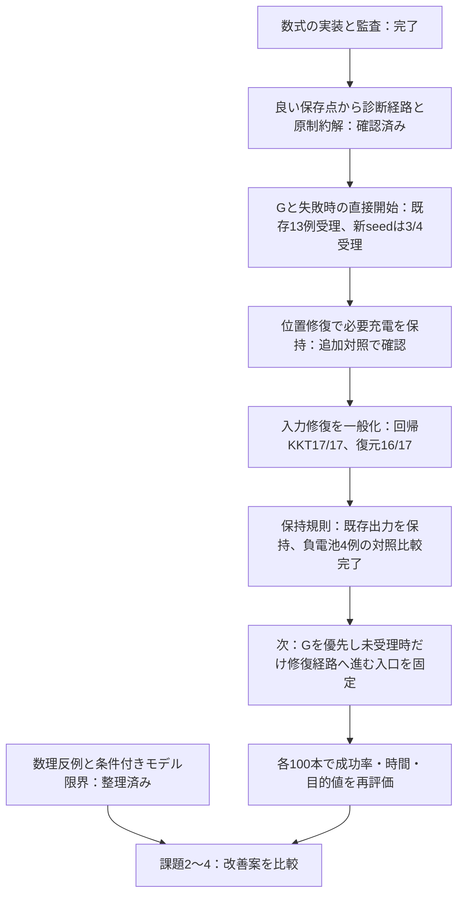

# 全体ロードマップ：論文再現・問題点の検証・改善案

更新日：2026-11-17（900件と図3の分布比較を完了。多タスク側の目的値差が残る）。
**今後の優先順位と達成状況はこのファイルに集約する。**
実験ごとの条件・数値は各REPORT.md、作業の履歴は[WORK_LOG.md](WORK_LOG.md)に残す。
求解条件と再実行の有無は、各実験のPLAN.md/REPORT.mdに記録する。

## 現在地

**数式の独自実装、解と残差の検証、診断用解法による良い解の構成まではできた。
R1で、元の初期軌道から全13段階の共通KKTを一つのランナーで通せることも確認した（図1相当の1例）。
本体L-BFGSで安定して解く実装と、論文の数値実験全体の再現はまだできていない。**

**現在の優先：目的値分布の差の原因を、保存した同じ900入力の各段階から切り分ける。**
**図3との目的値分布比較を完了（[レポート](experiments/2026-11-17-r3s-paper-comparison/REPORT.md)、[図](experiments/2026-11-17-r3s-paper-comparison/objective-distributions.png)）：**
900件中894の原実行可能返却点を、論文NLPの描画900点と比較した。返却なし6件は欠測として保持。
中央値の比（手元/論文）はtau1..9で1.067/1.476/1.378/1.661/1.752/1.813/2.230/2.387/2.553。
固定分岐KKT付き830件に絞ってもtau9は2.479倍、規則入り876件だけでも2.536倍。
欠測値を任意の非負値と仮定したtau9の全100件の中央値比は2.545〜2.562で、欠測だけでは差を説明できない。
一方、tau1は分布が交差し、中央値は手元が長いが平均は短い。中央値だけで全域の優劣を言わない。
独立の順序統計/ECDF積分で全表を検算し、6単体テストも通過。入力集団/初期化/N/解法が異なり、著者の数値再現は未達。
**次は原初期軌道→初期化→AL→返却点を同じ900入力内で照合し、長い目的値が決まる段階を分ける。G stage01の時間切れ219件もその後に診断する。**

**直近のR3s：固定900を最後まで解いた（[レポート](experiments/2026-11-16-r3s-cohort/REPORT.md)、[手順](experiments/2026-11-16-r3s-cohort/USAGE.md)）：**
R3と同じ900件・順序・予算・8並列で、G経路のstage13に外側停滞の打ち切り規則だけを入れた入口で、残り876件を解いた（R3の24件は旧入口のまま引き継ぎ）。900/900件完了、エラー・中断0。
**原実行可能な返却点894/900**、最終の共通KKT863、物理変数のKKTも779、最後の復元の受理817、返却点の固定分岐KKT830。経路はG268・補助経路632で、tau=8・9はG経路0件。
返却点が無い6件は全て補助経路の入力修復で止まった。Rust照合は14,328ファイルで一致、返却点で厳しい検査1e-10に当たったのは5件（受理基準1e-6は満たす）。
規則は876件中348件で成立した。ドライバー壁時計は計16.38時間で、R3の外挿（16.5時間）とほぼ同じ。対照が無いので、900件での短縮は確かめられない。
実行中に、評価ライブラリの復元、起動記録の上書き防止、厳しい検査で照合を止めない作り、STOPファイルでの停止を足した（protocolのhashの対象は不変）。
この後、上記の図3との分布比較を完了した。G stage01の時間切れ219件と目的値差の因果関係は未検証。

以下は段階ごとの履歴で、「次」はその時点の予定を含む。

[不受理時だけの再試行とGの計測](experiments/2026-11-16-init-retry/REPORT.md)。負電池という元入力条件で選んだ別4例は全て既定で受理され、出力を完全保持した。
追加の小さい補正は0件で、新規例での救済効果は未観測。前の設計4例では保存結果で規則を確認し、既定成功のtau7を転落させず保持できた。両群を合算した成功率は示さない。
Gの大小2サイズ×粗い/最終段階の固定4状態では、Hessian構成6〜27msが測った処理列の約92〜94%。毎回107/307回の勾配評価を行い、その評価部分が構成費用の約82〜90%だった。
これは全G時間の厳密な比率ではないが、完全なHessianを毎回作る費用が次の候補と絞れた。
この後、上記の方向曲率評価を固定4状態で比較した。新規例の再試行救済は、既定NLP不受理を条件とする別の事前計画が必要。
ユーザーがこの方針を選択したため、実行中のバッチ002まで完了して固定900は24/900件・876未実行で保持した。
累計はAL共通KKT22・追加物理KKT21、最後の復元/返却点の固定分岐KKT19、原実行可能点24。
バッチ002の8例は全件G未受理後の補助経路を使用し、7例で証明付きの復元点を返した。2タスク1例は再評価相補性3.034e-6で不受理のまま元初期点を保持。
現在の8件区切りを単純外挿すると残り約16.5時間（目安で保証なし）。GのALが両AL記録時間の約94.8%で、初期化NLPだけが費用の主因ではない。

**開始点補正の別実験（[レポート](experiments/2026-11-16-nlp-bound-push/REPORT.md)）：**
同じ4例×2条件でIpoptのbound_pushだけを変え、初回callback点を記録した。
既定では区間時間が最大1秒増え、実行可能なx0から元制約違反0.01へ変化。小さい補正では約1e-6秒/1e-8へ減った。
失敗2例は同じ予算で受理されたが、成功対照1例が転落した。一律変更は採用しない。改善点を固定900の件数へ加えない。
この後、既定受理解を保持する規則を事前固定して別の入力4例で確認し、Gの内側費用も上記のとおり計測した。
固定900の再開手順は残し、再開する場合の次はバッチ003。条件や過去結果は書き換えない。

**R3b（当時のバッチ001、[レポート](experiments/2026-11-16-r3a-cohort/batches/001/REPORT.md)）：**
固定順の次8入力を新規求解し、累計**16/900実行・884未実行**となった。
今回8例はAL共通/追加物理KKT6、最後の復元/返却点の固定分岐KKT6、原実行可能点8。壁時計374.265秒。
4・9タスクでは負電池からの修復は成功したが、原制約初期化NLPが1500反復上限となり、直接ALへ進まず構成点を返した。
同じNLPの開始点違反を再評価すると1.60e-15/3.09e-15で、実行可能な開始点は確認できた。不収束の根本原因/修正効果は未確定。
累計はAL共通KKT14・追加物理KKT13、最後の復元/固定分岐証明12、原実行可能点16。物理点のみの4件を証明付きの解へ数え替えない。
バッチ000の816成果物はhash一致を保持。共有数値コード/予算/採用規則も変更していない。
この後、固定バッチ002も同条件で実行した。改善比較は別計画/別版へ分けた。

**R3a（先行バッチ000当時の結果、[レポート](experiments/2026-11-16-r3a-cohort/batches/000/REPORT.md)）：**
tau=1..9各100例の未使用900 IDを先に固定し、最大8入力ずつ再開できる入口を用意した。
未測定サイズ2/4/6/8/9を含む先行8入力を新規に実行（壁時計473.199秒）。**8/900実行、892件は未実行。**
AL共通KKT8・追加物理KKT7、最後の復元受理6・返却点の固定分岐KKT6、原実行可能な返却点8を区別する。
8・9タスクでは元の実行可能点を保持して返し、KKT証明付きの点として数えていない。
8タスクは復元点の電池再計算が-2.43e-8で、厳密な非負条件だけ不合格。保存点からこの理由を再確認した。
9タスクは1500反復上限、固定分岐KKT最大0.05604515。根本原因は未確定で、実行不能と証明したわけではない。
G/補助の数値条件・予算・採用規則は維持し、失敗を再試行/除外せず保存。各100本の最終分布と著者の数値再現はまだ未達。
この後R3bとして同じ固定集合のバッチ001（次の8入力）を実行した。
8・9タスクの復元改善を試す場合は別計画/別版にし、この900入力の途中で条件や過去の件数を書き換えない。

**R2i（[レポート](experiments/2026-11-16-r2i-fresh-entry/REPORT.md)）：**
初期点の状態を見る前に固定した未使用8入力で、Gから返却まで全て新規に実行した。
G4例・補助4例を採用し、全8例で最後の復元を受理、原制約/固定分岐KKT付きの点を返した。
AL終点の共通KKT8例・追加物理KKT6例。平滑化KKTと原実行可能な返却点の証明は別の点の性質。
元初期点が負電池だった2例は、G未受理後に修復・原制約初期化・直接開始を新規に通した。
この2例は前処理ですでに最終返却点と同じ時間を得ており、ALの探索改善や修復の因果的な成功率向上とは数えない。
最大8並列の全体壁時計781.836秒（約13分2秒）。今回は再利用した求解はなく、必要な初期化/補助経路を含む。
数値フェーズ時間の約94.8%はG。追加物理KKT未達2例・費用・未測定サイズ・各100本の評価が残る。
この時点の次段階R3aで、入口のtau=1..9対応と900入力を固定して分布評価を開始した。
R2iの8例は小規模な前向き確認であり、既存25入力や新しい900入力とも合算して成功率を示さない。

**R2h（[レポート](experiments/2026-11-16-r2h-g-first/REPORT.md)）：**
Gの受理済み出力を保持し、未受理時だけ修復・直接開始・点保持へ進む単一入口を実装した。
既存25入力でGを12例、補助経路を13例に採用し、全25返却点が原制約と固定分岐KKTの証明を通った。
採用経路のAL終点は共通KKT25例、物理変数の追加KKT23例。最後の復元ソルバー受理は24例で、設計例tau5-seed3は保存証明で返した。
平滑化KKTと原実行可能な返却点の証明は別の点についての判定。全25例は既見の設計/回帰確認であり、独立成功率ではない。
G未測定8例だけ新たに求解し、2例で復元受理。G採用12出力をバイト単位で保持し、補助経路のみより短い解を維持した。
図1相当1.885854040 hを保持。tau5-seed205は2.113019722 h、tau7-seed400は2.948013524 h（追加物理KKTは未達）。
最大8並列の今回壁時計653.119秒は、再利用G17例と補助経路の求解を含まない。保存数値フェーズの合計目安7595.968秒の約99%はG。
この時点の次段階R2iで、版と予算を固定して未使用8例の単一入口と総費用を確認した。
900本と著者の数値再現は引き続き未達。

**R2g（[レポート](experiments/2026-11-15-r2g-incumbent/REPORT.md)）：**
受理済みの復元出力を保持し、未受理時だけ保存証明を再評価する手順を実装した。
既見の20出力は1バイトも変更せず保持。規則を設計したtau5-seed3だけ、前処理の2.250021367 hの点を証明付きで返した。
この例の最後の復元ソルバーは不受理のままであり、保存点の採用とソルバー成功を混ぜない。
入力監査8例から先に選んだ負電池の新規4入力は、対照も修復側も両尺度KKT・原制約復元を受理。
修復側は3例で同じ時間、1例で約3.37秒短いが、受理件数の改善は示していない。未知入力での保持による失敗補完も未観測。
最終平滑化KKTはALの点、原制約/固定分岐KKTは別の返却点の性質である。
この時点の次段階R2hで、Gの良い目的値と失敗時の回復を合わせた入口を検証した。
本体Rust・900本・著者の性能分布の再現は引き続き未達。

**直近のR2f（[レポート](experiments/2026-11-15-r2f-general-init/REPORT.md)）：**
入力だけから修復する[scripts/repair_initialization.py](scripts/repair_initialization.py)を実装した。
原実行可能な18初期点は完全保持し、必要な3例だけ構成と原制約NLPを実行。
回帰17例の両尺度KKTは16→17件となったが、原制約復元は16→16件（tau7-seed3を救済、tau5-seed3が転落）。
tau7-seed2の時間は12.54秒悪化した。設計未使用の4入力は全件合格したものの、全て修復不要であり、未知の修復必要例への効果は未検証。
復元が転落したtau5-seed3では、保存済みの初期化点を最終分岐で再評価すると原制約・電池・KKTに合格した。
良い点が既にあり、最後の数値再最適化で失っている。主比較の不受理結果は変更していない。
次のR2gで保持規則を固定し、負電池の新規入力で対照との比較を行った。
本体Rust・Gの出力・900本の性能値は変えていない。

**直近のR2e（[レポート](experiments/2026-11-15-r2e-position-init/REPORT.md)）：**
元のモード・領域・担当時点・Nを保ち位置/e/s/cを原制約NLPで整えると、最初の4例は3例受理、7タスクだけ初期化が不受理だった。
その固定結果を保存後、7タスクだけ別に計画した初期値の対照を実行。r20を領域内で再配置し、電池を再計算すると
15.793→13.066 kmの飛行・電池非負の軌道を構成でき、**同じNLPが1500反復未達→55反復収束**となった。
その後の同じ直接開始も必要な区間19の充電を保ち、両尺度KKTと原制約復元に合格（**3.105837715 h**）。
修復後の4出力は合格したが、失敗を見て設計した追加対照を含み、固定した一つの方法の4/4成功率とはしない。
前処理ですでに最終復元と同じ時間の原実行可能解を得ている。著者のALによる選択探索・性能分布の再現は未達。
次のR2fで区間番号を固定しない入力からの幾何修復へ一般化し、別seedとの対比較を行った。

**直近のR2d（[レポート](experiments/2026-11-15-r2d-fallback/REPORT.md)）：**
Gの復元が未受理の場合だけ元初期点から直接開始を追加すると、既存13例はすべて復元を受理できた（Gの8出力は変更なし）。
しかし設計に使っていないseed=3の4サイズは3例のみ受理。7タスク例は両経路で失敗した。
直接開始でも必要な充電1区間を失い、その固定選択の距離下界14.682 km>航続14.4 kmから実行不能と確認した。
さらに5・7タスクの元初期位置には15.793 kmの無充電区間があり、初期電池は−0.196754だった。
充電量だけではこの幾何は直せない。続くR2eで位置も動かした原制約初期化を対照とした。
同じseedの4サイズはタスク列を共有する。既存12乱数例も3seed×4サイズであり、互いに独立な12標本として扱わない。
著者の数値再現は未達。以下は経緯で、各段階の「次」は当時の判断も含む。

**直近のR2c-4（[レポート](experiments/2026-11-15-r2c-direct-final/REPORT.md)）：**
同じ元の初期点から第1〜12段階を省いて最終NLPへ直接入ると、先行6例すべてが共通・物理変数の両KKTと原制約復元を通った。
従来の未収束4例を救済し、tau1-seed2では必要な充電を失わせる粗い段階の経路依存を切り分けた。
一方、成功対照2例は充電が多く残り、ミッション時間が約2.91分・12.88分長くなった。
6並列（各1スレッド）の求解・復元・Python検証は13.90秒。本体L-BFGSや900本の改善実績ではない。
直接開始への全面置換はせず、Gで復元を受理できない時だけ追加する規則を次のR2dで確認した。

**R1の結果（[レポート](experiments/2026-11-15-original-init/REPORT.md)）：**
保存済みの良い解を使わず、Rustの元の初期軌道（3.0595 h）から第1〜13段階すべてで共通尺度KKTに到達した。
最終平滑化問題は **1.882924837 h**（充電7区間、750秒、631外側）。充電は第1段階で一度すべて消え、第3〜4段階で作り直された。
ただし事前に決めた原制約の復元は受理条件に届かず（残差4.3e-9、条件1e-10）、**今回は原制約を満たす解を得ていない。**
物理変数の停留性も2.4e-6で未達。

**R2aの結果（[レポート](experiments/2026-11-15-r2-cases/REPORT.md)）：**
R1と同じランナーを12固定例（tau=1,3,5,7 × seed 0,1,2）へ一度ずつ適用した。
**6例は全13段階の共通KKTに到達し、6例とも原制約の復元が受理された（残差1e-16以下）。残る6例は途中で止まった。**
止まった理由は2種類：第1・2段階で内側Newtonが収束しない（3例）、領域外の充電に頼る実行不能な停留点（3例）。
R1の経路は図1相当だけの偶然ではないが、参照経路としてそのまま使えるほど安定でもない。

**R2bの結果（[レポート](experiments/2026-11-15-r2b-coarse/REPORT.md)）：**
第1〜12段階を「共通KKTに達するか外側10回」で次へ進める規則（条件G）にすると、13例（12例＋図1相当）すべてが
最終段階まで進み、**8例で復元が受理された（すべて残差1e-16以下）。** 基準で通っていた7例の復元後の時間は変わらなかった。
図1相当の1.885854 hは、ここで初めて厳しい条件（1e-10）でも原制約を満たす解になった。
単独実行（S）では時間切れの3例は通らず、許容値を緩める規則（T）は通る例を7から5へ減らした。
**参照経路はGの規則にする。** 残る5例はすべて、最終段階で残差が一定のまま乗数が発散する形で止まる。

**R2c-2の結果（[レポート](experiments/2026-11-15-r2c-order/REPORT.md)）：**
初期軌道の訪問順を番号順から最近傍順に変えても、復元が受理される例は13例中8例のままだった（tau5-seed1が通り、tau7-seed2が通らなくなった）。
一方、通った例の時間は出発点の訪問順で大きく変わり、経路が短くなる例では約15〜22分短く、長くなる例（図1相当など）では約3分長くなった。
**この比較では訪問順の探索が十分でなく、解の時間は出発点の訪問順に強く依存した。** 残る失敗は訪問順の変更だけでは解消しなかった。

**900本での訪問順の比較（[レポート](experiments/2026-11-15-mc-order/REPORT.md)）：**
本体のL-BFGS（rho=1e4固定）で、同じ900本の初期軌道の訪問順だけを番号順から最近傍順に変えた。
目的値の中央値はタスク数4以上で2〜3割下がり、図3の読取値に対する比は1.13〜2.38倍から1.13〜1.67倍になった。
元の違反<=1e-3は774/900から795/900でほぼ同じ。**基準の900本の目的値が大きかったことの大きな部分は、番号順という初期化の仮定による。
差は残る**（タスク数1でも1.13倍、最近傍順は最短の順より直線距離で最大17%長いだけ）。
以下の「現在地」の残りはR1より前の経路の記録である。

直近では、保存した良い経路を出発点として、各段階の共通尺度KKTを確認しながら最終問題へ進めた。
最終時間は **1.879132289 h**。元の制約で位置も再最適化すると、
**1.882589424 h・電池非負・原制約違反が丸め誤差内**の解を得た。
論文の読取値約1.8932 hとの差は約38.2秒だが、次の依存が残る。

- 初期値は、以前の後処理で作った良い解を使っている。
- 第1〜4段階の個別診断・保存点をつないでいる。全13段階を最初から単一ランナーで、各段階のKKTを満たして通した結果ではない。
- 内側は診断用Newton。著者のMATLAB/L-BFGSの実行ではない。
- 残差尺度・AL更新・段階間リセットなどに独自の補完条件がある。
- 1.882589424 hは原制約で別に再最適化した点。平滑化KKT点そのものではない。

したがって、**「解ける具体例は得たが、入力からの安定した求解と著者の性能分布の再現は未達」**が総括になる。

## 何ができて、何ができていないか

| 対象 | 状況 | 達成した範囲／残る条件 |
|---|---|---|
| 数理式の独自実装 | 実装・検査済み | Rustで平滑化NLP・ホモトピー・AL・L-BFGSを実装。勾配・Jacobian・原制約の照合あり。未指定条件の補完や定義域外の拡張を含み、著者コードとの一致は未確認 |
| 最終平滑化NLPのKKT点の存在 | 具体例を確認済み | 図1相当で複数の最終KKT点を得た。現在「全条件KKTが0」という状態ではない。大域最適性の証明ではない |
| 近似を段階的に鋭くして最終問題へ進む経路 | 図1相当の1例で達成 | R1で、元の初期軌道から単一ランナーで全13段階の共通尺度KKTを確認して通過した。診断用Newton・独自尺度・750秒に依存 |
| 図1相当の原制約・電池を満たす解 | 復元により達成 | 条件Gで1.885854040 h、初期量変更で1.882589424 h、元初期点から直接開始で2.100473218 h。良い保存点からは約1.779030001 hも得た |
| 平滑化点の物理変数での同じKKT許容値 | R2c-4の6例で達成 | 直接開始の6例は共通・物理変数とも全指標1e-6以下。以前の段階経路では未達がある。著者の許容値は不明 |
| 保存済み良解に依存しない診断経路 | 複数例で原制約復元まで達成 | R2bのGは8/13、R2c-4の直接開始は先行6/6で原制約復元を受理。選択した小標本であり性能分布の再現ではない |
| 本体L-BFGSによる安定した求解 | 未達 | 診断用Newtonの成果は本体へ移していない。ライブラリ交換だけでは解決しなかった |
| 独自入力で各100本の基準測定 | 測定済み | 1〜9タスク各100本、計900本を保存。成功率の再現とは別 |
| R1の診断経路の別例での確認 | 12例中6例 | R2a。通った6例は厳しい基準でも原制約を満たす。止まった6例は粗い段階（第1〜3段階が5例）に集中 |
| 段階の進め方の比較（R2b） | 13例で比較済み | 外側10回で進む規則（G）は8/13で復元受理、基準の7例の解を保つ。許容値を緩める規則（T）は5/13。単独実行は効かない |
| 初期軌道の訪問順の比較（R2c-2） | 13例で比較済み | 最近傍順でも通る例は8/13のまま。通った例の時間は訪問順で最大約22分変わる。止まる例の主因ではない |
| 初期軌道の訪問順の900本での比較 | 測定済み | 最近傍順で目的値の中央値が2〜3割下がる（タスク数4以上）。違反<=1e-3は774→795/900。図3の読取値との差は1.13〜1.67倍が残る |
| 固定経路の初期充電量（R2c-3） | 初期化13例・先行6例の比較 | 初期化は全13例で原制約/KKTを通り、初期時間が短縮。先行する未収束4例は今回も最終KKTへ届かず、追加7例への拡大条件を満たさなかった |
| 最終NLPへ直接開始（R2c-4） | 先行6例すべて両KKT・原制約合格 | 未収束4例を救済。成功対照2例のミッション時間は約2.91分・12.88分悪化。全面置換はしない |
| 条件付き直接開始（R2d） | 既存13/13受理、新seedの4サイズは3/4受理 | Gの8出力を保持。新seedの7タスクは充電を失い、固定選択の実行不能を距離で確認。元初期軌道の航続超過も発見。平滑化の両尺度KKTは既存12/13、新seed受理3/3 |
| 初期位置も可変にした修復（R2e） | 当初3/4受理、別の初期値対照で残る1例も受理 | 7タスクは同じ原制約NLPが実行可能初期値で55反復収束。その後も必要充電を保持し、3.105837715 h・両尺度KKT/原制約合格。追加対照を含むため単一手法の4/4とはしない |
| 入力からの条件付き修復（R2f） | 回帰17例＋新規4例で比較 | 元初期点18例を完全保持、修復3例は初期化・両尺度KKT合格。回帰の原制約復元は16→16（救済1/転落1）。未知4例は修復不要だったため修復効果は未検証 |
| 原実行可能点/証明の保持（R2g） | 既見20出力を完全保持、設計例1件で証明採用 | 新規負電池4例は対照/修復側とも復元受理。未知入力での失敗補完は未観測。平滑化KKTと返却点の固定分岐KKTは別の点についての判定 |
| G優先の単一入口（R2h） | 既存25入力で返却点と固定分岐証明を確認 | G12出力を保持、補助13例。AL共通KKT25・追加物理KKT23・最後の復元24。既見入力であり、キャッシュなしの未知入力の統合実行と費用は次 |
| 未使用seedの入口全体（R2i） | 先に固定した8入力で、G/必要修復/補助を全て新規に実行 | 全8例で最後の復元/原制約/固定分岐証明を受理。共通KKT8・追加物理KKT6、壁時計781.836秒。各サイズ2例の小規模確認で、各100本の分布再現ではない |
| 診断手順の各100本評価（R3/R3s） | 900/900実行 | R3の24件（旧入口）とR3sの876件（G経路stage13に打ち切り規則）。原実行可能な返却点894、固定分岐証明830、最終の共通KKT863・物理KKTも779。図3との分布比較済み、差が残る |
| 著者の図1・図3の実験の再実行 | 未達 | 著者コード・元データ・seed・N・AL等の条件が揃っていない。MATLAB本体も未実施 |
| 数理モデル・近似への批判的検討 | 反例・導出あり | 求解失敗と独立に主張できるものがある。影響の頻度や改善性能は別に検証する |
| 課題2〜4の草稿 | 作成済み | 単一車両の再訪間移動を中心に、複数案・追加モデル・構成検証を保存。同時NLPの性能比較は未実施 |

## 数値の読み分け

| 数値 | 何を意味するか | 根拠 |
|---|---|---|
| 1.879132289 h | 直近の最終平滑化点。共通KKT合格だが、純モード電池は約0.000441不足 | [後続段階の検証](experiments/2026-11-15-decomposed-follow/REPORT.md) |
| 1.882589424 h | その点の担当時点・モード・Nを固定し、原制約で位置も再最適化した実行可能解 | [同レポートの復元結果](experiments/2026-11-15-decomposed-follow/REPORT.md#原制約で一度復元した結果) |
| 約1.779030001 h | 良い初期点から最終問題へ直接進む別の経路の復元解。直近の値は最良記録の更新ではない | [初期解と段階の対照](experiments/2026-11-15-warm-start/REPORT.md) |
| 1.882924837 h | R1（元の初期軌道から全13段階）の最終平滑化点。共通KKT合格、純モード電池は約0.000393不足。原制約の解ではない | [R1のレポート](experiments/2026-11-15-original-init/REPORT.md) |
| 1.885854039 h | R1の復元でIpoptが返した点。元の制約の残差4.3e-9。R1の条件1e-10では不受理、R2aで事前に決め直した条件1e-6では受理（解き直しなし）。リポジトリの検証器（1e-10）は通らない | [同レポートの復元の節](experiments/2026-11-15-original-init/REPORT.md#最終点の原制約と復元の不受理) |
| 12例中6例、復元後0.5618〜1.9208 h | R2a。R1と同じランナーを独立例へ適用。通った例の復元は残差1e-16以下。各100本の成功率ではない | [R2aのレポート](experiments/2026-11-15-r2-cases/REPORT.md) |
| 1.885854040 h | R2bの条件G（外側10回で進む）での図1相当の復元解。残差5.6e-17で、厳しい条件とリポジトリの検証器も通る。論文の読取値より約26秒短い | [R2bのレポート](experiments/2026-11-15-r2b-coarse/REPORT.md) |
| 13例中8例、復元後0.5618〜1.9208 h | R2bの条件G。基準の7例と同じ時間＋tau5-seed2（1.380279 h）。各100本の成功率ではない | [同上](experiments/2026-11-15-r2b-coarse/REPORT.md) |
| 1.944576 h（図1相当）、1.006796 h（tau5-seed2）など | R2c-2。出発点を最近傍順にした復元解。図1相当は番号順（1.885854 h）より長く、tau5-seed2は番号順（1.380279 h）より短い | [R2c-2のレポート](experiments/2026-11-15-r2c-order/REPORT.md) |
| 先行6例中6例、図1相当2.100473218 h | R2c-4。元初期点から最終NLPへ直接開始し、両尺度KKTと原制約復元を合格。未収束4例を救済した一方、成功対照の時間は悪化。独立母集団の成功率ではない | [直接開始の対照](experiments/2026-11-15-r2c-direct-final/REPORT.md) |
| 既存13例すべて、新seedの4サイズ中3例で復元受理 | R2d。G未受理時のみ直接開始。新しい7タスクは両経路で未達、母集団成功率ではない | [条件付き直接開始](experiments/2026-11-15-r2d-fallback/REPORT.md) |
| 約1.8932 h | 論文図1の読取値。手元と入力・N・初期化・実装の一致が未確認 | [論文図の読取り](experiments/2026-11-14-paper-figures/REPORT.md) |
| 図3比1.13〜1.67倍、元違反<=1e-3が795/900 | 本体L-BFGS・rho=1e4固定・最近傍順の出発点の900本。番号順（1.13〜2.38倍、774/900）との対比較。KKTは1/900のまま | [900本の訪問順の比較](experiments/2026-11-15-mc-order/REPORT.md) |
| KKT 0/900、元違反<=1e-3が438/900 | 古い基準実装・独自入力の測定。現在の全成果を表す数字ではない | [900本の基準測定](experiments/2026-11-14-reproduction/REPORT.md) |
| KKT 1/900、元違反<=1e-3が774/900 | 別の固定rho条件の同じ900本。追加物理監査は82/900で、全面改善ではない | [固定ペナルティ診断](experiments/2026-11-14-conditioning/REPORT.md) |

KKTの有限許容値は変数・残差の尺度で変わる。共通尺度と物理変数の指標を併記する。
また、平滑化KKT、原制約、純モードで再積分した電池、追加の車両条件はそれぞれ別の判定である。
論文が900/900でKKT収束したとは記載されていない。違反<=1e-3もこちらの比較用閾値である。

## 原因調査で確かになったこと

| 調査 | 確認できたこと | 適用範囲 |
|---|---|---|
| 内側ライブラリ | 自作L-BFGSとSciPy L-BFGS-Bに共通する停滞があった | 単純な交換だけで直るという説明では不十分。[比較](experiments/2026-11-15-library-trace/REPORT.md) |
| 残差・変数尺度 | 等価な制約でもALの経路が大きく変わった | 原問題の同値性と、有限ペナルティの数値挙動は別。[比較](experiments/2026-11-15-fidelity/REPORT.md) |
| 制約達成後のrho増加 | 不要な増加で停留性を悪化させる具体例を特定 | 増加抑制を本体へ反映済み（7065fd4）。標準3例の性能は変わらず。[検証](experiments/2026-11-15-stage2/REPORT.md) |
| 内側未収束時のrho増加 | 第3段階では精度条件で共通KKTが0/4→4/4 | 本体3例では原制約が悪化したため追加条件の本体適用は見送り。[検証](experiments/2026-11-15-stage3/REPORT.md) |
| 診断Newtonの二階情報 | PHRの切替をまたぐ差分が大きな非対称成分を生んだ。Hessianの分解で改善 | 差分Hessianを使わない本体L-BFGSのバグ修正ではない。[検証](experiments/2026-11-15-stage4-inner/REPORT.md) |
| 元の初期軌道（R1） | 第1段階のKKT点で充電が0区間になるが、第3〜4段階で7区間が作り直された。途中は充電時間が区間の長さを超える状態を通る | 図1相当の1例・診断Newton。rho固定のtau1-seed2では作り直せなかった。[R1](experiments/2026-11-15-original-init/REPORT.md) |
| 12固定例（R2a） | 通る例では充電が第1・2段階で0になり第3〜4段階で作り直される。止まる例は、内側Newtonの未収束（3例）と、乗数が発散する実行不能な停留点（3例） | 小標本・3並列・時間上限つき。[R2a](experiments/2026-11-15-r2-cases/REPORT.md) |
| 段階の進め方（R2b） | 各段階を1e-6まで解く規則は不要で、外側10回で進めても通った例の解は変わらない。許容値を緩めると逆に第3段階で止まる例が出る。残る5例は最終段階で乗数が発散する | 13例の小標本。Gの計算時間は基準より短くならない。[R2b](experiments/2026-11-15-r2b-coarse/REPORT.md) |
| 初期軌道の訪問順（R2c-2） | 最終点の訪問順は多くの例で出発点のまま（最近傍順で10/13、番号順で7/13）。時間の増減は直線距離の増減と同じ向き | 13例の小標本。900本での測定はしていない。[R2c-2](experiments/2026-11-15-r2c-order/REPORT.md) |
| 解の割当て | 固定した充電選択のままでは時間の下界が高い例、必要な充電を失い固定分岐では復元不能な例があった | 反復不足と、解の選択が悪いことを分ける。[選択の比較](experiments/2026-11-14-branch-selection/REPORT.md) |

単一の原因を直せば全て解決する段階ではないが、「論文のモデルが良い解を持たない」という説明は支持されない。
独自実装の失敗を著者のアルゴリズムの失敗率へ置き換えない。

## 今後のロードマップ

再現の経路と数理的な批判・改善の経路を分ける。
**再現が未完了でも、反例や導出で確認済みの限界は説明できる。**
一方、実装の失敗に基づく性能批判や改善の成功率は、安定した比較条件を用意してから評価する。

### R1：元の初期軌道から診断経路を通す【実行済み：平滑化KKTは到達、原制約の復元は不受理】

結果は[R1のレポート](experiments/2026-11-15-original-init/REPORT.md)。以下は実行前に決めた内容。

**問い：良い保存済み解を与えなくても、最終問題のKKTと良い充電選択へ進めるか。**

- 図1相当の元の初期軌道から、直近と同じR尺度・分解Newton・段階リセット/更新規則を適用する。
- 初期化以外の条件を結果を見て変えず、第1段階から単一ランナーで状態を保存する。
- 各段階の共通/物理変数KKT、充電選択、原制約、純モード電池、時間切れを記録する。
- 判定：最終共通KKTへ進むか、同じ原制約復元を通るか、目的値がどうなるかを別々に報告する。

最終へ進めない場合は最初の未達段階を調べる。
最終へ進んでも高い時間にとどまる場合は、入力から作る初期軌道の充電選択・訪問順を比較する。
既存の良解を読み込む成功経路と、入力だけからの成功経路を混ぜない。

### R2：再利用できる求解実装と評価条件を固定する【R2iの未使用入力まで確認、費用/追加精度は残る】

**R2a（実行済み）**：R1のランナーを12固定例へ適用。6例が最後まで通り、6例が粗い段階などで止まった。
参照経路そのものがまだ安定でないので、内側解法を替える比較（当初のR2の中心）より先に、次の2点を扱う。

- **R2b（実行済み）：粗い段階の未収束。** 単独実行では直らず、第1〜12段階を外側10回で打ち切って進む規則（G）で
  13例すべてが最終段階へ進んだ。通った例は7→8、基準の7例の解は不変。**以後の参照経路はGの規則を使う。**
  許容値を緩める規則（T）は採用しない。
- **R2c〜R2d（比較済み）：最終段階で乗数が発散した5例から開始**（tau1-seed2、tau5-seed0、tau5-seed1、tau7-seed0、tau7-seed1）。
  - R2c-1（実行済み、[レポート](experiments/2026-11-15-r2c-branch/REPORT.md)）：止まった点の分岐を固定して元の制約で解くと、
    5例とも実行可能な点は得られなかった。tau1-seed2は距離の下界から実行不能と証明、3例はIpoptが実行不能を検出、1例は未確定。
    tau=5,7の4例では、初期軌道の訪問順（番号順）の経路が最短の順より1.5〜1.8倍長い。
  - **R2c-2実行前の判断（実行済み）**：[幾何の確認と判断](experiments/2026-11-15-r2c-order-screen/REPORT.md)で、
    充電地点への往復を含む初期経路が、多タスクの未受理4例すべてで短くなると確認した。失敗原因の確定ではなく初期化方針の対照とする。
    問題データ・N・条件G・AL・予算・復元判定を固定し、充電領域の選び方や充電目標は同時に変えない。
  - 成功8例についても、受理を維持するかと復元後時間の改善/同等/悪化を比較する。同じ軌道へ戻ることは要求しない。
    1タスク3例はNearestでも初期点が同一なので、全変数の一致を検査して条件Gの結果を再利用し、変わる10例を解く。
    **tau1-seed2はこの因子では直らない**。残る例には訪問順を固定した充電立ち寄りの選択・回復を次に検討する。
  - **R2c-2（実行済み、[レポート](experiments/2026-11-15-r2c-order/REPORT.md)）**：復元受理は8/13のまま。
    tau5-seed1が新たに通り（1.323929 h）、tau7-seed2は通らなくなった。tau5-seed0・tau7-seed0・tau7-seed1はどちらの出発点でも停止。
    両方で通った例の時間は、経路が短くなる例で大きく短くなり（tau5-seed2：1.380279→1.006796 h、tau3-seed0：1.049899→0.805101 h）、
    長くなる例で長くなった（図1相当：1.885854→1.944576 h、tau3-seed1：0.782870→0.826978 h）。
    訪問順は失敗の主因ではないが、解の時間には強く効く。どちらかで通る9例という数は、事後の選択なので成功率に使わない。
  - **900本での訪問順の確認（実行済み、[レポート](experiments/2026-11-15-mc-order/REPORT.md)）**：本体L-BFGSでも、目的値は出発点の訪問順に従う。
    最近傍順で図3比は1.13〜2.38倍から1.13〜1.67倍へ。違反<=1e-3の件数はほぼ不変。対の目的値の比と直線距離の比の相関は0.78〜0.96。
  - **R2c-3（実行済み、[レポート](experiments/2026-11-15-r2c-charge-init/REPORT.md)）**：訪問順・位置列・N・充電箇所を固定し、
    初期e/s/cだけを原制約NLPで整えた。13初期点はすべて受理され、初期時間も短縮したが、先行比較の未収束4例は最終KKTへ届かなかった。
    成功対照2例は受理を維持し、図1相当は1.885854040→1.882589424 h（約11.75秒短縮）、tau1-seed0は同じ時間だった。
    改善が無いため事前条件に従い追加7例へは拡大しない。この初期充電量の方針は、本体の規定値には採用しない。
  - **R2c-4（実行済み、[レポート](experiments/2026-11-15-r2c-direct-final/REPORT.md)）**：同じ元初期点から最終段階へ直接入る一因子比較。
    未収束4例は全件救済され、成功対照2例も受理を維持。6例すべて共通・物理変数の全KKT指標<=1e-6、復元後原残差<=5.6e-17。
    初期モード/領域の選択は全6例で残った。tau1-seed2では充電を失う粗い段階の経路依存が失敗に効いていると確認できた。
    一方、tau1-seed0は充電1→2・時間+174.70秒、図1相当は7→14・+772.63秒。解の質は悪化し、全面置換しない。
    6並列・各1スレッドで求解/復元/Python検証13.90秒。全40外側・1569内側受理点と18出力を検証。事前計画どおり6例で終了。
  - **R2d（実行済み、[レポート](experiments/2026-11-15-r2d-fallback/REPORT.md)）**：Gで復元が未受理の場合だけ同じ元初期点から直接開始を追加。
    既存13例は全件受理（Gの8出力はそのまま、直接開始の5例を採用）。新規のtau5-seed1は2.145959990 h。
    既存13例は設計に使用済み。seed=3の4サイズは1/3タスクがG、5タスクが追加直接開始で受理、7タスクは両経路で未達。
    受理した新規3例は両尺度KKT・原制約・電池に合格。既存の図1相当は物理変数stat=2.17e-6が未達のまま。
    7タスク直接開始は区間19の充電を最初のAL内側第4受理点で失う。その固定分岐は距離下界14.681831 km>航続14.4 kmから実行不能。
    5・7タスクの元初期軌道は15.793258 kmの飛行を共有し、電池が−0.196754。固定位置の初期量調整では満充電でも届かない。
    新規7phaseを最大5並列で求解/復元/Python検証780秒。1311外側・53956内側点（中断92）、Rust78出力を確認した。
    今回は設計未使用の一つのseedの確認であり、同じseedの4サイズを相互独立な4標本としない。過去900本とはseedも別。
  - **R2e-1（実行済み、[レポート](experiments/2026-11-15-r2e-position-init/REPORT.md)）**：元の選択/Nを固定して位置/e/s/cを原制約NLPで整える。
    tau1/3/5-seed3は初期化と直接開始・復元まで合格、tau7は初期化が1500反復上限で不受理。結果を1e1c6b1に固定して入力には採用しなかった。
    tau1/3は修復なし直接開始と同じ時間、tau5は2.252117624→2.250021367 h（7.55秒短縮）。Gの時間との比較は混ぜない。
  - **R2e-2（別に計画し実行済み、[レポート](experiments/2026-11-15-r2e-feasible-start/REPORT.md)）**：tau7だけ、r20を領域0内でr21へ近づけ電池を再計算する実行可能なx0を構成。
    同じ原制約NLPが55反復で収束し、同じ直接開始も7外側・91受理点で両尺度KKT、最後の復元も受理（3.105837715 h）。
    全98内側点で区間19の充電を保持。原制約の前処理ですでに同じ時間の実行可能解を得ていることも明記する。
    全38外側・575内側受理点と26出力を検査。2実験の求解/検証合計6.83秒、失敗した初期化を含むtau7の実測は4.38秒。
    最初の不受理結果は変更せず、事後設計した追加対照を含む4出力を単一手法の4/4成功率とはしない。
  - **R2f（実行済み、[レポート](experiments/2026-11-15-r2f-general-init/REPORT.md)）**：ケース/区間番号を使わず、元の原実行可能点は保持し、必要な入力だけ自由な端点を領域内で再配置。
    時間/電池を再計算して同じ原制約NLP・直接開始へ渡す。回帰17例＋別seedの新規4例を先に指定し、最大8並列で比較した。
    保持18例、修復3例は全件構成・初期化を受理。回帰の両尺度KKT16→17、復元16→16（救済tau7-seed3、転落tau5-seed3）。
    tau7-seed2は構成時に位置を動かさず充電量を直せたが、充電区間13→14となり時間+12.54秒。
    新規tau1-seed101/tau3-seed103/tau5-seed105/tau7-seed107は4例とも原初期点が実行可能で、修復を行わず両尺度KKTと復元を通った。
    したがって未知の修復必要例での検証はまだ無い。失敗例を見てseedを差し替えたり追加したりせず、21例で終了した。
    tau5-seed3では最後のIpoptが1500反復未達。保存済み初期化点は同じ最終分岐でKKT/原制約/電池に合格すると、再求解なしで確認した。
    主比較の不受理結果は変更しない。新規13本・86外側・3072内側受理点と66出力を検証、ドライバー実測24.08秒（過去11対照の費用は別）。
  - **R2g（実行・検証済み、[レポート](experiments/2026-11-15-r2g-incumbent/REPORT.md)）**：原実行可能点を保持し、復元受理済み出力をそのまま採用。
    不受理なら同じ分岐の初期化証明を再計算する。既見20出力は完全保持、設計例tau5-seed3だけ証明で採用した。最後の復元は不受理のまま。
    新規対象はtau5 seed200..399、tau7 seed400..599から元初期電池が負の最初の2例ずつと先に固定し、8入力を監査して203/205/400/401を選択。
    対照も修復側も4例とも両尺度KKT・最後の復元を受理。3例は同じ時間、tau7-seed400だけ修復側が3.37秒短い。
    未知入力で証明による失敗補完、物理点退避、分岐不一致の拒否は発動していない。保持規則の新規入力での改善効果は未確認。
    新規8フェーズの56外側・1586内側受理点を再評価、保持規則29評価を再計算、68出力をRust照合した。
    求解は2026-11-15、検証/記録確定は16日。求解を繰り返さず引継ぎ、起動コマンドを会話のツール履歴から事後記録した。
  - **R2h（実行・検証済み、[レポート](experiments/2026-11-16-r2h-g-first/REPORT.md)）**：G受理なら出力を保持、未受理時だけ元入力からの補助経路へ進む単一入口を固定。
    既存25入力でG12・補助13を採用し、返却点/固定分岐KKTは全25例で確認。共通KKT25・追加物理KKT23・最後の復元24を分けた。
    G17例と補助経路は過去結果を再評価し、未測定G8例だけ新規求解（受理2）。採用Gは全12例で出力完全保持、目的値は経路選択に使わない。
    図1相当1.885854040 hを保持。新たなGのtau5-seed205/tau7-seed400は補助経路より約22.12分/49.74分短い。
    92段階・2824外側・108990内側受理点・中断608点を再評価し、Rust165出力を照合、返却25点も厳しい原制約検査を通った。
    今回壁時計653.119秒。再利用した求解費用は別で、保存フェーズの合計目安7595.968秒の約99%がG。効率は未解決。
    全25入力は既見の設計/回帰確認。追加経路の新規NLPを含めた一続きの呼出しは今回未実行である。
  - **R2i（実行・検証済み、[レポート](experiments/2026-11-16-r2i-fresh-entry/REPORT.md)）**：未使用seed8入力を初期点監査前に固定し、キャッシュなしで入口全体を実行。
    G4例・補助4例で全8復元を受理。共通KKT8・追加物理KKT6・返却点の固定分岐証明8を区別した。
    負電池のtau3-seed3002/tau7-seed7002は構成・原制約初期化（33/98反復）・直接開始を通した。原初期点が有効な補助2例は元初期点を保持。
    修復2例は前処理ですでに最終返却時間を達成。修復なし対照は解いておらず、ALの選択探索/修復の成功率向上の証拠とはしない。
    12フェーズ・108段階・3159外側・105179内側受理点・中断204点と初期化2例を再評価。Rust152出力/厳しい原制約30出力（返却8点を含む）に合格。
    最大8並列、全て新規求解で壁時計781.836秒。数値フェーズ時間の約94.8%はG。追加物理KKT未達はtau5-seed5002/tau7-seed7001。
    小規模な前向き確認で、900本の性能分布は未測定。Gの高速化や本体移植は別の比較とし、今回の結果を著者のL-BFGSへ読み替えない。
  - 図3との残る差（1.13〜1.67倍）の候補はN・充電の入れ方・未収束・入力分布。まず実行不能な分岐への停滞を優先し、
    目的値を図3へ合わせる係数探索には戻らない。タスク数1でも残る差の分解は、その後の別の比較とする。
- 参照経路の計算時間（図1相当で約770秒）は未解決。実用的な内側解法への置き換えはR2cの後に扱う。
- 復元の受理条件（1e-6）とリポジトリの検証器（1e-10）の不一致を解消する。今回の6例は厳しい側でも通った。

R1から加わった、先に決めるべき点：

- 復元の受理条件。Ipoptが許容レベルで止まると残差1e-8程度が残り、検査の1e-10と噛み合わない。求解前に条件を決め直す。
- 第3段階以降でrhoが毎回1e8まで上がり、内側が`stuck`で終わること。Newton以外の内側解法へ移すときの障害になる。
- R1は図1相当の1例だけ。同じランナーを既存の小規模例（tau=1,3,5,7）へ適用できるかは未確認。

**問い：診断で解けた問題を、安定した予算で繰り返し解けるか。**

- 診断Newtonを参照に、内側解法・尺度/前処理・rho更新・段階進行を一因子ずつ比較する。
- 本体へ取り込む変更は独立例でも確認する。第3段階だけの改善を全体へ無条件に広げない。
- KKT・原制約・物理単位別の許容値、打切りと復元の扱いを評価前に固定する。
- Gの経路で残る物理変数の追加精度課題も扱う。R2c-4の6例は両尺度1e-6を達成したが、著者の未公開許容値とは区別する。
- 完了条件：保存済み良解なしで実行できる入口、設定・予算・判定規則、再開可能な記録を一つの版にまとめる。

著者のL-BFGSに近い再実装と、診断Newtonや復元を加えた改善手法は、別の手法として集計する。
必要ならMATLABでの比較を追加するが、現時点では実施環境・著者コードを確保できていない。

### R3：各タスク数100本の分布を再評価する【R3sで900/900実行、図3との分布比較済み、差が残る】

**問い：単一の図1だけでなく、複数入力でも性能を保てるか。**

- **R3a（先行8入力を実行済み、[レポート](experiments/2026-11-16-r3a-cohort/REPORT.md)）**：tau=1..9各100、seed=tau*1000000+runを求解前に固定。
  runごとtau2/4/6/8/9/1/3/5/7の順に並べ、8件ずつ113バッチ（最後4件）。入口は許容tauと出力先のみ変更し、数値子処理はR2hをそのまま使う。
  G3・補助5で原実行可能点8、AL共通KKT8・追加物理KKT7、最後の復元/返却点の固定分岐KKT6。
  8タスクは許容残差を通っても再計算電池が負となり不受理。9タスクは復元の1500反復上限で、原因は未確定。両例とも元の実行可能点を保持。
  13フェーズ/85段階/2183外側/66033内側受理点/中断313点を再評価。Rust125出力を照合し、厳しい原制約検査18出力も合格。
  全て新規求解で壁時計473.199秒。900件中8件だけの途中結果で、未実行892件を成功/失敗へ数えない。
- **R3b（バッチ001を実行済み、[レポート](experiments/2026-11-16-r3a-cohort/batches/001/REPORT.md)）**：G3・補助5で原実行可能点8、AL共通/追加物理KKT6、復元/返却点の固定分岐KKT6。
  tau4-seed4000001/tau9-seed9000001は修復構成後の原制約初期化が1500反復上限。実行可能なNLP開始点の違反1.60e-15/3.09e-15を再確認し、原実行可能な構成点を保持した。
  G8・直接開始3の11フェーズ/71段階/1253外側/47629内側受理点/中断425点と初期化2件を再評価。Rust109出力/厳しい原制約24出力（返却8点を含む）を照合した。
  全て新規求解で壁時計374.265秒。累計16/900で共通KKT14・追加物理KKT13・復元/固定分岐証明12・原実行可能点16。バッチ000の816成果物hashは不変。
- **バッチ002（実行済み、[レポート](experiments/2026-11-16-r3a-cohort/batches/002/REPORT.md)）**：補助8例、共通/追加物理KKT8、原実行可能点8・固定分岐証明7。壁時計774.520秒。
  全16フェーズ/76段階/2783外側/78577内側受理点/中断766点と初期化3例を再評価し、Rust129出力を照合した。
- **900件追加は診断より後にする。** ユーザーの明示選択に基づく。次の固定バッチは003として残す。
  まず上記の少数例の開始点補正・G費用を診断し、変更は別計画/別版とする。
  完了した失敗は再試行しない。中断の部分出力はプロセス監査まで新規起動も拒否し、中断として残す。
  8・9タスクの復元改善は別の比較とし、同じ900入力の途中で設定や採用規則を変更しない。
  R2iの8入力と既存の設計/回帰25入力を新しい分布評価へ合算しない。
- 設定を固定した後、独自入力の各100本を実行。既存900入力は回帰比較に使い、別seedの評価も分ける。
- KKT、元違反、電池、目的値、時間、打切りをそれぞれ集計。失敗を分母から除外しない。
- 復元前後と、実行可能解だけの時間分布を分ける。上流の初期化費用も含めて測る。
- 著者の図3とは分布比較として報告し、入力対が同じとは主張しない。
- 完了条件：新しい版の集計・全入力/出力・コマンド・失敗理由を保存し、再現できた傾向と残る差を示す。

元データ・コード・設定の記載不足は、係数探索では解消しない。
入手できなければ、厳密な著者実験の再実行は未達としたまま、独自条件の再実装として範囲を明記する。

### C1：課題2の問題点を根拠の強さで整理する【既存成果を使って並行可能】

| 論点 | 確認済みの範囲 | 残る検証 |
|---|---|---|
| 平滑化でc<=sを失う | 近似NLPを満たす反例がある | 通常入力での頻度と、必要条件追加の性能。小標本の限定比較は済み、一般優位性は未確認 |
| 有限pの等式・psiの境界ずれ | 数式の導出、原実行可能解が除外される例がある | 包含を保つ近似が、収束・目的値・時間を改善するか |
| 単位・候補重複・Nへの依存 | 数式と限定比較で確認。Nは最小区間時間による下界も変える | 元の条件と異なるモデル/初期化の影響を分けた広い比較 |
| 単一車両の再訪間移動 | 条件付き反例と車両軌道の検証・構成がある | 車両を同時計画したNLPの性能。論文図1が車両条件に違反するという主張ではない |
| 一般の充放電写像の時間分割 | 論文の一般条件だけでは半群性を保証しない反例がある | 数値例のCC–CV/一定放電率への欠陥とは扱わず、一般モデルの条件として論じる |
| 実験条件の記載不足 | 未指定項目を整理済み | 著者情報の入手。こちらの収束診断だけで著者の失敗率は決められない |

元の順位1〜7の初回限定比較は完了している。「完了」はその範囲の比較を終えた意味で、論点を全面解決した意味ではない。
数式・反例は[批判的検討](../human/critical_review.md)、検証条件と履歴は[問題点の検証順](../human/validation_plan.md)。

### C2：課題3・4の改善案を具体化し比較する【草稿あり、性能評価は未達】

既存草稿の中心は、各領域を同じ一台が担当する場合の再訪間移動。
[車両モデルの草稿](../human/carrier_model.md)に、運用条件の限定・再訪間制約・車両位置の同時計画・事後修復を整理してある。
固定担当の車両軌道の検査/構成は実装済みだが、同時NLPを解いて優位性を示してはいない。

次は、適用する運用条件と比較対象を固定し、一つの問題に対する複数案を比べる。
単一車両を仮定しない用途にも必要な修正、と一般化しない。
近似自体の改善案は[必要条件・零点集合・包含の比較](experiments/2026-11-14-approximation/REPORT.md)を別の候補として残す。

完了条件は「なぜ問題か → 複数の解決案 → 選ぶ理由 → 数式・手順 → 検証と限界」がつながる説明と比較結果。
草稿があることと、改良手法の性能を実証したことを区別する。

## 文書とコードの使い分け

| 場所 | 役割 |
|---|---|
| このROADMAP.md | 現在地・次の優先順位・到達条件。作業が進んだらここを更新する |
| [README.md](README.md) | 読む入口と本体の実行方法 |
| [WORK_LOG.md](WORK_LOG.md) | 日付・コミット・失敗を含む作業履歴 |
| [TESTING.md](TESTING.md) | 単体テストの実行方法・数理契約・検査範囲 |
| [human/reproduction.md](../human/reproduction.md) | 再現調査の詳しい経過。過去の「次は」はその時点の予定 |
| [human/report.md](../human/report.md) | 課題1〜4の草稿と参照先 |
| `src/` | 本体Rust実装。診断結果が全て反映されているわけではない |
| `experiments/*/REPORT.md` | 条件・結果・限界の固定記録。過去の実験結果を新しい成果で書き換えない |
| `experiments/*/PLAN.md` | 求解前に固定した条件。追加実験は理由と条件を別に残す |

次の作業は **同じ900入力内の各段階の目的値を照合し、長い時間がどの段階で決まるかを分ける。その後G stage01の時間切れ219件を診断する**。条件付き再試行の新規救済は未観測。
課題2の説明をまとめる場合はC1/C2の既存根拠を使い、R3未達を理由に数理的な検討まで止める必要はない。
