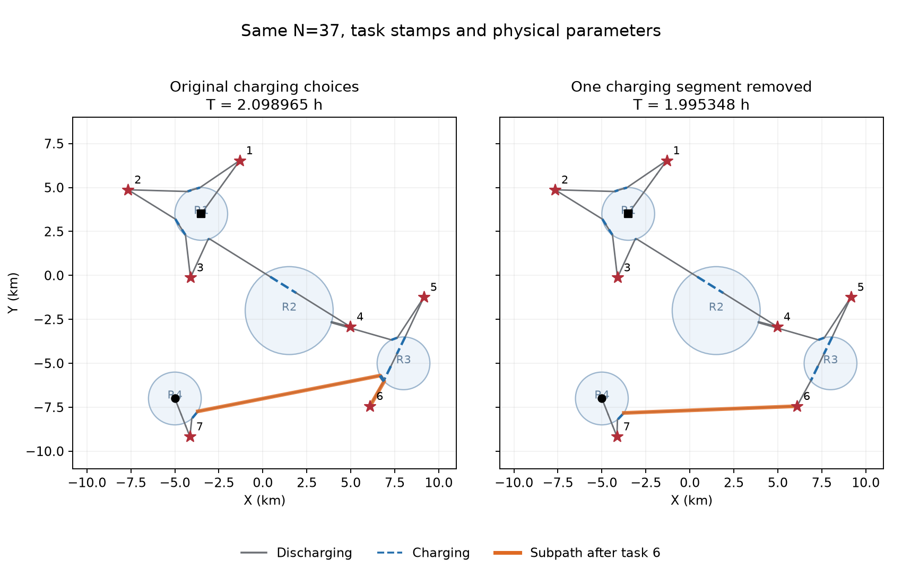

# 未記載の条件と、最適化で選ぶべき解の構造

2026-11-14開始、2026-11-15検証・記録完了。
利用者の「論文に記載されていない条件か、詰める意味があるか」に対する調査。

**充放電モード・充電領域・タスク担当時点は非公開の外部条件ではなく、本来は解法が選ぶ解の一部である。**
それらを前の診断で固定したのは、現在の解を連続変数だけでどこまで改善できるか調べるためだった。
今回、物理条件・N・タスク担当時点を変えず、充電の選択一つを変えた原制約解で
2.098964574→1.995347783 h、約373.0秒の改善を確認した。
未記載のNを調整しなくても、現在の解の充電選択に改善余地がある。

## 論文に何が指定されているか

対象はローカル保存の`2609.40201v1.pdf`、式(8)、(12)、IV-A、IV-B。

| 対象 | 論文との対応 |
|---|---|
| 充放電モード・充電領域 | 式(12)の選言で最適化する。最終値を外部条件として指定していない |
| タスクの担当時点 | 式(8)、(12)の選言で最適化する。前の診断では既存解から固定した |
| タスクの訪問順 | 最終解について固定する条件はない。担当時点の選択で決まる |
| 時点数N | モデルで定義されるが、実験での具体値は特定できない。こちらの37は独自の初期化の設計 |
| 初期軌道 | 各タスクの前後に最寄りの充電領域を訪れる方針は記載。座標・電池・区間時間等の全数値は不明 |
| 速度・電池特性・時間下限等 | IV-Aに記載。今回変更しない |
| ALの詳細・KKT許容値・乱数の分布とseed | 公開論文から全条件は確定できない |

したがって、前の「固定選択を変える必要がある」という結論を、そのまま
「著者しか知らない条件を当てる必要がある」と読むのは正確でない。
Nと初期化の不明点は残るが、まずは解法が選ぶべき充電の組合せを調べる意味がある。

## 同じ条件で充電の選択を比較

事前計画は`PLAN.md`、コミット`90e79bb`。出発点は
`../2026-11-14-restoration/geometry.json`（`b896624`）。

12充電区間のそれぞれについて、放電に変える12候補と、他の3領域に移す36候補を作った。
各候補は同じ元解から一回だけ開始し、改善を次の候補へ渡していない。
N=37、物理条件、7タスクの担当時点・座標・順番は共通。
変更していない区間のモード・領域も保持し、位置・時間・電池を原制約で再最適化した。
旧復元のFixedBranchをそのまま利用した。IPOPTは最大1500反復・5秒、その他の許容値と
電池の内部余裕1e-8は旧復元と同じ。論文のAL/L-BFGSではなく、原因を調べる診断である。

| 変更 | 候補数 | 厳密な採用基準に合格 | 0.001秒超の改善 | 最小時間[h] |
|---|---:|---:|---:|---:|
| 充電区間を放電へ | 12 | 12 | 8 | 1.995347783 |
| 別の充電領域へ | 36 | 25 | 5 | 2.000663446 |
| 合計 | 48 | 37 | 13 | 1.995347783 |

最小値は原制約・電池・固定した分岐のKKTを全て通過した候補から選び、論文値との近さは使っていない。
37候補がSolve_Succeeded、10候補がInfeasible_Problem_Detected、1候補がSolved_To_Acceptable_Level。
後二者は不採用であり、別の開始点も試していない。非凸問題なので、失敗を実行不能の証明とはしない。
全候補の求解・検査・保存を含むケース別時間の合計は約2.92秒。5秒上限に達した候補はなかった。

## 減ったのはタスク6の後の折り返し

最良候補は`segment29-remove`。コードの0始まり区間29で、領域番号2（図のR3）での
充電を放電へ変えた。他の充電・担当時点を変えずに全体の連続変数を再最適化すると、
タスク6からR3へ一度戻る折り返しがなくなり、次のR4へ向かう経路になった。
必要な電池は他の充電時間の再調整で確保された。



| 指標 | 元の選択 | 充電一つを放電へ変更 |
|---|---:|---:|
| 総時間[h] | 2.098964574 | 1.995347783 |
| 放電区間時間[h] | 1.499345088 | 1.431974108 |
| 充電区間時間[h] | 0.599619485 | 0.563373675 |
| 経路長[km] | 60.41545 | 57.59863 |
| 充電区間数 | 12 | 11 |

総時間は約6.22分短縮し、放電区間が約4.04分、充電区間が約2.17分減った。
最良候補の原制約違反は4.17e-17未満、電池の完全再計算で最低値は約1.0063e-8。
最終再計算点の固定分岐KKTはstat=1.47e-11未満、feas=2.4e-23未満、comp=9.10e-9未満、dual=0。
充電から放電への変更は解の構造を変えるので、前回の固定分岐の下界2.08325 hとは矛盾しない。

## ここから言えること、次に調べること

現在の平滑化KKT解由来の充電選択は、原制約の目的値を良くする観点では改善可能である。
Nを論文らしい値へ合わせる前に、充電の選択を見直す効果を切り分けられた。
ただし、元の平滑化NLPが局所最小だったという証明でも、全ての差の原因の特定でもない。
1.99535 hも論文の読取値約1.8932 hより大きく、Algorithm 1の再現は未達成のまま。

また、以前の`2026-11-14-resume/fixed-modes/default-fig1-fixed-modes.json`には、
同じinstance・phys・N=37で約1.85748 hの原実行可能な後処理解が既にある。
今回の1.99535 hは手元での最良記録ではない。古い解は担当時点とモードが異なり、
元ソルバーのKKTには到達していない。これも論文の再現成功とは数えない。
既存の結果も踏まえると、狙うべきは論文の時間へ合わせることではなく、
**論文に沿った求解過程が、良い充電の選択とKKTの両方へ安定して到達できるか**の検証である。

次は初期軌道から各平滑化段階へ進む際に、不要な充電が残る過程を追う。
各選言候補の残差・勾配重みを記録し、充電の選択が切り替わらない段階を特定する。
初期化・平滑化・内側ALのどこに手当てが必要かを、その記録に基づき判断する。
Nや物理係数の数値合わせ、改善候補への貪欲な反復探索、900本の再計算は今回は行わなかった。

追加の「領域ごとに同じ一台の車両」を要求する監査では、最良候補も4組の移動が間に合わず、
最大不足は約1.174 kmだった。この追加運用条件は論文のサービス仮定と区別する。

## 検証と保存

- 48候補の全生出力・乗数・停止理由は`cases/*/solver.json`、判定は`result.json`。
- 採用した37候補は`solution.json`。最良候補と密な履歴は`best.json`。
- `verify.py`で候補の網羅、共通条件・固定選択の維持、原制約・電池・最終KKTを再評価。
- 元のRust評価関数で37候補とbestの38出力を照合し、原制約と密な電池履歴を確認。
- 既存モデルの3テストも通過。CC-CVの値・微分137点のRust照合とJacobian検査を含む。
- 集計は`summary.json`、`cases.csv`、`comparison.json`。検証記録は`verification.json`と各log。

48候補は最初の実行で全て保存された。最後の集計でNumPy整数のJSON変換エラーが出たため、
整数へ明示変換する修正を加え、`--summarize`で保存済みの48候補を集計し直した。
求解の再試行・候補の追加は行っていない。初回のエラーも`run.log`に保持した。

再実行用のPython環境は旧復元・再現レポートを参照。
`run.py`は既存casesへの上書きを拒否する。`run.py --summarize`、`verify.py`、`analyze.py`は
保存済みの候補を使い、求解は行わない。Rust照合はuav/で次を実行する。

```bash
python3 scripts/verify_solutions.py experiments/2026-11-14-branch-selection/cases/*/solution.json experiments/2026-11-14-branch-selection/best.json
```
