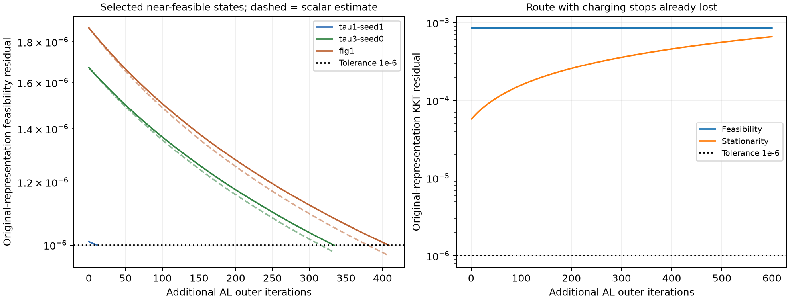

# 保存状態からの継続：遅い乗数更新と差分ヘッセ行列の精度

2026-11-14。Claudeが残した[条件数診断](../2026-11-14-conditioning/REPORT.md)から継続した。
**図1相当の最終平滑化問題で、元の制約表現のKKT許容値1e-6に到達した。**
ただし診断用のニュートン法と追加予算による結果で、論文の数値再現達成ではない。
目的値・純モード電池の問題は残る。本体srcは変更していない。

## 1. 最初に固定した比較

事前計画は`PLAN.md`、初回比較のコード・条件は`c9b4548`。
固定rho=1e4・ニュートン法の保存状態のうち、停留性が既定値内で、実行可能性が
僅かに許容値を超えるtau1-seed1、tau3-seed0、fig1を選んだ。
粗い段階で充電の立ち寄りを失ったtau1-seed2も対照として選んだ。
母集団の成功率を測る抽出ではない。

変数y・乗数lambda,mu・rhoを全精度で引き継ぎ、最終のeps=5e-4,p=12,delta=1e-3を固定。
まず内側と差分刻み1e-6を変えず、各600外側・300内側・300秒・最大2並列で延長した。
元の150外側以内での成功とは混ぜない。

各候補では、正の分母で除した速度不等式の乗数を元へ戻し、元のモデルで
停留性・実行可能性・相補性・双対非負性を計算した。全て1e-6以下を必要とした。
開始時点の残差はClaudeの保存値と一致することを確認した。

## 2. 外側反復の延長だけで進む例・進まない例

| 例 | 開始時の実行可能性 | 事前予測の追加回数 | 実際の追加回数 | 終了時の実行可能性 | 終了理由 |
|---|---:|---:|---:|---:|---|
| tau1-seed1 | 1.00954e-6 | 約10 | 11 | 9.99866e-7 | 元表現でKKT合格 |
| tau3-seed0 | 1.67030e-6 | 約315 | 334 | 9.99313e-7 | 元表現でKKT合格 |
| fig1 | 1.87407e-6 | 約379 | 116 | 1.46253e-6 | 追加300秒で打切り |
| tau1-seed2 | 8.58869e-4 | 単一候補の漸近模型を適用できない | 600 | 8.58553e-4 | 追加反復上限 |

上の予測は、単一の支配的残差に関するh≈v²/(2eps)、h≈eps F²/(2lambda²)、
lambda←lambda+rho hから導いた

\[
\widehat K=\frac{\lambda_0}{3\rho h_0}
\left[\left(\frac{h_0}{\eta}\right)^{3/2}-1\right],\qquad\eta=10^{-6}
\]

を、開始時の最大モード等式と対応する乗数に代入したものである。
Fがほぼ一定、vがepsより小さい等の仮定を置き、全制約の収束保証には使わない。
tau1-seed2ではh自体がepsより大きく、この局所近似の適用範囲から外れる。
計算された形式上の予測値も`initial.json`に残したが、有効な予測とは扱わない。

小規模二例は予測と同程度の追加回数で到達した。したがって元の150外側の上限で
未達だったことを、必ずしもKKTへ到達不能と解釈できない。
一方、対照例は同じ延長では直らず、立ち寄り消失は別の対策を要する。

## 3. 図1の内側が上限まで走る理由を調べる

図1は多くの内側で上限300回となった。そこで、その同じ保存点・乗数・rhoから、
差分ヘッセ行列の刻みだけを変えた。関数・解析勾配・gtolは同じである。

| 差分刻み | 内側反復 | 終了時の解析勾配∞ノルム | AL値 |
|---|---:|---:|---:|
| 1e-6 | 300（上限） | 2.10049e-6 | 2.099123778427705 |
| 1e-7 | 141 | 9.96873e-7 | 2.099123778427705 |
| 1e-8 | 14 | 9.85674e-7 | 2.099123778427705 |

AL値の差が丸め精度程度でも、求められた解析勾配は異なる。
この点では差分ヘッセ行列の精度が、内側の停止に影響した。
ただしこれだけで全ての失敗を差分の精度に帰属するものではない。

計画した条件を満たしたため、最初の小さい刻み1e-7で別枠の継続を行った。
追加237外側・300秒で、実行可能性は1.05810e-6まで下がったが、まだ未達だった。
次にその保存点で1e-7と1e-8を比較し、同じgtolと同程度のAL値を満たすことを再確認した。
この比較では1e-7が139反復、1e-8が15反復だった。

追加計画に従い、刻み1e-8でさらに一度だけ継続すると、56外側・約7.3秒でKKTに到達した。
3段階を別々のディレクトリに保存し、打切りを成功へ書き換えてはいない。

## 4. 図1の到達点と限界

| 指標 | 結果 |
|---|---:|
| 元表現の停留性 | 9.87084e-7 |
| 元表現の実行可能性 | 9.99027e-7 |
| 元表現の相補性 | 8.33346e-12 |
| 双対非負性の違反 | 0 |
| 目的値 | 2.098735388 h |
| 原制約の最大違反（混合単位） | 2.89518e-5 |
| 外側反復の合計 | 559（元150＋116＋237＋56） |
| 求解区間の時間の合計 | 約1131秒（精度比較は別） |

論文の図から読み取った目的値約1.8932 hとは約10.9%の差がある。
本実装はN=37で、論文の描画から推定されるN=17と同じ条件だとも保証できない。
さらに純モードの電池再計算には約0.00346の不足が残る。
よって「図1規模でもこの最終NLPのKKT許容値に入る点が得られた」という到達点であり、
論文のAlgorithm 1を同じ計算予算で再現したとは言わない。

τ1・τ3の合格例にも電池不足は残った。固定rhoの900本が原違反の判定を改善しつつ
電池監査を悪化させた結果と合わせ、KKT・元制約・物理的実施可能性を別々に報告する。

左の破線は単一候補の模型、実線は選んだ保存点からの元表現の実行可能性残差。
図1の実線は3つの継続をつないだもので、途中で差分刻みが変わっている。
右は立ち寄りを失った対照例で、単に反復を増やしてもこの上限内では修正できなかった。

## 5. 保存と再実行

`cases/*/initial.json`に元ファイルのハッシュと開始残差、`outer.jsonl`に全ての外側履歴、
`state.json`に全精度の最終状態、`result.json`に停止理由、`raw.json`に再評価用の軌道を保存した。
図1の後二段階は`fig1-refined/`と`fig1-accurate/`。
`hessian-step-check.json`と`fig1-accurate/inner-check.json`に同じ点からの比較を保存している。
一覧は`summary.csv`。`PLAN.md`に各追加比較の理由と実行条件を残した。
6出力の目的値・原制約を元のRust評価関数で再照合した。
KKTも、解析的な目的関数勾配と元の制約Jacobian・変換した乗数の行列積から独立に再計算し、
保存値と合格判定が一致した。検査結果は`verification.json`、`rust-validation.log`。

再実行には旧レポートと同じC ABIライブラリ・NumPy/SciPy環境を使う。
各スクリプトは保存済み結果を上書きしないので、再求解には別の出力ディレクトリを用意する。
`summarize.py`だけは保存データを再集計し、図とCSVを更新できる。
本体srcは変更せず、診断用`newton_al.tr_newton`に差分刻みの引数を追加した。
既定値1e-6の動作を保持し、以前の結果と新しい精度比較を区別している。
