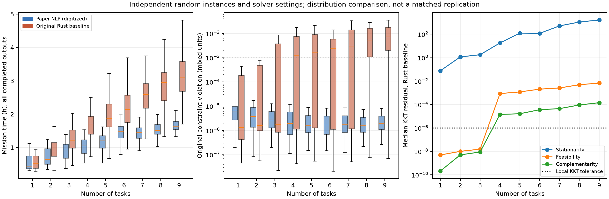

# 数値再現の再開：900本の基準測定とKKT未収束の切り分け

2026-11-14。**論文の数値再現は引き続き未達成**である。
今回、現行Rust実装を1〜9タスク各100本で評価し、未達の程度を定量化した。
別の13例の診断では、実行可能集合を保つ速度制約の表現変更とBFGSの組合せで、
最終平滑化問題のKKT収束を3例で確認した。ただし図1相当は時間内に収束せず、
論文の分布や成功率が再現できたという結論にはならない。

## 1. 今回の再現基準と、論文からは決まらない部分

[原論文](https://arxiv.org/abs/2609.40201v1) IV-Bは、各タスク数100例について
計算時間・目的値・元制約違反の分布を報告し、ALをKKT許容値または反復上限で停止する。
**100例全てがKKT収束したという件数・具体的な許容値は公開されていない。**
したがって、以下を区別する。

| 対象 | 今回どう扱うか |
|---|---|
| 最終平滑化問題のKKT収束 | 自分の既定値1e-6で、停留性・実行可能性・相補性を別々に判定する |
| 元の式(11),(12)の制約違反 | 論文と同じ種類の混合単位の最大違反を集計する |
| 違反<=1e-3の件数 | 分布比較のための自分の閾値。著者の成功判定とは呼ばない |
| 純モードの電池再計算 | 追加の物理監査。論文が報告した成功率とは区別する |
| 著者の入力・MATLAB設定の再実行 | 元データ・コードがなく未実施 |

利用者が持つ資料も公開論文のみであることを確認した。乱数分布・seed・N・初期解の
細部・AL更新則・段階ごとの許容値等に未指定部分があり、独自の選択として残す。
図1の描画からN=17が示唆されるが、本実装の初期化はN=5tau+2であり、図1では37。
描画からの推定を著者の全実験の既知のNと扱わない。

## 2. 各100本の基準実験

対象は本体`src`を変更していないRust AL＋自作L-BFGS。
タスク数1,...,9、各100件、seed=tau*10000+run、計900件を一回ずつ求解した。
独自の入力分布は[-9,9]^2の一様分布で、全充電円からの距離が6 kmを超える点を棄却する。
この分布を論文と同じと断定しない。

最大4並列、各ケース90秒の壁時計上限、既定の13段階、10外側反復×12＋最終30、
各内側2000反復。打切り・失敗も各100件の分母から除外しない。
個々の入力・出力・コマンド・監査・終了状態を即時保存する再開可能なランナーを使った。
本番前の1ケースの動作確認は別ディレクトリで、900件には混ぜていない。

集計は [mc-comparison.csv](mc-comparison.csv)、
ケース一覧は [mc-original/results.csv](mc-original/results.csv)、
件数は [mc-original/summary.json](mc-original/summary.json)。

全900件が13段階を終了し、打切り・異常終了はなかった。KKT収束は0/900。
元の違反<=1e-3は438/900、追加の物理単位別・純モード電池監査は286/900だった。

| タスク数 | KKT合格 | 元違反<=1e-3 | 追加物理監査 | 図3読取の違反<=1e-3 |
|---:|---:|---:|---:|---:|
| 1 | 0/100 | 80/100 | 42/100 | 99/100 |
| 2 | 0/100 | 78/100 | 60/100 | 98/100 |
| 3 | 0/100 | 62/100 | 39/100 | 100/100 |
| 4 | 0/100 | 48/100 | 29/100 | 99/100 |
| 5 | 0/100 | 44/100 | 30/100 | 100/100 |
| 6 | 0/100 | 43/100 | 32/100 | 100/100 |
| 7 | 0/100 | 38/100 | 24/100 | 100/100 |
| 8 | 0/100 | 25/100 | 16/100 | 100/100 |
| 9 | 0/100 | 20/100 | 14/100 | 99/100 |

図3の読取は計895/900がこの閾値内で、現在の独自実装とは大きな差がある。
全出力の目的値の中央値も、独自実装は図3読取の約1.16〜1.95倍だった。
タスク分布とN等が一致していないため、この差全てを解法一つに帰属しない。

900件全てで、Pythonの独立した原制約評価とRust出力の読み戻し差が、9桁丸めの
解析的な範囲内に収まった。最大差は1.18e-8、全件有限、KKTのフラグと記録残差も一致。
別途、独立診断24出力の目的値・原制約をRustで再評価した。



青は図3のベクトルデータから読み取ったNLPの分布、赤は今回の独自入力の基準実装。
同じ入力対の比較ではない。目的値は論文に合わせ全出力で示し、実行不能解を含むので、
小さい値だけを見て優れていると判断しない。許容値内の出力だけの中央値もCSVに別記した。
異なるハードウェア・並列負荷であるため、計算時間から論文に対する高速化率を主張しない。

## 3. 同じモデル・勾配で内側実装を比較する

診断用の`bridge.rs`から、不変のRustモデル・解析勾配・制約JacobianをC ABIで呼び出す。
関数を書き直したPythonモデルとの違いを、ソルバーの違いと混同しないためである。

1タスク、seed=0、最初のeps=.2,p=2の段階では、同じ初期状態から
SciPy BFGSが6外側反復でKKTに到達した（stat=4.29e-7、feas=1.15e-7）。
自作L-BFGSは30外側反復でもstat=2.81e-3だった。
SciPyのL-BFGS-Bを無制約で使い、関数値減少の許容値を0にしても、この比較では
stat=8.09e-4で関数値減少による停止となった。
[SciPyの公式資料](https://docs.scipy.org/doc/scipy/reference/optimize.minimize-lbfgsb.html)の
ftolとgtolは異なる終了条件なので、ライブラリの成功フラグをKKT成功とは扱わない。

このBFGSをそのまま13段階に適用しても最終KKTには到達しなかった。
独立したIPOPT/SLSQPも参照として試したが、この1例では最終KKTを得られなかった。
これらはMATLABの`fminunc`による論文の実装の再実行ではない。
IPOPTは[CasADiのCallback](https://web.casadi.org/docs/#subclassing-callback)を通じて
同じRust関数とJacobianを評価した。各ソルバーの失敗・精度不足も保存している。

## 4. 実行可能集合を保つ速度制約の前処理

Rustの元の速度制約は、d=r[k+1]-r[k]として

\[
g_k=\|d\|^2-v_d^2s_k|s_k|\le0.
\]

s>=s_min>0では論文の速度上限と同値であるが、ALの曲率には
rho J_g^T J_gが入り、距離の大きい区間の二乗表現は数値条件を悪くしうる。
そこで、正の滑らかな量

\[
D_k=\sqrt{\|d\|^2+\delta^2}
    +\sqrt{v_d^2s_k^2+\delta^2}>0,\qquad
\widetilde g_k=g_k/D_k\le0
\]

を使った。delta=1e-3は既定値を使用し、調整していない。
**全ての点で不等式の符号は同じなので、平滑化NLPの実行可能集合も目的関数も変わらない。**
有限反復のALの経路は変わる。psi・最小値近似・c<=s・車両再訪制約は変更・追加していない。

新しい微分には分母の微分も含める。50個の摂動点で、他の制約が同一、速度制約の符号が
同一であることを検査した。モデル勾配・電池等のRustの9テスト、C ABIの4テストも通過した。
元の大きなrhoの差分検査では、値約4.34e6の差から勾配約-0.674を求める際に桁落ちした。
刻み1e-6では誤差2.85e-4、1e-3では3.37e-7まで減ることを確認した。
高rhoの検査は、検証済みJacobianからの連鎖律との照合（相対1e-10）に分け、
通常rhoでの差分許容値1e-5は維持した。失敗ログも保存した。

## 5. KKTは元の制約表現でも照合する

境界g=0では、変換後の乗数をmu_tildeとするとmu=mu_tilde/Dと戻せる。
制約が僅かにずれる場合の微分も含め、実際に元のRustモデルのJacobianで
停留性・実行可能性・相補性・双対非負性を計算し直した。
元表現でも全て1e-6以下のときだけ、この診断のKKT合格とする。
JSONの9桁出力だけで判定せず、保存した全精度の変数・乗数を使う。

同じ1タスクseed=0、同じ最大反復予算の診断は以下のとおり。

| 速度制約 | 内側 | 最終停留性 | 最終KKT |
|---|---|---:|---|
| 元の二乗表現 | 自作L-BFGS | 1.78e1 | 不合格 |
| 元の二乗表現 | SciPy BFGS | 1.81e-1 | 不合格 |
| 正の量で除した表現 | 自作L-BFGS | 6.49e-2 | 不合格 |
| 正の量で除した表現 | SciPy BFGS | 8.29e-7 | 合格 |

最後の行の元表現でのfeasは7.15e-9、compは2.21e-11。
その点での全制約Jacobianの最大特異値の二乗は、元表現429.34、変更後14.37だった。
数値条件に関する具体的な変化であるが、全例の原因を一つに特定したという意味ではない。

また、変更後の自作L-BFGSの最終失敗点から、y・乗数・rhoを全く同じにして
内側だけを再開した比較でも、両実装がgtolに届かなかった。
BFGSに替えるだけで任意のAL状態を救済できるわけではなく、そこまでの経路も影響する。
結果は`inner-comparison.json`、全精度の照合は`diagnostic-assessment.json`。

## 6. 13例の確認と、残った失敗

旧検証と同じ図1＋tau=1,3,5,7のseed=0,1,2を対象に、表現変更＋BFGSで比較した。
前述の図1とtau1-seed0は既存の診断結果を再利用し、残り11例は一回ずつ求解した。
最大2並列、90秒、同じ最大反復数。原制約の修復は行っていない。

- 最終段階のKKTに到達：3/13（tau1-seed0、tau1-seed1、tau3-seed2）。
- 時間切れ：4/13（図1、tau7の3例）。失敗として分母に含めた。
- 残り6例：最終段階まで計算したが未収束。

収束3例は従来の物理単位別の原制約監査を通ったが、純モードの電池再計算では
約3.75e-5、4.06e-5、1.09e-4不足し、許容値1e-6を満たさなかった。
これは有限近似と原問題の違いで、KKT収束を物理的な成功と同一視できない実例である。
この追加監査を著者の図3の成功判定と混同しない。

最終条件だけを初期解から直接解く診断でも1例でKKTに到達したが、
これは13段階のAlgorithm 1を通した成功件数には加えていない。
独立した分布の各100本で、この変更後の解法の成功率を確認したわけでもない。

## 7. 残る再現作業

現時点で確定したのは、元実装の各100本の性能と、KKT収束が可能な構成が存在すること。
自作L-BFGSの不具合一つが全ての原因だと確定したわけではない。
元実装の未収束を、そのまま著者の実装・論文手法の失敗として数えてはいけない。

次は、等価な速度表現を保ち、内側解法の停滞・AL更新・段階移行を同じ失敗状態から
切り分ける。訪問・モードの支持が粗い段階で崩れない初期化・段階移行も検討対象となる。
小規模例と図1相当で最終KKTが安定して得られるまで、変更後の900本を追加して
成功率だけを合わせる係数探索には進まない。

訪問等式にも数値的な退化の危険がある。二候補の解析例では、eps=5e-4,p=12、
他候補まで1 kmの場合、厳密な近似等式を満たす最短距離は約3.19e-24 kmで、
その勾配は約6.38e-21になる。直接計算した訪問点の等式残差は丸めで0になる。
ただし、今回の有限許容値でのKKT到達を一律に不可能とする証明ではない。

## 8. 保存・再実行

事前計画は`PLAN.md`（`e747979`）、診断コードの保存は`2c6dc8d`。
作業開始時の図の読み取り結果は`f6edbdc`に保存した。
本体srcのハッシュ、ライブラリ・パッケージの情報は`provenance.json`、
900本の条件は`mc-original/manifest.json`、13例の条件は`pilot/manifest.json`に保存した。

`uav/`から実行する。基準実験はRustとPython標準ライブラリのみ必要。

```bash
cargo test
cargo build --release
python3 experiments/2026-11-14-reproduction/run_mc.py
```

同じ条件なら保存済みstatus.jsonを使って再開し、完了済みの求解を繰り返さない。
条件が異なれば再開を拒否する。生出力は保存用アーカイブにも格納する。
Git管理には`mc-original/cases.tar.gz`を使い、展開済み`cases/`は作業用として除外する。
新しいチェックアウトで`cases/`がなければ、ランナーはアーカイブから復元して再開する。

独立診断はNumPy 2.5.1、SciPy 1.18.0を使用。IPOPT参照のみCasADi 3.8.2も必要。

```bash
rustc --edition=2021 --crate-type cdylib -O experiments/2026-11-14-reproduction/bridge.rs -o /tmp/uav-reproduction-bridge.so
python3 experiments/2026-11-14-reproduction/make_speed_variant.py
rustc --edition=2021 --crate-type cdylib -O experiments/2026-11-14-reproduction/bridge-speed.rs -o /tmp/uav-reproduction-speed.so
python3 experiments/2026-11-14-reproduction/test_bridge.py
python3 experiments/2026-11-14-reproduction/check_speed.py
python3 experiments/2026-11-14-reproduction/independent_al.py --backend scipy-bfgs --library /tmp/uav-reproduction-speed.so --out /tmp/uav-new-diagnostic.json
python3 experiments/2026-11-14-reproduction/assess_diagnostics.py
python3 experiments/2026-11-14-reproduction/analyze_mc.py
```

`run_pilot.py`は11件の新規求解が既にあれば再実行を拒否する。
反復する場合は実験ディレクトリを分ける。グラフ生成のみmatplotlibを使う。
使用したキャッシュ済みPython環境の呼び出し方も`ENVIRONMENT.md`に記録する。
