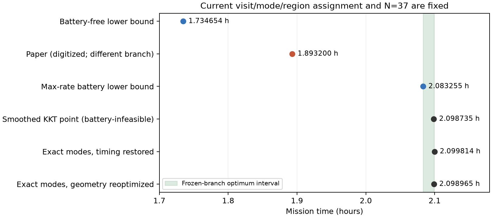

# 原制約での復元：電池不足は直るが、現在の割当てでは論文値に届かない

2026-11-14。入力は`de12699`時点の図1相当の最終KKT到達解。
**電池不足を修復できた。さらに、現在の訪問・モード・領域割当てとNを固定する限り、
連続変数の最適化だけでは論文の読取値に届かないことを、凸緩和の数値下界で確認した。**
原論文の平滑化ALをそのまま実行した結果ではなく、診断・原制約復元・下界評価である。
大域最適なモードや、論文と同じ入力・計算条件を得たとは主張しない。

## 1. 固定したものと変更したもの

事前条件は`PLAN.md`（`cef4ace`）。元データは
`../2026-11-14-final-continuation/fig1-accurate/raw.json`。
保存された全精度の変数から復元し、9桁に丸められた出力だけには依存しない。
N=37、7タスクの担当時点、36区間の充放電モード、12充電区間の領域番号を固定した。

- A（timing）：タスク担当点をタスク座標に一致させ、経路を固定して時間・電池を再最適化。
- B（geometry）：Aから始め、同じ担当時点・モードのまま補助点や充電位置も再最適化。

充電区間はc=s、放電区間はc=0を変数から消去し、電池ダイナミクスを元のCC-CV写像と
一定放電率で結ぶ。速度・円領域・区間時間の上下限も元の条件を使い、psiとsoft-minは使わない。
タスク座標の一致による位置補正は最大約8.53e-6 km（約8.5 mm）。

変数を内部で尺度変換し、[CasADiの自動微分](https://web.casadi.org/docs/#nonlinear-programming)と
IPOPTを使用した。二階微分も自動微分から与える。
各1500反復・300秒を上限とし、tol=1e-10、制約許容値1e-11、双対許容値1e-8、
相補性許容値1e-9、acceptable終了は無効、境界の緩和は0とした。
[IPOPTの公式資料](https://coin-or.github.io/Ipopt/OPTIONS.html)に従って各許容値を別々に指定し、
成功フラグだけで判断せず、固定した分岐のKKTと出力の原制約を評価した。

丸めで電池が負にならないよう、最適化内の下限に1e-8だけ余裕を加えた。
これは原問題より僅かに厳しい条件であり、明示した数値的な復元条件である。
出力は初期電池から全行程を再計算した。速度下限に対する丸め補正は今回は0だった。

## 2. 電池不足と目的値の結果

| 段階 | 目的値[h] | 原制約の最大違反 | 純モード再計算の最低電池 |
|---|---:|---:|---:|
| 元の平滑化KKT到達解 | 2.098735388 | 2.90e-5 | -0.00346205 |
| A：経路固定・時間再最適化 | 2.099814414 | 5.20e-17 | 1.0046e-8 |
| B：位置も再最適化 | 2.098964574 | 5.55e-17 | 1.0066e-8 |

Aの追加時間は元解に対して約3.88秒。BはAから約3.06秒短くなり、元解に対して約0.83秒長い。
**電池不足の修復はでき、目的値への影響は小さかった。**
この微小充電誤差の補正だけでは、論文の約1.8932 hとの差（Bでは約740.8秒）を説明できない。

Aは72変数・10反復、Bは128変数・14反復でIPOPTが終了した。
固定した分岐のKKTは、Aでstat=2.75e-14、feas=4.88e-13、comp=5.29e-9、
Bでstat=1.26e-15、feas=7.99e-15、comp=9.10e-9で、いずれも1e-6以下。
ただしこれは固定した原制約NLPについての判定で、平滑化問題や離散的な全候補の大域最適性ではない。
本体ソルバーのKKT成功として数えないよう、出力の`metrics.converged`はfalseとし、
`diagnostic.branch_kkt`にこの判定を保存した。

位置も動かしたBでは、Aから最大約1.47 km動いた点があるが、総時間の短縮は小さい。
この停留点だけから、同じ分岐の最良解がここにあるとは言えないため、下界も調べた。

## 3. 同じ分岐を楽観的に評価する

最初に電池制約を全て外し、速度・領域・時間だけの凸問題を解いた。
下界は約1.73465 hで、論文の読取値を排除できなかった。

次にCC-CVの充電率が常にkappa以下という必要条件を加えた。
元の充電写像は正の時間について単調で、CCでは増加率kappa、CVではそれ以下なので、
全ての元実行可能解は充電区間で

\[
e_k\le e_{k+1}\le e_k+\kappa s_k
\]

を満たす。放電区間の\(e_{k+1}=e_k-\zeta s_k\)と、元の電池上下限0〜1も残す。
CVの充電速度低下は無視されるので、これは原問題を含む楽観的な緩和である。

正の時間について速度制約は

\[
\frac{\|r_{k+1}-r_k\|^2}{v_k s_k}-v_k s_k\le0
\]

と同値に書ける。二次関数のperspectiveと一次関数の和なので凸であり、
円領域を二乗ノルムで書いた制約、上記の線形電池制約、固定した訪問と併せて凸問題になる。
ここでv_kは充電区間でv_c、放電区間でv_d。

## 4. 求解値だけではなく、誤差を補正した下界を計算する

Bの原実行可能な目的値T_Bより良い軌道は、各座標がr0±v_d*T_Bの箱に入る。
これは全時刻のr0からの移動距離がv_d*T_B以下だからである。
電池と時間にも元の有限な上下限があり、この箱の中で下界を計算できる。

凸な不等式g<=0、線形等式h=0、非負乗数muと自由乗数lambdaに対して
L=f+lambda^T h+mu^T gは凸で、任意の評価点x0で

\[
L(x)\ge L(x_0)+r^T(x-x_0),\qquad r=\nabla L(x_0)
\]

である。全実行可能点でf(x)>=L(x)なので、下界は

\[
\boxed{LB=L(x_0)+\sum_i
\min\{r_i(l_i-x_{0i}),\ r_i(u_i-x_{0i})\}}
\]

となる。これにより僅かに残る停留性誤差も箱の最小化で補正する。
IPOPTの目的値をそのまま下界とみなさず、乗数・残差・補正項を保存した。

最大充電率の緩和は128変数・108制約で、求解値は2.083255048 h、
補正後の数値下界は**2.083255001 h**。補正・双対ギャップは約4.76e-8 hだった。
独立したNumPyの式で制約・Jacobian・下界を再計算し、一致を確認した。
各緩和30点で凸Lagrangianの一次下界も検査した。
これは浮動小数点の数値的な下界評価で、区間演算による形式的証明ではない。

したがって手元の入力・現在の担当時点・モード・領域番号・Nを固定した最良値は、
数値評価ではおよそ

\[
2.08325\ \mathrm{h}\ \le T^*_{\rm fixed}\le 2.098964574\ \mathrm{h}
\]

に絞れる。さらに連続変数を改善できる余地は最大約56.6秒だが、論文の読取値との差は約740.8秒。
**現在の固定選択のままでは論文値に届かない。少なくとも、固定した選択のいずれかを
変える必要がある。** モード・領域・担当時点・Nのどれ一つが主因かまでは、この評価では確定しない。
他の分岐やNを含む論文全問題の下界ではなく、読取入力と計算条件の相違も引き続き残る。



## 5. 追加の監査と保存

CC-CVの値とe・時間に関する微分を137点で元のRust電池関数と照合した。
固定した担当点・モードの不変性、A/B両モデルのJacobianの差分検査も通過した。
修復出力は元のRust評価関数で原制約を再評価し、密な電池時系列も上下限内と確認した。

各領域に同じ一台の車両が対応する追加条件も別に調べたところ、A/Bとも不合格で、
再配置の最大不足はそれぞれ約1.170/1.173 kmだった。
これは原論文のサービス仮定とは別の条件であり、今回の最適化へは混ぜていない。
原制約・電池が修復できても、任意の単一車両運用を保証する結果ではない。

出力は`timing.json`、`geometry.json`。ソルバーの生の状態と乗数は`*-solver.json`、
検証は`tests.log`と`rust-validation.log`。
緩和は`travel-bound.json`と`charging-bound.json`、独立照合は`bound-verification.json`。
全精度の点・乗数・箱・残差・設定も保存した。一覧は`summary.json`。

再実行は`uav/`で行う。NumPy/SciPy/CasADiの既存環境は再現再開レポートのENVIRONMENT.md参照。

```bash
rustc --edition=2021 --crate-type cdylib -O experiments/2026-11-14-restoration/battery_bridge.rs -o /tmp/uav-restoration-battery.so
python3 experiments/2026-11-14-restoration/test_fixed_branch.py
python3 experiments/2026-11-14-restoration/fixed_branch.py
python3 experiments/2026-11-14-restoration/travel_lower_bound.py
python3 experiments/2026-11-14-restoration/travel_lower_bound.py --linear-battery
python3 experiments/2026-11-14-restoration/verify_bounds.py
```

復元の求解は保存済み結果の上書きを拒否する。別ディレクトリで実行すること。
これは原制約での後処理であり、論文のAlgorithm 1の再現成功件数へは加えない。
