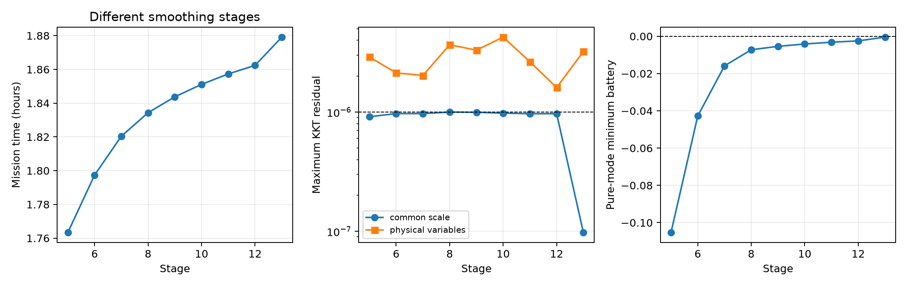
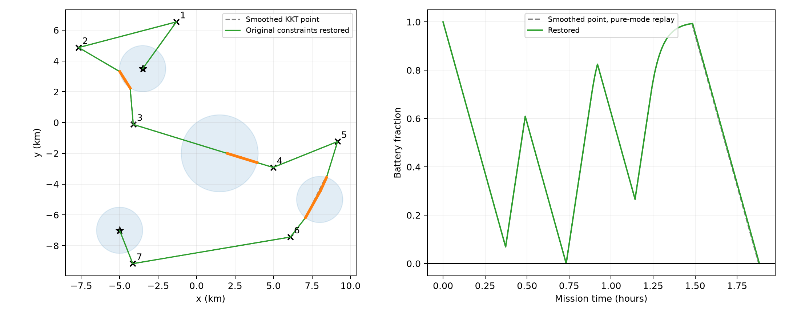

# 第13段階まで共通KKTに到達し、原制約の解を1.88259時間で復元した

2026-11-15。基準651a5f1、事前計画f667e36。

**保存した第4段階の点から、第5〜13段階すべてで共通尺度KKTを満たす経路を得た。**
最終平滑化問題の目的値は1.879132289 h。
その点の担当時点・充電モード・Nを固定して原制約で位置も再最適化すると、
1.882589424 h、原制約違反が丸め誤差内、純モードの電池も非負の解を得た。
復元前後の目的値の差は約12.45秒である。

ただし、平滑化問題の物理変数での停留性は3.22e-6で、追加した厳しい目標1e-6には未達。
最終段階は両尺度の達成を目指して続行したが、全体480秒の上限で停止した。
共通KKTの達成、両尺度の達成、原制約の復元を区別して記録する。

今回の原制約解は論文の読取値約1.8932 hより約38.20秒短いが、
保存済みの良い初期解・独自の尺度/AL設定・診断用Newton・追加の原制約復元を使っている。
著者のMATLAB/L-BFGSの再現や100本ずつの分布の再現を達成したとは扱わない。
以前に得た約1.77903 hの原実行可能解より良い記録でもない。

## 出発点と固定条件

入力は`stage4-inner/cases/stalled/newton-decomposed/one-update-state.json`。
N=37、図1相当の同じ座標・物理条件、Rの残差/変数尺度を使用する。
出発点の目的値1.666730100 hは粗い第4段階の値であり、原実行可能な時間ではない。
さらに上流では、以前の後処理で得た約1.85748 hの良い原実行可能解を初期値に使っている。

eps/pは元の13段階の予定を維持し、第5〜13段階だけを新しく解いた。
前の「軌道だけを引き継ぐ」比較と同じく、各段階でlambda/mu=0、rho=1e4へ戻した。
内側は前回の分解Hessianを使う診断用trust-region Newton、H_L差分1e-7、
gtol=1e-8、最大300。trust-regionと、小予測時の勾配ノルムによる受理規則も同じ。

記録機能を加える前後で、第4段階の固定ALから出力点・勾配・停止理由・反復が一致することを確認した。
求解前に出発点の共通KKTも再評価した。
乗数更新は元のAL式、rho増加は前回の精度gate付き規則のままである。

```text
V = max(common feasibility, common complementarity)
V > 1e-6、V > previous_V/4、inner AL gradient <= 1e-6 のときだけrhoを10倍（最大1e8）。
```

各段階最大200外側、最終600、各120秒、全体480秒で一回だけ実行した。
第5〜12段階は共通KKT全成分<=1e-6を満たしてから進み、
第13段階では共通KKTに加えて物理変数での指標も全成分<=1e-6を要求した。
著者の許容値を特定したものではない。

## 第5〜13段階の結果

第5〜12段階はそれぞれ16/18/17/15/13/12/11/10外側で共通KKTへ到達した。
第5段階の序盤にはrho増加後に内側精度が一時的に崩れたが、反復上限を延長せず回復した。
全段階の目的値・残差・時間は[stages.md](stages.md)。

第13段階は10外側時点、今回の開始から約398.29秒、計122外側で初めて共通KKTを満たした。
その点は`stages/stage13/first-common-kkt.json`へ保存した。
物理変数での指標は未達のため続行し、計498外側・約480.01秒で上限停止した。
このうち最終段階は386外側である。

| 指標 | 最初の最終共通KKT点 | 上限停止時 |
|---|---:|---:|
| 第13段階の外側回数 | 10 | 386 |
| 共通停留性 | 8.47e-8 | 9.77e-8 |
| 共通実行可能性 | 8.79e-7 | 4.61e-8 |
| 共通相補性 | 2.10e-8 | 7.60e-11 |
| 物理変数の停留性 | 2.83e-6 | 3.22e-6 |

反復を続けると実行可能性は改善したが、停留性が単調に改善したわけではない。
最終rhoは1e8。内側の目標1e-8も常に達成しているわけではなく、stuckや上限停止も残る。
内側の停止理由だけで外側KKTの成否を判断しない。

グラフの各点はeps/pの異なるNLPなので、段階間の時間増加を「同じ問題の最適化が悪化した」とは解釈しない。
原制約に近づくにつれて、純モードで再積分した電池不足は小さくなった。



## 最終共通KKT点にも原制約の不足が残る

上限停止時の全精度変数で元の選言制約を再評価した結果は以下の通り。

| 原制約・追加監査 | 値 |
|---|---:|
| 原制約の最大違反 | 6.7918e-6 |
| タスク訪問の違反 | 1.3824e-6 |
| モードの違反 | 6.7918e-6 |
| 純モードの最低電池 | -0.000441202 |

平滑化KKTへ到達しても、元の選言制約や純モード電池まで自動的に満たすわけではない。
有限eps/pでの近似の誤差と、平滑化NLPの求解残差を区別する必要がある。
今回の1.879132289 hを、そのまま物理的に実行可能な性能として扱わない。

## 原制約で一度復元した結果

事前計画どおり、第13段階の共通KKTへ到達したため、最後の出力から一度だけ復元した。
担当時点`[2,8,13,17,22,27,34]`、充電/放電モード、領域番号、N=37を固定し、
位置・区間時間を変える元の固定分岐NLPを既存のFixedBranch/Ipoptで解いた。
充電は領域0/1/2で各2区間、合計6区間。別のモードや担当時点は探索していない。
最低電池余裕1e-8、最大1500反復/30秒、許容値は以前の復元と同じ。

20反復・約0.050秒で`Solved_To_Acceptable_Level`、solver_success=true。
返却フラグに加え、保存された乗数とJacobianから固定分岐のKKTも独立に検査した。

| 復元点の指標 | 値 |
|---|---:|
| 目的値 | 1.882589424 h |
| 元制約の最大違反 | 約5.55e-17 |
| 純モードの最低電池 | 約1.00010e-8 |
| 固定分岐の停留性 | 9.98e-10 |
| 固定分岐の実行可能性 | 1.60e-15 |
| 固定分岐の相補性 | 4.92e-9 |

密な電池履歴でも[0,1]以内だった。
復元前後の目的値差は約12.45秒だが、これは位置も再最適化して得た一回の結果であり、
必要な最小追加時間の下界でも、時間だけを追加した修復でもない。
同じ担当時点・モードでも、ある時点の位置は最大約2.08 km移動している。
下図の経路が近いことと、個々の時点位置が同じことは区別する。
平滑化KKT点と復元点は別の点・別のKKTであり、復元点を平滑化ALの成功に加えない。



## 何が分かり、何が残ったか

この独自の尺度・段階移行条件では、良い保存点から各近似NLPを共通KKTまで解きながら
最終問題へ進み、必要な充電を保持した実行可能解を後処理で作れることを確認した。
「良い初期点でも近似を通すと必ず充電を失う」という一般化はできない。
以前の失敗を、そのまま論文の手法の失敗とする根拠も弱くなる。

一方、著者のL-BFGSを再現できたわけではなく、今回のNewton・独自尺度・rho更新とリセット、
保存済みの良い初期解への依存は残る。物理変数で同じ1e-6という追加目標も未達だった。
論文の読取値約1.8932 hとの差は約-38.20秒（約-0.56%）だが、
図からの座標/時間の読取り、N、初期化、著者の未公開条件の違いがあるため、数値の一致とは扱わない。
最良時間の更新や、著者の大域最適性を否定した結果でもない。

次は、保存済みの良い原実行可能解を使わず、元の初期軌道から同じ診断条件を適用する。
入力だけからこの充電選択と最終KKTへ進めるかを切り分け、
その後で本体の内側解法・尺度/前処理と100本ずつの評価へ戻す。
先に任意の設定探索で論文時間へ合わせる作業には戻らない。

## 検証と保存

- 求解前に第4段階の共通KKTと、記録機能を加えたNewtonの同じ固定ALの出力を照合。
- 全498外側のAL値/勾配、乗数更新、両尺度KKT、rho判断、段階間のリセットを保存点から再計算。
- 全16754内側受理点の値・勾配ノルムと受理条件も再評価。各段階の最終停留性は元Jacobian積でも照合。
- 原制約の復元について、固定選択・固定分岐KKT・原制約・密な電池履歴を別に再検査。
- 各段階9出力、最終出力、復元点の計11出力を元のRust評価器でも確認。
- 本体srcは未変更なのでcargoテストは再実行していない。900本の過去の数値も変更していない。

求解後、内側の初期評価直前に期限を超えた場合の境界処理を補い、
入力点を時間切れとして返すことと、通常時の第4段階固定ALの出力が変わらないことを確認した。
今回の保存求解は再試行していない。

480秒は今回の第5段階以降の継続だけの時間であり、良い初期解の生成、第1〜4段階、
これまでの診断比較、事前照合、復元、保存点の検証費用を含まない。
著者の実行時間との性能比較には使わない。

状態は`stages/*/outer.jsonl.gz`、内側の受理点と乗数は`inner*.jsonl.gz`、
最終点は`result.json`/`solution.json`、復元は`restored/`に保存した。
`verification.json`、`provenance.json`、`artifact-index.json`、Git外文書の`human-notes.tar.gz`も保存。
既存結果の上書きは拒否する。再求解は別の出力先を準備すること。

```bash
python experiments/2026-11-15-decomposed-follow/newton.py
python experiments/2026-11-15-decomposed-follow/run.py
python experiments/2026-11-15-decomposed-follow/restore.py
python experiments/2026-11-15-decomposed-follow/verify.py
python experiments/2026-11-15-decomposed-follow/analyze.py
```

Python環境・2本のRust評価ライブラリはfidelity実験と同じ。検証と集計は新たな求解を行わない。
