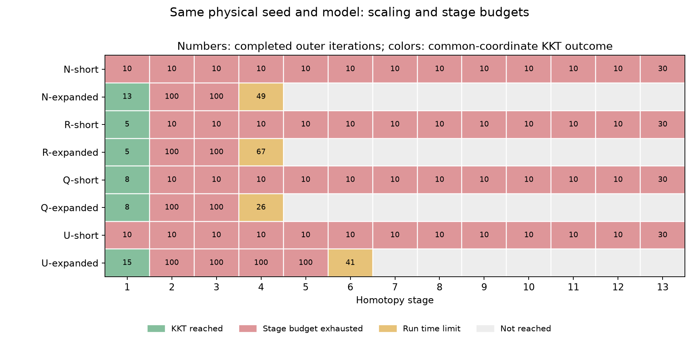
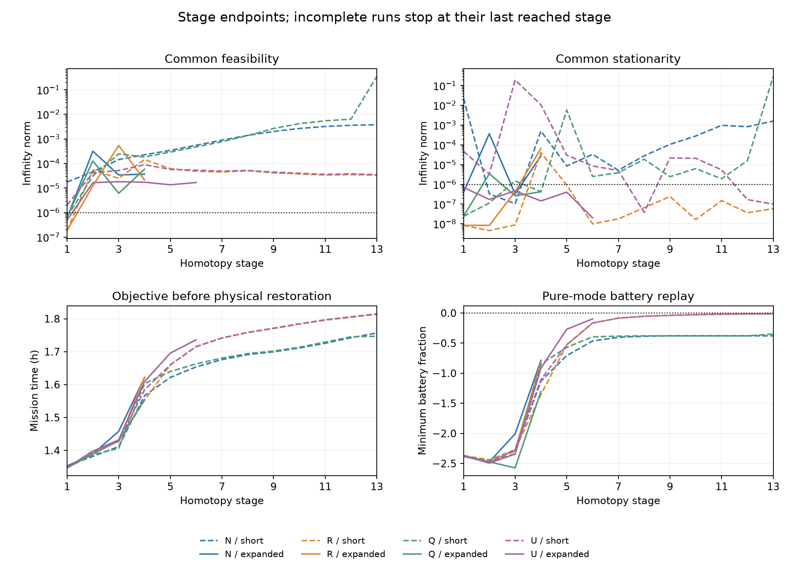

# 残差尺度と段階内反復枠の影響

2026-11-15。出発点31ff31b。本体srcは変更していない。事前計画は`PLAN.md`。
著者の再現を優先し、初期化を改良する前に、こちらで補った尺度・段階内予算を切り分けた。

**尺度を変えると、同じ良い初期点から必要な充電を失う経路が変わった。**
しかし、尺度を紙面の単位へ戻すだけで、最終KKT・原実行可能性を再現できたわけではない。
反復枠の拡大は第1段階のKKT到達を変えたが、第2段階以降の未収束は残り、
90秒の上限では拡大した4条件とも最終段階へ届かなかった。
「各段階を十分に解いても失敗した」という結論にはしていない。

## 1. 同じものと変えたもの

図1・N=37・同じ物理条件・保存済みの原実行可能初期点（約1.85748 h）、初期乗数0、rho=1e4固定。
eps/pの13段階・psi・原モデルは同じで、内側はSciPy BFGSに固定した。
MATLABそのものではなく、著者のAL係数・許容値・N等も未確定のまま。

| 条件 | 残差倍率 | 速度制約 | 変数 |
|---|---|---|---|
| N | 既存の電池14.4倍・時間境界36倍 | 正の量で除す | 既存の尺度y=x/d |
| R | 電池・境界の倍率を外す | Nと同じ | Nと同じ |
| Q | Rと同じ | 二乗速度へ戻す | Nと同じ |
| U | Rと同じ | Qと同じ | 物理単位x |

N→R、R→Q、Q→Uで一つずつ変更した。正の行倍率と変数変換なので可行集合は同じだが、
同じrhoのALの重み・内側の条件・有限反復の経路は変わる。
負時間側のsigned-square延長や端点消去等は残るため、Uも著者の実装そのものとは呼ばない。
変換と判定の式は`METHOD.md`。

各条件で二つの反復枠を比較した。

- short：各段階10外側、最終30外側。
- expanded：各段階100外側、最終300外側。

内側は最大2000反復、gtol=1e-8。前回の1e-6より厳しい設定だが、この比較内では全条件共通。
各条件90秒で順次実行。段階の上限に達したら未収束を記録して次へ進む。
したがってexpandedは、十分解けたことを仮定する条件ではなく、反復枠を拡大した条件である。

## 2. 共通のKKTで比較する

尺度の異なる残差をそのまま比べず、乗数を共通の二乗速度モデル・既存の残差/変数尺度へ写し、
その元モデルで実際にKKTを再評価した。段階停止は全成分<=1e-6。
紙面の単位へ倍率を外し、物理変数xで停留性を測った指標も別に保存した。
これらは平滑化NLPのKKTで、原選言制約・純モード電池とは別に判定する。
著者の許容値が同じと判明したわけではない。

## 3. 最終段階まで完了したshortの結果

| 条件 | 最終時間[h] | 共通の停留性 | 共通の実行可能性 | 原制約違反 | 純モード最低電池 |
|---|---:|---:|---:|---:|---:|
| N | 1.756726526 | 1.60e-3 | 3.77e-3 | 4.24e-3 | -0.378618 |
| R | 1.813336314 | 5.83e-8 | 3.35e-5 | 1.86e-4 | -0.012467 |
| Q | 1.746745437 | 0.289 | 0.346 | 0.109 | -0.348751 |
| U | 1.815160468 | 9.92e-8 | 3.46e-5 | 1.89e-4 | -0.011942 |

4条件とも最終KKT・原実行可能性は未達。R/Uの短い時間も、未復元点の値であって実行可能な成功とは数えない。
N→Rだけで電池不足と到達経路が大きく変わり、Qでは悪化し、Uでは再び小さくなった。
「尺度を外すほど単調に改善する」「どれか一つの変更で再現できる」という結果ではない。
全NLPの可行集合が同じでも、こちらの尺度の選択を無害な実装上の差として除外できないことが分かった。
演算順序の差や単一事例への依存も残るので、一意の原因と断定しない。

N/Qは、最初の充電までにタスク1・2・3を担当する分岐になった。
その担当時点・純モードのまま厳密な訪問へ戻すには、距離下界16.436329 kmが必要だが、
電池で飛べる上限は14.4 km。この固定分岐を連続調整だけで復元することはできない。
R/Uはこの特定の容量下界には反しないが、それだけで実行可能とは証明されない。
今回、新たな原制約復元は行っていない。

## 4. 反復枠を増やすと、第1段階の成否が変わる

第1段階の共通KKTまでの外側反復は次のとおり。

| 条件 | short | expanded |
|---|---|---|
| N | 10回では未達 | 13回で到達 |
| R | 5回で到達 | 5回で到達 |
| Q | 8回で到達 | 8回で到達 |
| U | 10回では未達 | 15回で到達 |

各10回という独自の上限が、未収束段階を通すことに影響する具体例である。
ただし第2段階は、全expanded条件で100回でも共通KKT未達だった。
その後も未収束のまま上限で次へ進んでおり、「各段階のKKTを満たしたホモトピー」の検証にはなっていない。



expandedの到達状況は、Nが第4段階49外側、Rが第4段階67外側、Qが第4段階26外側、
Uが第6段階41外側で90秒の時間切れ。合計外側は262/272/234/456。
これらを最終段階の失敗として数えず、shortとの最終目的値の比較にも混ぜない。
R/Q/UはAL評価を構成するため1評価でRustを2回呼び、Nは1回なので、
壁時計の到達段階にはPython側の実装費用も含まれる。著者やライブラリの性能順位とは扱わない。



## 5. 内側の勾配だけを小さくしても、制約は残る

R-expandedの第2段階100回目では、内側の勾配ノルムは8.36e-9でBFGSは正常終了した。
それでも、共通の実行可能性は1.24e-5、紙面の単位へ戻した実行可能性は7.74e-6だった。
Nは同じ箇所で内側反復上限、Q/Uはprecision lossで、内側の精度不足も別に残る。

追加の保存点分析としてRの第2段階で、残った制約の行とJacobianを調べた。
最大の共通違反は区間15の時間下限で1.24e-5、時間に戻すと約0.00124秒。
モード等式には絶対残差約6.5e-6〜7.7e-6があり、対応するJacobianの行ノルムは約3.8e-4〜5.6e-4だった。
線形な時間下限の行ノルム1と比べて小さい。
これは内側の定常性と外側の制約達成を区別して調べる根拠になるが、
内側が局所最小だったという証明や、これが全ての失敗の原因という証明ではない。
データは`stage2-rows.json`、再計算は`inspect_stage2.py`。

## 6. 再現に向けて何が絞れたか

今回確認できたのは、独自の尺度・段階上限の相違が実際に効くことである。
それらを外したUでもshortは未達、expandedは未完了なので、著者の手法自体の失敗は示していない。
rho=1e4固定・乗数の持ち越し・N・初期軌道の細部・MATLABとの差も残る。

次はRの第2段階の保存状態を使い、残る制約のJacobian・内側定常点の曲率と、
ALの乗数/ペナルティ更新を点検する。内側が十分に小さい勾配でも進まない現象と、
内側自体の精度不足を分ける。設定を論文値に近づけるための無差別な数値探索には戻らない。
その後に、段階を収束させてから進む条件を完走させ、初期化改善とは別に比較する。

## 7. 検証・記録

- 求解前の3テストで、同じ初期物理変数、正の行変換、AL勾配の差分/連鎖則、共通KKT写像を確認。
- `verify.py`で全1817外側のAL更新・内側値と勾配・両尺度のKKTを再評価した。
- 各最終点の停留性は元Jacobianと写した乗数の積でも別に検査。8出力を元Rustでも照合した。
- 原制約違反の読み戻し一致と、原実行可能性の合格は別。今回は原実行可能な成功点は得ていない。
- 全精度状態、候補重み、停止理由は`cases/*/outer.jsonl.gz`とstage開始/終了JSON。
- h/gは保存状態から復元し、`replayed-residuals.jsonl.gz`と`final-constraint-audit.json`に保存。
- 集計は`comparison.csv`、`summary.json`。時間切れ4件を最終結果から除外するフラグを明示した。

初回N-shortは第1段階終了後のログ出力でキー重複の例外になったが、保存済みの10外側から続行した。
同じ求解をやり直しておらず、最初の時間も90秒予算へ含めている。詳細は`METHOD.md`と`recovery.json`。
初回の`run.log`も保持した。結果を見たrhoや近似係数の変更は行っていない。

Python環境は既存の再現実験と同じ。ビルドはuav/で次を実行する。

```bash
rustc --edition=2021 --crate-type cdylib -O experiments/2026-11-14-reproduction/bridge.rs -o /tmp/uav-fidelity-original.so
rustc --edition=2021 --crate-type cdylib -O experiments/2026-11-14-reproduction/bridge-speed.rs -o /tmp/uav-fidelity-speed.so
python3 experiments/2026-11-15-fidelity/test_scaling.py
python3 experiments/2026-11-15-fidelity/run.py
python3 experiments/2026-11-15-fidelity/analyze.py
python3 experiments/2026-11-15-fidelity/verify.py
python3 experiments/2026-11-15-fidelity/inspect_stage2.py
```

新規求解は既存casesの上書きを拒否する。analyze/verify/inspectは保存済み結果だけを使う。
