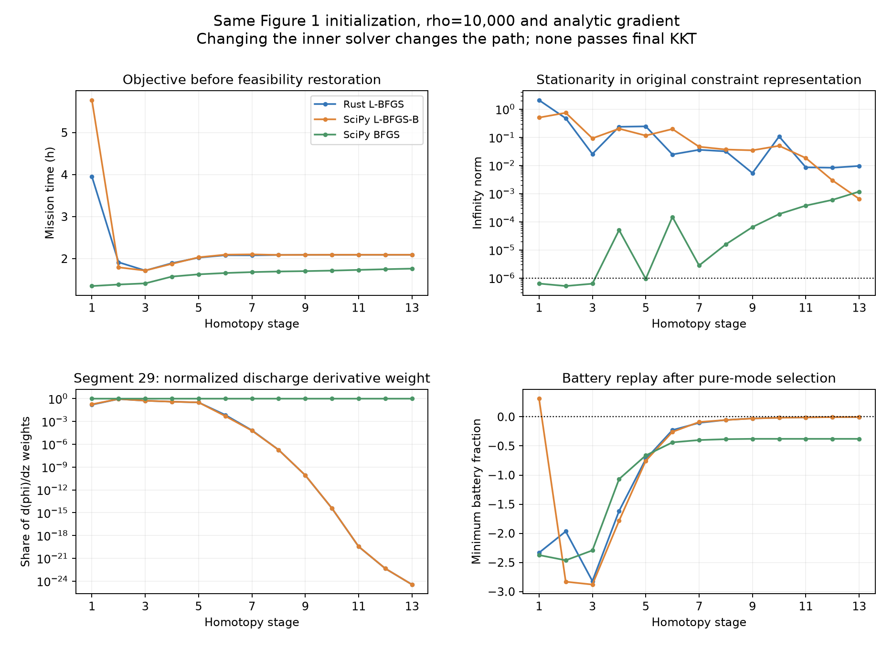

# 自作L-BFGSをライブラリに替えるだけでは図1の再現は直らなかった

2026-11-15。利用者の「自作関数とMATLABの違いもあると思う」に対する比較。
事前計画は`PLAN.md`、コミット`a4f1818`。本体srcは変更していない。

**ライブラリの違いは計算経路と到達精度に影響したが、今回試した二つの置換だけでは解決しなかった。**
SciPy L-BFGS-Bは自作版とほぼ同じ充電の選択を残した。
密なBFGSは別の経路へ進む一方、必要な充電も失い、原制約・電池を満たさなかった。
MATLAB・OctaveはPATH上に見つからず、MATLABのfminuncそのものは実行していない。
論文の数値再現は未達成のまま。過去に診断用ニュートン法の継続で達成した図1のKKTを
取り消すものではなく、今回は初期点から150外側の準ニュートン法を比較した結果である。

## 1. 比較したもの

図1の同じinstance・phys・N=37・初期軌道・変数尺度・解析勾配を使用。
最近のKKT到達解の診断と同じ、正の量で除した速度制約・rho=1e4固定とした。
このrhoとALの反復上限は独自の条件であり、MATLABや著者の設定が判明したものではない。

内側だけを自作Rust L-BFGS、SciPy L-BFGS-B（境界指定なし）、SciPy BFGSへ変更した。
13平滑化段階、各10外側・最終30外側、内側最大2000反復、gtol=1e-6。
L-BFGSの記憶20、ftol=1e-14。自作は微小減少10回で停止し、SciPy固有の停止規則とは異なる。
全実装にRustの同じAL評価・解析勾配を渡したので、関数の移植誤差は比較に混ぜていない。
3実装は順に実行し、上限は各120秒。全て時間切れなく150外側を完了した。

[MATLABの公式資料](https://www.mathworks.com/help/optim/ug/fminunc.html)では、
L-BFGSはHessianApproximationの選択肢で、勾配・関数値・ステップに関する停止理由が区別されている。
[SciPyの公式資料](https://docs.scipy.org/doc/scipy/reference/optimize.minimize-lbfgsb.html)でも、
gtolとftolは別の停止条件である。同じL-BFGSという名称やsuccessフラグだけでは到達精度の一致を保証できない。
今回のSciPy比較をMATLAB実装と同一とは呼ばず、実測した勾配と最終NLPのKKTを別々に評価した。

## 2. 初期軌道からの結果

KKTは元の速度制約表現へ乗数を戻して評価した。各残差の基準は1e-6。
電池は最終点の純モード選択で、初期電池から全行程を再計算した。

| 内側 | 時間[h] | 停留性 | 実行可能性 | 元制約違反 | 純モード最低電池 | 秒 |
|---|---:|---:|---:|---:|---:|---:|
| 自作L-BFGS | 2.093057929 | 9.58e-3 | 2.40e-6 | 4.23e-5 | -0.003719 | 7.32 |
| SciPy L-BFGS-B | 2.093053231 | 6.49e-4 | 2.03e-6 | 4.28e-5 | -0.003875 | 17.52 |
| SciPy BFGS | 1.762960680 | 1.17e-3 | 3.31e-3 | 3.77e-3 | -0.378624 | 45.59 |

3条件とも最終KKTは未達。自作とSciPy L-BFGS-Bの目的値の差は約0.017秒だった。
SciPy L-BFGS-Bは停留性を改善したが、原制約と電池の差は解決していない。
BFGSの短い時間は実行不能な点の値であり、改善や論文を上回る結果とは数えない。
計算時間は今回の単一実行・同じホストでの記録で、一般的なライブラリ性能順位ではない。

自作とSciPy L-BFGS-Bは、150内側全てが2000反復の上限で止まり、gtol達成は0/150。
BFGSはgtol達成51/150、上限16/150、precision loss 83/150だった。
今回の全経路では「関数値でsuccessだが勾配は未達」の終了は観測されていない。
停止条件一般の違いと、今回実際に支配した反復上限・精度不足を区別する。



## 3. 同じAL部分問題から解き直しても、差は部分的だった

自作の経路のstage 1・7・13の最初の内側開始点を事前に代表点と決めた。
y・lambda・mu・rho・eps・pを同じにして3実装を一回ずつ実行。
元の二乗速度と正の量で除した速度の両表現を比較した。
表現間のAL自体は異なるが、各表現内の3実装は同じALを評価する。
各15秒・2000反復で、全18回に時間切れはなかった。

以下は内側ALの勾配無限大ノルム。元の表現へのKKTではなく、内側の共通目的関数の精度である。

| 速度表現 | stage | 自作 | SciPy L-BFGS-B | SciPy BFGS |
|---|---:|---:|---:|---:|
| 正の量で除す | 1 | 1.69 | 1.07 | 0.614 |
| 正の量で除す | 7 | 3.08e-2 | 7.31e-2 | **2.09e-7** |
| 正の量で除す | 13 | 3.18e-3 | 2.55e-3 | 3.85e-4 |
| 元の二乗 | 1 | 4.15 | 3.09 | 6.51 |
| 元の二乗 | 7 | 0.154 | 0.826 | 4.25e-2 |
| 元の二乗 | 13 | 3.81e-2 | 8.39e-3 | 2.47e-2 |

stage7の正規化表現だけはBFGSが同じ開始点からgtolへ到達した。
stage13ではBFGSもprecision lossで止まり、gtol未達。
**自作実装に替わる解法が効く部分問題はあるが、ライブラリを交換するだけで全段階を解決したわけではない。**
反復上限・条件の悪さ・そこまでの経路の影響を残しており、自作コードの不具合を全て排除した検証でもない。

## 4. 充電の選択はstage4で戻り、stage6以降に鋭くなる

前回、充電を一つ放電へ変えると約6.22分改善した区間29を追った。
自作とSciPy L-BFGS-Bの両方で、stage2〜3は放電候補が最小、stage4でR3の充電が最小へ戻った。
stage6以降は放電候補への微分重みが急激に小さくなった。
これは連続変数の粗い段階の最近傍候補であり、stage2〜3が既に純放電で実行可能だったという意味ではない。

各候補z_iに対して、phi=(sum z_i^(-p))^(-1/p)なので

\[
\frac{\partial\phi}{\partial z_i}=(\phi/z_i)^{p+1}.
\]

保存した重みと、重みの和で割った寄与率を区別して記録した。
以下は放電候補の正規化した寄与率で、確率や勾配ベクトル全体の割合ではない。

| stage | 自作 | SciPy L-BFGS-B |
|---|---:|---:|
| 3 | 0.534 | 0.541 |
| 4 | 0.401 | 0.401 |
| 5 | 0.322 | 0.321 |
| 6 | 7.26e-3 | 5.14e-3 |
| 7 | 6.91e-5 | 6.17e-5 |
| 10 | 3.77e-15 | 3.82e-15 |
| 13 | 3.57e-25 | 3.59e-25 |

追加の保存点分析として、stage6終了の座標・時間・充電時間を全て固定したまま、
eps・pだけを最終値へ変えて評価した。放電の微分重みは7.17e-3→8.41e-17となった。
経路の移動を伴わなくても、近似を鋭くするだけで、既に劣る候補の影響が小さくなる例である。
新しい求解や条件の選び直しは行っていない。

この観察は、粗い段階での選択とその後の鋭化を調べる根拠になる。
ただし、勾配にはz_i自身の微分やALの重みも掛かるため、この寄与率だけで
モード変更が数学的に不可能、あるいは唯一の原因だったとは断定しない。
元の制約でs>=s_min>0かつc=0またはsという選択を変えるには、連続な移動の途中で
原モード制約を一度外れる必要もあり、固定した最終分岐の局所調整とは異なる問題である。

## 5. BFGSは必要な充電を失った分岐へ進んだ

BFGSは区間29の放電候補をstage1から選んだが、最終の純充電は4区間だけだった。
最初の充電は区間16。その前にタスク1・2・3を時点3・8・14で担当している。
このモードと担当時点を保ってタスク座標を厳密に復元しようとすると、
充電前に少なくともr0→a1→a2→a3の距離を飛ばなければならない。

\[
 D_{\min}=\|a_1-r_0\|+\|a_2-a_1\|+\|a_3-a_2\|
 =16.436329\ \mathrm{km}.
\]

満充電から純放電だけで飛べる距離の上限は

\[
 v_d(e_{\max}-e_{\min})/\zeta=36/2.5=14.4\ \mathrm{km}.
\]

したがって2.036329 km不足する。この固定した分岐は、位置や時間の連続最適化だけでは
原制約へ復元できない。これはソルバーの失敗フラグではなく、三角不等式と電池容量による必要条件の違反である。
他の担当時点・モードへ変えた全問題の実行不能性ではない。
`bfgs-prefix-certificate.json`に保存し、別の式で再検算した。

この結果は、不要な充電を消すだけでなく、必要な充電の選択を確保することも必要だと示す。
粗い段階は元の純モード問題の実行可能軌道ではなく、全実装にc>sの逸脱もあった。
その逸脱を禁止するc<=sや尺度統一の追加効果は既存の別実験で検証済みで、
今回は同じモデルの内側だけを比較するため混ぜていない。

## 6. 次の作業への判断

現状では、SciPy L-BFGS-Bをそのまま既定実装へ置き換えても、数値再現を直せるという根拠はない。
密なBFGSも一部の内側精度を改善するが、今回の経路では必要な充電を落としているため、単純な採用はできない。
MATLABならどの結果になるかは未検証であり、MATLABでも失敗すると主張しない。

次の検証は、**良い原実行可能解を初期点にしたとき、同じ最終平滑化NLPへ到達できるか**を優先する。
以前の同じN・入力の約1.85748 hの後処理解を対照として使えば、
良い構造からでも最終KKTへ進めないのか、初期の粗い近似で構造を失うのかを分けられる。
これは著者の初期化そのものの再現ではなく、原因を絞る対照実験である。
その後に、stage1〜6での初期化・段階移行・原制約復元を見直す。
最終段階の反復上限だけを増やすことや、Nを論文値に近づける調整は今回の第一候補にはしない。

## 保存と再実行

- `trace.py`：3経路と18部分問題。モデル評価は既存Rustブリッジを使用。
- `runs/*/stage*-start.json`、`stage*-end.json`：各段階の全精度の変数・乗数・候補重み。
- `runs/*/outer.jsonl.gz`：全450外側の状態・停止理由・評価数・充電候補。
- `probes/*/input.json`：各表現の共通開始状態、各backendのJSON：生の最終点と実測勾配。
- `runs.csv`、`probes.csv`、`analysis.json`：集計。図は`library-trace.png/svg`。
- `verify.py`：全450状態でAL乗数更新・候補等式・元表現KKT、全18部分問題の値と勾配を再評価。
- `test_trace.py`：候補のphi・微分重み・psiをRust関数に照合し、全候補等式もRust評価に照合。2テスト通過。
- `rust-validation.log`：3最終出力を元Rust評価で照合。これは読み戻しの一致であり、実行可能合格の意味ではない。

ビルドはuav/で実行する。Python環境は再現実験のENVIRONMENT.mdを参照。

```bash
rustc --edition=2021 --crate-type cdylib -O experiments/2026-11-14-reproduction/bridge.rs -o /tmp/uav-library-trace-original.so
rustc --edition=2021 --crate-type cdylib -O experiments/2026-11-14-reproduction/bridge-speed.rs -o /tmp/uav-library-trace-speed.so
rustc --edition=2021 --crate-type cdylib -O experiments/2026-11-15-library-trace/trace_helpers.rs -o /tmp/uav-library-trace-helpers.so
python3 experiments/2026-11-15-library-trace/test_trace.py
python3 experiments/2026-11-15-library-trace/trace.py
python3 experiments/2026-11-15-library-trace/analyze.py
python3 experiments/2026-11-15-library-trace/verify.py
```

trace.pyは既存のruns/probesへの上書きを拒否する。保存済み結果を検査する場合はanalyze.pyとverify.pyを使う。
