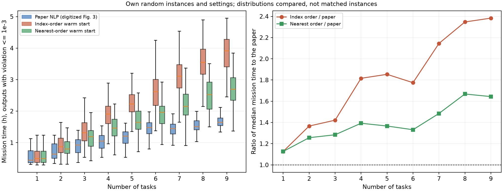

# 900本：最近傍順の出発点で目的値は大きく下がったが、図3の読取値との差は残った

2026-11-15。基準42af3b4、事前計画とバイナリの一致確認はbae92b1。本体srcは変更していない。

**同じ900本・同じバイナリで、初期軌道の訪問順を番号順から最近傍順に変えた。**
**目的値の中央値は、タスク数4以上で2〜3割下がった。図3の読取値に対する比は、番号順の1.13〜2.38倍から、
最近傍順の1.13〜1.67倍になった。元の制約の違反<=1e-3の件数は774/900から795/900で、ほぼ同じである。**

計画で決めた読み方では「下がるが差が残る：訪問順は一因。残りは別の要因」に当たる。
独自の入力分布での測定で、論文の入力ではない。論文の初期化の訪問順は分からない。

## 条件

| 条件 | 訪問順 | 求解 |
|---|---|---|
| I（基準、保存結果） | 番号順 | `../2026-11-14-conditioning/mc-rho1e4`：本体のL-BFGS、`--rho0 1e4 --rho-mult 1` |
| N | 最近傍順 | 同じ引数に`--order nearest`を加えただけ |

- 入力は同じ900本（tau=1..9、各100本、seed=tau*10000+run）。8並列、1例90秒。時間切れ・異常終了は0件。
- 基準Iのバイナリと現在のバイナリは、rhoを増やす判定だけが違う。rhoを固定する設定では影響しないことを、
  現在のバイナリで各tauの最初の1例を解き直して確かめた。9例とも出力が完全に一致した（`binary-check.json`）。
- tau=1は訪問順が1通りである。IとNの目的値は100例すべて一致した。引数以外に違いが無いことの検査になっている。

## 結果

違反<=1e-3の出力だけで中央値を取った表（集計は`analyze.py`、数値は`mc-order.csv`、対ごとの値は`pairs.csv`）：

| タスク数 | 違反<=1e-3 I | N | 目的の中央値 h I | N | 図3読取 | 図3比 I | 図3比 N | 対の比N/Iの中央値（四分位） | 直線距離の比の中央値 |
|---:|---:|---:|---:|---:|---:|---:|---:|---|---:|
| 1 | 80 | 80 | 0.499 | 0.499 | 0.443 | 1.13 | 1.13 | 1.000 | 1.000 |
| 2 | 89 | 88 | 0.867 | 0.798 | 0.635 | 1.37 | 1.26 | 1.000（0.949〜1.000） | 1.000 |
| 3 | 91 | 92 | 1.318 | 1.190 | 0.927 | 1.42 | 1.28 | 0.904（0.742〜1.000） | 0.913 |
| 4 | 89 | 91 | 1.907 | 1.462 | 1.050 | 1.82 | 1.39 | 0.783（0.654〜0.922） | 0.800 |
| 5 | 90 | 92 | 2.229 | 1.643 | 1.203 | 1.85 | 1.37 | 0.735（0.653〜0.846） | 0.723 |
| 6 | 90 | 85 | 2.619 | 1.964 | 1.475 | 1.77 | 1.33 | 0.768（0.623〜0.870） | 0.683 |
| 7 | 82 | 94 | 3.105 | 2.149 | 1.448 | 2.14 | 1.48 | 0.712（0.623〜0.802） | 0.681 |
| 8 | 81 | 85 | 3.549 | 2.522 | 1.512 | 2.35 | 1.67 | 0.709（0.611〜0.814） | 0.644 |
| 9 | 82 | 88 | 3.911 | 2.698 | 1.641 | 2.38 | 1.64 | 0.713（0.621〜0.797） | 0.603 |

「対の比」は、IとNの両方が違反<=1e-3だった対（各タスク数73〜87対）での、目的値の比N/Iである。
「直線距離の比」は、同じ対での、出発点→タスク→終点の直線距離の比（最近傍順/番号順）である。



- **目的値は訪問順で大きく変わる。** タスク数4以上では、対の比の中央値が0.71〜0.78。同じ問題で約2〜3割短い。
- **改善した対がほとんどである。** タスク数5以上では、0.1%より大きく改善した対が71〜78、悪化した対が0〜9。
- **目的値の比は、直線距離の比に従う。** 対数での相関は、タスク数2〜9で0.78〜0.96。
  R2c-2の13例（診断用Newton）で見た関係が、本体のL-BFGSと900本でも成り立つ。
- **違反<=1e-3の件数はほぼ同じ。** 774/900から795/900。新たに合格74件、不合格に転じた53件で、入れ替わりは多い。
  純モード電池の監査は82/900から85/900、KKT（1e-6）は1/900のままである。訪問順はここには効いていない。
- 全出力で中央値を取っても同じ傾向だった（図3比は1.13〜2.37倍から1.13〜1.70倍。`summary.md`）。

### 解は出発点の訪問順を引き継ぐ

最終点の訪問順が出発点の訪問順と同じだった件数（各100本中）：

| タスク数 | 1 | 2 | 3 | 4 | 5 | 6 | 7 | 8 | 9 |
|---|---:|---:|---:|---:|---:|---:|---:|---:|---:|
| I（番号順のまま） | 100 | 100 | 95 | 93 | 86 | 67 | 72 | 54 | 45 |
| N（最近傍順のまま） | 100 | 99 | 93 | 95 | 89 | 74 | 78 | 75 | 65 |

タスク数が増えると入れ替わる例は増えるが、タスク数9でも番号順の45%、最近傍順の65%は出発点のままである。
番号順は最短の順より大幅に長いのに、半数近くがそのまま最後まで残る。

### 訪問順であと何が残るか（幾何だけの見積もり）

各例の直線距離を、厳密な最短の順（部分集合の動的計画法）と比べた（`route_slack.py`、`route-slack.json`。求解なし）。

| タスク数 | 1 | 2 | 3 | 4 | 5 | 6 | 7 | 8 | 9 |
|---|---:|---:|---:|---:|---:|---:|---:|---:|---:|
| 番号順/最短（中央値） | 1.00 | 1.00 | 1.22 | 1.40 | 1.53 | 1.63 | 1.75 | 1.83 | 1.90 |
| 最近傍順/最短（中央値） | 1.00 | 1.00 | 1.01 | 1.04 | 1.08 | 1.08 | 1.15 | 1.17 | 1.17 |
| 図3比 I | 1.13 | 1.37 | 1.42 | 1.82 | 1.85 | 1.77 | 2.14 | 2.35 | 2.38 |
| 図3比 N | 1.13 | 1.26 | 1.28 | 1.39 | 1.37 | 1.33 | 1.48 | 1.67 | 1.64 |

- 番号順の経路は、タスク数9で最短の順の1.9倍ある。図3比Iがタスク数とともに1.13から2.38へ増える形と並行している。
- 最近傍順は最短の順より中央値で最大17%長い。図3比Nの残り（1.26〜1.67倍）は、これより大きい。
  **訪問順をさらに良くしても、残りの差の全部は説明できない見込みである。** ただしこれは直線距離だけの見積もりで、
  最短の順での求解はしていない。
- タスク数1は訪問順が無関係で、図3比は1.13倍のまま残る。訪問順と無関係な差が少なくともこの程度ある。

## 何が分かり、何が言えないか

- 基準の900本の目的値が図3の読取値より大きかったことの、**大きな部分は初期軌道の訪問順（番号順）による。**
  番号順はこちらが置いた仮定で、論文は訪問順を明記していない。
- **差は残る。** 最近傍順でも1.13〜1.67倍。残りの候補は、時点数N、充電の入れ方、求解の未収束（KKT 1/900）、
  入力分布の違い、残った訪問順の余地である。どれがどれだけかは測っていない。
- 論文の手法は訪問順を実質的に決めない。解の質は初期軌道の訪問順に強く依存する。
  これは定式化と局所解法の性質で、こちらの実装の細部に依らない（L-BFGSでも診断用Newtonでも同じ向き）。
- 図3の読取値との比較は入力分布が違うので、分布どうしの比較にとどまる。
  著者の初期化が最近傍順やそれに近い順だったかどうかは分からない。
- rho=1e4固定は1例から選んだ値で、最適とは限らない。別の値・別の訪問順は試していない。

## 保存・再実行

```bash
# uav/ で実行。求解はRustのバイナリと標準ライブラリだけ
cargo build --release
python3 experiments/2026-11-15-mc-order/check_binary.py     # 基準の出力の再現（既存の結果は上書きしない）
python3 experiments/2026-11-15-mc-order/run_mc_nearest.py   # 900本、8並列。保存済みの例は解き直さない
python  experiments/2026-11-15-mc-order/analyze.py          # 集計と図（NumPy・Matplotlib）
python3 experiments/2026-11-15-mc-order/route_slack.py      # 幾何の見積もり
```

生の出力は`mc-nearest/cases.tar.gz`（展開済みの`cases/`はGitの管理外）。条件は`mc-nearest/manifest.json`。
8並列で約13分かかった。計算時間は並列数に依るので、論文との速度比較には使わない。
