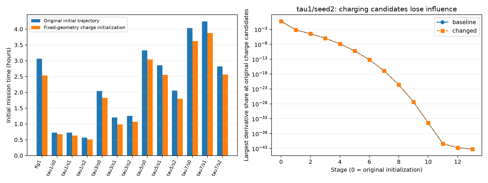

# R2c-3：初期の充電量を整えても、未収束4例は最終KKTへ届かなかった

2026-11-15。基準cb42603、事前計画0ab25ee、初期化13例と実装の保存9ddc1af。
本体srcと既存の条件Gの求解・復元・検証コードは変更していない。

**経路と充電箇所を保って初期の電池・区間時間を原制約で整えると、初期時間は13例すべてで短くなった。
しかし先行比較の未収束4例は、今回も最終共通KKTに届かなかった。**
初期化の改善と、平滑化経路を通した最終解の改善は別だった。
成功対照2例は受理を維持し、図1相当は1.885854040→1.882589424 h（約11.75秒短縮）、
tau1-seed0は約0.561777834 hで同じだった。ただし未収束4例の救済がなく、追加7例は事前条件どおり実行しなかった。
成功対照の結果を含む全表は[comparison.md](comparison.md)。

## 何を固定し、何を変えたか

番号順の元の初期軌道から、位置列・N・訪問順・担当時点・充電/放電の区間・領域を固定した。
既存のFixedBranch(moving=False)で、電池と区間時間だけを変数とする元の制約のNLPを一回ずつ解いた。
一律に残量0.9まで充電する方針に対し、同じ経路上で総時間を目的に充電量と時間を整える前処理である。
過去の良解や最終点を初期化に使わず、初期充電箇所の追加・削除、位置の移動、訪問順の変更は行っていない。
Ipoptの局所解であり、大域的に最良の充電量を保証するものではない。

初期化は最大1500反復/10秒、以前の復元と同じ許容値、最低電池余裕1e-8。
ソルバ成功に加え、固定分岐KKT<=1e-6、元残差<=1e-6、電池[0,1]、全精度の位置列・選択の一致で受理した。
保存JSONの9桁丸めによる位置の変更を避けるため、固定NLPのタスク位置には元の初期位置列の全精度値を渡した。
その後に解く平滑化モデルの入力・関数・勾配には変更がない。

初期化後は条件Gをそのまま使用した。各段階で乗数0/rho1e4へ戻し、分解HessianのNewtonと同じrho規則を使う。
第1〜12段階は共通KKTか外側10回、第13段階は最大600外側、各120秒/全体960秒。
最大3並列で各一度。最終の復元・受理条件もR2a/R2bと同じである。
前処理費用は条件Gの時間と別に記録し、改良を本体へ反映したとは扱わない。

## 初期化は13例すべて受理された

代表的な初期の総時間は次のように変わった。

| 例 | 元の初期時間 h | 充電量を整えた初期時間 h |
|---|---:|---:|
| 図1相当 | 3.059548 | 2.533106 |
| tau1-seed0 | 0.725910 | 0.672234 |
| tau1-seed2 | 0.568827 | 0.507705 |
| tau5-seed0 | 3.327031 | 3.039460 |
| tau7-seed0 | 4.038017 | 3.623084 |
| tau7-seed1 | 4.241368 | 3.875187 |

全13例で原制約・固定分岐KKT・電池の検査を通り、位置列と充電/放電の選択を保持した。
全精度の状態・ソルバ乗数・オプション・受理判定を`initializations/`に保存した。
元のRust評価器でも13出力の目的値と原残差を照合した。

## 先行する6例と、追加7例の条件

両方の訪問順で止まる4例（tau1-seed2、tau5-seed0、tau7-seed0、tau7-seed1）と、
成功対照2例（tau1-seed0、図1相当）を先に解く計画である。
未収束4例で1件以上の最終共通KKT・復元受理を得て、対照2例とも受理・時間非退行なら残り7例へ進むと事前に決めた。

未収束4例はいずれも第13段階へは進むが、共通KKTには届かなかった。

| 例 | 新しい点の充電区間 | 最終の共通実行可能性残差 | 停止 |
|---|---:|---:|---|
| tau1-seed2 | 0 | 1.57e-3 | 外側600回 |
| tau5-seed0 | 3 | 1.07e-2 | 第13段階120秒 |
| tau7-seed0 | 2 | 約3.00e-1 | 第13段階120秒 |
| tau7-seed1 | 5 | 約3.00e-1 | 第13段階120秒 |

tau1-seed0の成功対照は復元受理を維持し、時間は約0.561777834 hで基準と同じだった。
図1相当も最終共通KKTと復元受理を維持し、充電が7→6区間、復元後1.882589424 hとなった。
入力だけから作った初期化で以前の良い保存点由来の経路に近い値を得たが、約1.77903 hの最良記録を更新したわけではない。
図1の物理変数の追加KKT許容値1e-6は今回も未達で、第13段階は120秒で停止している。
他の失敗点は充電区間数・位置も変わるので、前回の固定分岐の実行不能判定をそのまま流用しない。
今回言えるのは、定めた予算では原実行可能な最終解へ進めなかったこと。
未収束4例の改善が無かったため、事前条件を満たさず、全13例の追加求解へは拡大しない。
初期化13例の受理を、最終の13例の成功として数えない。
先行6例は失敗4例と成功2例を意図して選んだ標本なので、2/6も母集団の成功率として扱わない。

## tau1-seed2では粗い第1段階から同じ充電喪失が起きた

唯一のタスクなので訪問順は変わらない。
初期時間0.568827→0.507705 hと電池配分を変え、初期点は原実行可能だったが、
第1段階の終了時点で充電区間は2→0になり、以後も作り直されなかった。
最終時間約0.415870166 h・共通実行可能性残差約0.001565966は基準とほぼ同じ。

元の充電区間・領域に対応する候補の微分重み（各mode内での相対share）の最大値は、
新旧とも第1段階で約6.68e-4、第3段階で約1.08e-6、第7段階で約1.25e-17、
最終段階で約5.98e-44となった。これはAL全体の勾配ではなく、soft-min候補間の相対寄与である。
初期の充電量を変えただけでは、粗い段階で移った先の分岐から戻れなかった。

この例は充電なしでは出発点→タスク→終点の距離下界14.972 kmが航続距離14.4 kmを超える。
充電なしの分岐の実行不能性は前回の下界をそのまま適用できる。
ただし微分重みの小ささから、他の全ての探索や初期化でも回復不能とは言わない。

## 解釈と次の対象

今回の「固定した初期経路上で充電時間を短くする」方針だけでは、未収束の救済は確認できなかった。
初期化全般が無関係と分かったわけではなく、充電箇所・領域の選択や、粗い近似からの回復は未検証として残る。
初期点の電池余裕を小さくした影響もあるので、充電量のあらゆる方針を否定しない。
この前処理は失敗改善のための本体の規定値には採用しない。

次はtau1-seed2を使い、同じ元の初期点と最終NLPに対し、粗い段階を通る経路と、
最終段階へ直接入る経路を切り分ける。充電を保った最終解が得られるかを確認してから、他例への比較を検討する。
最終段階への直接開始は以前の図1で高い時間にとどまったことがあるため、全体の解決策とは決めない。
論文の数値再現と、診断・解法改善の試験を引き続き区別する。

## 検証と保存

初期化13例のKKT・原残差・位置/モード/担当時点・電池履歴は`verify_initial.py`で再評価。
条件Gの各求解は既存の`verify.py`を変更せず使い、全2133外側の更新・両KKT・rho判断、
89486内側受理点と中断分521点を再評価した。6求解すべてでrun/restore/verifyが完了した。
各段階78出力＋最終6出力＋受理復元2出力の86件を元Rustで照合し、初期化13件と合わせて99件を確認した。
件数と対照結果はsummary.json/verification-summary.jsonに記録した。
本体未変更のためcargoテスト、900本の再評価は行っていない。

既存出力の上書きは拒否する。`driver.py`は初期化13例→先行6例→事前条件が成立した場合だけ追加7例を実行する。
分析は`analyze.py`、段階ごとの充電選択と微分重みは`structure.py`。
大きい内側受理点のログはGit管理外でローカルに残し、hashと件数はlocal-inner-manifest.jsonへ保存する。
