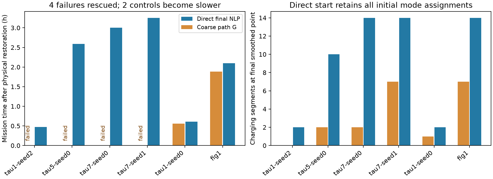

# R2c-4：同じ元初期点から最終問題へ直接入ると何が変わるか

2026-11-15。**未収束だった4例はすべて、最終平滑化NLPのKKTと原制約復元に到達した。
一方、成功対照2例のミッション時間は長くなった。** 粗い段階を省くことは救済に効いたが、常に良い解を返す方法ではない。
診断Newtonによる独自条件の比較であり、本体L-BFGSの改善・著者実験の再現ではない。

## 先に固定した条件

[PLAN.md](PLAN.md)をa7beecb、ランナーと差分をed5f185へ保存してから求解した。基準版は50b7796。
基準はR2bの条件G・番号順。同じ入力、N、元の初期y、R尺度、分解HessianのNewton、AL更新、
初期rho=1e4、判定と予算を使い、**第1〜12段階を省いて第13段階だけを解く**。
eps=.0005、p=12、delta=.001。最終段階は最大600外側/120秒、内側最大300/gtol=1e-8。
最終共通KKTを得た後、同じ一度の原制約復元（1500反復/30秒、受理条件1e-6）を使う。
R2c-3で整えた初期量や、以前の良い解は使わなかった。

`runner.patch`は段階ループの範囲だけ、`verifier.patch`は初回段階番号の検査だけの差分。
全6例で元の初期yが基準Gの保存値と全精度で一致し、初期AL勾配と独立したJacobianとの積も一致した。
最終問題での初期AL値は元のミッション時間に一致する。

6独立プロセスを同時に実行し、BLAS/OpenMP/MKLを各1スレッドに固定した。最大6コアで利用者の上限8以内。
求解・復元・Python検証を含むドライバーの壁時計時間は**13.90秒**。Rust照合、集計、文書化の時間は含めない。
基準Gは3並列だったため、厳密な速度比は評価しない。

## 結果

| 入力 | 条件Gの復元時間 h | 直接開始の復元時間 h | 対照との差 秒 | 充電区間 G→直接 | 外側 |
|---|---:|---:|---:|---:|---:|
| tau1-seed2 | 未受理 | 0.469434576 | — | 0→2 | 6 |
| tau5-seed0 | 未受理 | 2.588952879 | — | 2→10 | 7 |
| tau7-seed0 | 未受理 | 3.002229662 | — | 2→14 | 7 |
| tau7-seed1 | 未受理 | 3.254270329 | — | 7→14 | 7 |
| tau1-seed0 | 0.561777834 | 0.610306765 | +174.70 | 1→2 | 6 |
| fig1 | 1.885854040 | 2.100473218 | +772.63 | 7→14 | 7 |

未受理4例には比較可能な実行可能目的値がない。救済されたことと目的値の改善を混ぜない。
全6例の最終共通KKTと物理変数の追加KKTは、すべての指標が1e-6以下。
共通statは最大9.93e-9未満、物理変数statは最大3.52e-7未満である。
著者の物理変数での許容値は不明。今回の合格は大域最適性を意味しない。



## 原制約と電池は別に確認した

平滑化KKT点そのものは原制約の解ではない。原制約違反は最大約3.02e-5、
純モードで再積分した電池の最小値は−0.00454〜−0.000816だった。
復元後は全6例で原制約違反が5.56e-17未満、電池最小値は約1e-8で非負。
担当タスクへの厳密な訪問、区間内電池、固定分岐KKTも全件合格した。
復元による時間増加は約0.11〜1.22秒。復元は元の担当時点・モード・領域を固定した別の最適化である。
元のモデルの追加車両運用条件を新たに満たしたとは主張しない。

検証した内容は以下のとおり。

- 全40外側、1569内側受理点を保存し、既存検証器でAL更新・rho判断・受理条件を再評価。中断点0。
- 各最終点で、原Jacobianと乗数から停留性を独立再計算。
- 6初期点の完全一致、初期AL勾配のチェーン則を事前確認。
- 段階出力6・最終出力6・復元出力6の計18出力をRustの元評価器で照合し、終了コード0。
  復元6出力は厳しい検査1e-10も通る。平滑化出力の元制約違反は合格と読み替えない。

## 原因として言えること

**tau1-seed2では、元の初期点や最終問題が本質的に解けないという説明を退けられる。**
同じ初期点から、粗い段階を通すGでは必要な充電が消えて実行不能な分岐へ進み、
直接開始では充電2区間を残して原実行可能解へ到達した。
充電なしで必要な距離の下界14.972 kmが航続14.4 kmを超えることは
[R2c-1](../2026-11-15-r2c-branch/REPORT.md)で確認済み。
初期充電量だけの変更が効かなかった[R2c-3](../2026-11-15-r2c-charge-init/REPORT.md)と合わせると、
この例では**粗い近似を通る求解経路が必要な充電を失わせた**という因果的な対照になる。
他の3例も段階経路だけの変更で救済されたが、失敗機構を全て同一とは断定しない。

直接開始では全6例で、初期の区間ごとのモードと充電領域の選択がそのまま残った。
これらは求解中に固定しておらず、自由変数を解いた結果である。
担当タスクの時点も5例で同じだが、tau7-seed1では変わった。
鋭い近似では別モード候補の微分が極小になり、初期の選択にとどまりやすいという既存の診断と整合する。
今回だけでモード切替の不能性を数学的に証明したとはしない。

対照のtau1-seed0は充電1→2区間、図1相当は7→14区間となり、時間が約2.91分、12.88分長くなった。
Gでは不要な充電の削除を含む別の選択へ移れており、粗い段階には解の質を上げる働きもある。
直接開始は実行可能性を得る手段になったが、全面的な置き換えは支持されない。
図1相当の約2.10047 hは以前の直接開始診断とも整合し、論文の約1.8932 hに近づいた結果ではない。

## 次へ引き継ぐこと

事前計画の6例だけで終了し、追加7例や900本は解かなかった。
結果を見てGと直接開始の良い方を選んだ成績を、単一経路の成功率としては示さない。
次の候補は**Gで原制約復元が受理されなかった時だけ、元初期点から直接開始を一度追加する規則**。
Gで受理された出力はそのまま採る。この規則の13例での確認と、設計に使っていないseedでの確認はまだ行っていない。
G＋直接開始＋復元の総費用を含め、予算と失敗の扱いを先に固定する必要がある。

本体`src/`、本体L-BFGSの900本の値、過去の実験出力は変更していない。
著者コード・入力・未記載設定との一致とMATLABでの実行は引き続き未達。

## 保存と再実行

`summary.json`と`comparison.md`は`python3 analyze.py`で既存出力から再集計できる。
`plot.py`はmatplotlibのみ追加で必要。各入力の`source.json`、外側状態、最終出力、復元、検証をGitに保存する。
内側ログはローカルに残し、`local-inner-manifest.json`にhashを保存した。
外部依存のソースhash・Python環境は`provenance.json`、文書は`human-notes.tar.gz`、保存物は`artifact-index.json`に記録する。

求解ドライバーは既存の`cases/`・`logs/`への上書きを拒否する。
再実行時はこの実験をそのまま上書きせず、版を保った別の実験先を用意する。
この環境で実行したコマンドは以下。キャッシュと共有ライブラリの所在は`provenance.json`を参照する。

```bash
OPENBLAS_NUM_THREADS=1 OMP_NUM_THREADS=1 MKL_NUM_THREADS=1 \
PYTHONDONTWRITEBYTECODE=1 \
PYTHONPATH=/home/mordent/.cache/uv/archive-v0/IH8olt7ky0AxR5WV:/home/mordent/.cache/uv/environments-v2/sys-id-chirp-1714f8f5f4d59f0e/lib/python3.12/site-packages \
/home/mordent/.local/share/uv/python/cpython-3.12-linux-x86_64-gnu/bin/python \
experiments/2026-11-15-r2c-direct-final/driver.py
```
