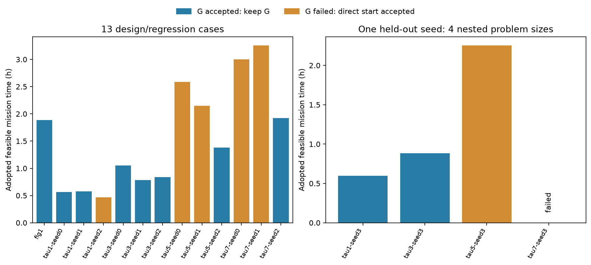

# R2d：Gの未受理時だけ直接開始する規則の検証

2026-11-15。**既存13例はすべて原制約復元を受理できた。一方、設計に使っていないseed=3の4サイズでは3例が受理、7タスク例は両経路で失敗した。**
失敗点は必要な充電を失った分岐であり、距離の下界から実行不能と証明できる。
さらに、このseedの5・7タスクの元初期軌道は、初めから航続を超える飛行区間を含んでいた。
粗い段階を省くだけで一般に直るわけではなく、次は初期軌道の位置も含む実行可能性の確保を切り分ける。
本体L-BFGS・著者実装・各100本の性能分布の再現は引き続き未達。

## 先に固定した規則と実行

基準033a5bb。[PLAN.md](PLAN.md)を0d7312f、実行コードと再利用の照合をfa7bcffへ保存してから求解した。
Gで原制約復元が受理されたらその出力を採り、未受理の場合だけ同じ元初期yから直接開始と復元を一度追加する。
目的値の良い方を選ぶ規則ではない。Gの終点を直接開始へ渡さず、元の初期点へ戻す。

G・直接開始のランナー、Newton、AL、尺度、N、番号順、rho=1e4、復元は既存ファイルを変更せず読み込んだ。
Gは各段階120秒/全体960秒、粗い段階10外側、最終600外側。
直接開始は最終段階だけ120秒/600外側。復元は各1500反復/30秒、受理基準1e-6。
共通KKTと物理変数の追加目標を分け、復元の入口は従来どおり最終共通KKTとした。

最大5独立プロセス、BLAS/OpenMP/MKL各1スレッド。新しい求解・復元・Python検証は全体780.08秒（約13分）。
既存13例のG、直接開始4例は解き直しておらず、新規は残るtau5-seed1の直接開始とseed=3の4サイズだけ。
新しい段階・最終・復元出力は66件、採用先を含むユニーク78出力をRustで照合した。
全7新規phaseで1311外側・53956内側受理点・中断92点を既存検証器で再評価した。
例外や検証失敗0。時間切れを成功例の分母から外していない。

## 既存13例：回帰確認

Gで受理されていた8例の出力はファイルごとそのまま採用した。位置・時間・充電・目的値に変更はない。
G未受理5例のうち、前回の直接開始4例はその検証済み出力を再利用した。
未確認だったtau5-seed1も、新たな直接開始で両尺度KKTと復元を通り、**2.145959990 h**となった。
結果として13例すべてで原制約復元を受理した。全数値と採用先/hashは[comparison.md](comparison.md)と`summary.json`にある。

ただしこの13例は規則の設計に使用済みであり、独立評価の成功率ではない。
12乱数例も3seed×4サイズでタスク列を共有する（別途図1相当1例）。
選択された平滑化点の両尺度KKTは12/13。図1相当は物理変数stat=2.17e-6で追加目標1e-6に未達のまま。
最終共通KKT、復元後の固定分岐KKTと原制約は全13例で合格している。

## 設計に使っていないseedの4サイズ

| 入力 | Gの復元 | 追加直接開始の復元 | 採用後の時間 h | 初期化からPython検証まで 秒 |
|---|---|---|---:|---:|
| tau1-seed3 | 受理 | 実行せず | 0.596028936 | 11.98 |
| tau3-seed3 | 受理 | 実行せず | 0.883828194 | 84.73 |
| tau5-seed3 | 未受理 | 受理 | 2.252117624 | 294.58 |
| tau7-seed3 | 未受理 | 未受理 | — | 780.07 |

受理3例は両尺度の平滑化KKTと固定分岐KKTに合格し、復元後の原違反<=5.6e-17・電池非負。
Gで通る2例では直接開始を実行していない。
5タスク例はGの最終600外側で未達、直接開始を追加すると受理された。
7タスク例はGと直接開始の最終段階がいずれも120秒で打切り。復元の入口に届かなかった。

これらは**一つの新しいseedの4サイズ**であり、互いに独立な4標本ではない。
`instance::random`が生成する同じタスク列の先頭1/3/5/7個を使うことを保存入力で確認した。
PLANの「過去900本に含まれる」は実行中に誤記と確認した。過去はseed=tau*10000+runで、今回はseed=3。
bb41862に訂正と共有関係を記録し、例・予算・求解条件は変更していない。

## 7タスク例の失敗：直接開始でも必要な充電を失う

Gの最終共通feasは約0.300、直接開始は約0.00956で下げ止まり、乗数が増大した。
この段階では平滑化KKTも原実行可能性も未達であり、出力の小さい目的値を改善とは数えない。
Gで止まった分岐の実行可能性は新しく解いていない。

直接開始は充電14区間から13区間となり、**区間19の領域0での充電が消えた**。
最初のAL問題の内側受理点を追うと、わずか第4受理点で区間19の候補の最小値が充電から飛行へ切り替わる。
第3点ではc/s=1.127、第4点では1.329と混合状態を通り、最初の内側問題の終点では飛行候補の相対微分shareがほぼ1。
充電候補のshareは約3.66e-38となった。これは候補間の相対微分であり、AL全体の勾配とは区別する。
AL値は197.706→3.19739へ下がり、内側勾配も5.81e-11まで下がったが、必要な分岐を失った。
細部は`switch-trace.json`。保存点の再評価だけで、新しい求解は行っていない。

この失敗点のモード・領域・担当時点を固定すると、直前の充電は区間16の領域0、次は区間21の領域2。
その間は純飛行で、タスク3（担当時点18）を必ず通る。
領域0からタスク3まで最低0.258605 km、タスク3から領域2まで最低14.423227 kmなので、
必要距離は**14.681831 km以上**。満充電の航続**14.4 km**を超える。
丸め誤差を差し引いても結論は変わらない。区間時間・位置・充電量を調整しても、この選択のままでは元の問題を満たせない。
これは固定した選択の実行不能証明であり、入力全体や選択自由なNLPの実行不能証明ではない。
根拠は`branch-distance-bound.json`、再計算は`python3 branch_bound.py`。

## 入口にも問題：元初期軌道が原実行可能とは限らなかった

seed=3の5・7タスク例では、元初期軌道の**飛行区間20が15.793258 km**あり、満充電でも届かない。
実際の開始電池0.9から飛び、到着電池は−0.196754となる。
元の制約の違反0.196754と初期の負電池を`initialization-audit.json`へ記録した。
非実行可能な初期点を与えること自体はALの使用条件違反ではなく、失敗原因の確定には対照が必要。
同じ区間を共有するため、これは2つの独立した失敗原因の発見ではない。
1・3タスク例の初期電池は非負だった。

7タスク直接開始の初期ALペナルティ193.561はほぼ全て電池下限違反によるものだった。
初期点が良い原実行可能点だった前回6例と入口条件が異なる。
**今回の失敗を粗い段階だけの問題とは言えない。** ただし5タスク例は同じ負電池からでも直接開始で回復できたので、
初期電池不足だけで最終の成否が決まるとも言えない。

固定した初期位置に15.793 kmの飛行がある以上、初期e/s/cだけを整えるR2c-3の方法では、この幾何を原実行可能にできない。
位置またはモード・領域の変更が必要。これは独自の初期軌道生成の問題であり、著者の初期化の欠陥としない。

## 費用と次の優先順位

新しいGの粗い第1〜12段階だけで、1/3/5/7タスクは約10/81/184/532秒。
7タスクの最後はG120秒＋直接開始120秒を使っても失敗した。
このコストと未解決例を残したまま、900本を実行して安定性を示したとはしない。
既存13例の費用は過去のAL＋復元の合算で、初期化/検証は未記録なので完全な総実測時間ではない。
段階別費用は`stage-costs.json`、新規の総実測時間は`execution.json`。

次は**R2e：seed=3の同じ元のモード・領域・訪問順/Nを保ち、初期位置も動かす原制約初期化**を検証する。
まず負電池を直せるか、次に整えた初期点から直接開始して区間19の必要充電を保てるかを別に判定する。
復元/初期化で得た点を最終平滑化KKTの達成と混ぜず、対照と予算を事前に固定する。
今回のターンでは新しい初期化の求解や900本への拡大は行っていない。

本体src、既存出力、過去900本の数値は変更していない。
著者コード・入力・未記載条件・MATLABとの一致と、大域最適性は確認していない。
再実行方法と保存物は[README.md](README.md)、ソース/出力hashと環境は`provenance.json`に記録する。
