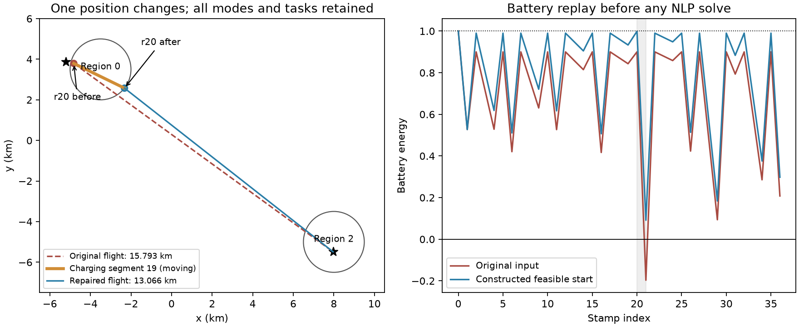

# R2e：初期位置を修復すると必要な充電を保てるか

2026-11-15。**前回未達のtau7-seed3を、原制約で初期位置も整えた後の直接開始で救済できた。**
最終平滑化NLPの両尺度KKT、原制約復元、電池に合格し、復元後**3.105837715 h**。
必要だった区間19の領域0での充電は、確認した全98内側点で保たれた。
ただし最初に計画した原制約初期化は3/4例で受理、tau7は不受理だった。その固定結果を保存した後、
別に事前計画した初期値の追加対照で救済した。最初から固定した一つの方法の4/4成功率とはしない。

## 最初に固定した比較（R2e-1）

[PLAN.md](PLAN.md)を5553c4d、コードを11e2c32へ保存してから求解した。
seed=3のtau=1,3,5,7を対象に、元の区間モード・充電領域・タスク担当時点・Nを固定し、
位置/e/s/cを可変にした原制約NLP（FixedBranch(moving=True)）を一度解いた。
Ipoptの設定と1500反復/30秒、受理条件はR2aの復元と同じ。
入力から元初期yを作り、R2dの保存値と全精度で一致することを確認した。以前の良解は初期値に使わない。

初期化が受理された場合だけ、R2c-4と同じ最終NLPへの直接開始と原制約復元を一度行った。
eps=.0005、p=12、delta=.001、R尺度、Newton最大300/gtol1e-8、ALの初期乗数0/rho=1e4、
最終120秒/600外側、復元1500反復/30秒は変えなかった。
位置だけでなく初期e/s/cも同時に改善する前処理であり、効果を位置変更だけの量的効果とはしない。

比較元のtau5/7の直接開始はR2dから再利用。未測定だったtau1/3の元初期点からの直接開始は新たに一度測った。
Gを通す結果は比較に混ぜない。同じseedの4サイズはタスク列を共有するので独立4標本ではない。

**R2e-1の固定結果は初期化3/4受理、その3例は最終の両尺度KKTと復元も受理。**
tau7の初期化は1500反復上限、返却KKT stat=.0353/feas=4161.82で不受理。
その点を直接開始に渡さず、同じ初期値での再試行や予算延長もしていない。
1e1c6b1へ[STATUS.md](STATUS.md)と全結果を保存した。この結果は追加対照後も変更しない。

## 追加の一因子対照（R2e-2）

tau7の初期化が止まったことは、元の充電14区間の選択が実行不能な証明にはならない。
別フォルダーの[PLAN](../2026-11-15-r2e-feasible-start/PLAN.md)をb3cd205、コードを8950dd5へ保存してから、
**同じ原制約NLPのx0だけ**を実行可能な構成点へ変えて一度解く追加対照を行った。
目的関数・制約・Ipopt・精度・予算は変えていない。[initializer.patch](../2026-11-15-r2e-feasible-start/initializer.patch)はx0設定の1行だけの差分。

構成は最適化をせず、次の操作だけを一度行った。

1. 区間19が領域0での充電、次の区間20が飛行であり、r20がタスクの固定点でないことを確認。
2. r20を、領域0の円内で次のr21に最も近い境界内側1e-3 kmの点へ移す。位置変更はこの1点だけ。
3. 各区間の移動に必要な時間を計算し、充電では電池0.99に達する時間も確保して、先頭から原モデルで電池を再積分。
4. 元制約・電池・タスク・密な履歴を検査。設定を何通りも試していない。

この構成点では飛行区間20が**15.793258→13.066142 km**、電池最小値は**−0.196754→0.091364**。
原制約違反5.6e-17未満、充電領域・モード・担当時点・Nは元のままだった。
したがって、元の充電14区間を保持した分岐は原実行可能である。
構成点そのものの時間は5.874915410 hで、最適解/KKT点とは扱わない。

## 原制約NLPと最終問題の結果

構成した点から同じ原制約NLPを解くと、**Ipoptは55反復で収束**。
原制約初期化は3.105837716 h、原違反5.6e-17未満、電池最小値約1e-8。
元初期軌道からの位置変化の最大値は2.704 kmだった（1点だけの構成後、NLPでは他の自由位置も最適化する）。

その点から同じ直接開始を行うと、**7外側・91内側受理点**で共通/物理変数の全KKT指標<=1e-6。
共通stat=9.15e-9、物理変数stat=3.29e-7、共通feas=7.61e-7。
平滑化点は3.105498691 h、最後の原制約復元で3.105837715 hとなった。
純モード電池不足のある平滑化点そのものと、復元後の原実行可能点は区別している。

全比較は以下。tau7の行は別に計画した追加対照である。

| 入力 | 元初期点の直接開始＋復元 h | 原制約初期化 h | 修復後の直接開始＋復元 h | 試行 |
|---|---:|---:|---:|---|
| tau1-seed3 | 0.656197991 | 0.656197991 | 0.656197991 | R2e-1 |
| tau3-seed3 | 1.085727316 | 1.085727317 | 1.085727316 | R2e-1 |
| tau5-seed3 | 2.252117624 | 2.250021367 | 2.250021367 | R2e-1 |
| tau7-seed3 | 未受理 | 3.105837716 | 3.105837715 | R2e-2：追加対照 |

修復後の4出力は充電2/6/10/14区間で、原制約違反<=5.6e-17、電池最小値約1e-8、両尺度KKTと固定分岐KKTに合格。
tau1/3は元の直接開始と同じ時間、tau5は約7.55秒短くなった。
Gの受理時間（tau1=.5960 h、tau3=.8838 h）はこれらの直接開始より短い。直接開始がGより良いという結果ではない。

**原制約の前処理ですでに、最終の復元と同じ時間の原実行可能解を得ている。**
最終ALが良い充電選択を新たに探し出したという証拠にはならない。
一方、同じ入力・Nのまま必要充電を保持し、最終平滑化KKTまで到達できることは確認できた。

## 原因としてどこまで言えるか

- R2dで直接開始が失敗した分岐は区間19の充電を失い、距離下界14.682 km>航続14.4 kmから実行不能だった。
- 今回、充電14区間の元の選択なら原実行可能点を構成でき、同じ原制約NLPと直接開始も通った。
  元の選択が本質的に不適切なのではなく、初期位置や電池と数値解法の経路が成否に効いていた。
- 同じ原制約NLPが初期値の変更だけで1500反復未達→55反復収束となった。これは初期値に対する数値的依存の具体例。
- 負電池だけが最終失敗の原因だったとは確定しない。tau5は元の負電池からも直接開始で回復し、今回の前処理は位置・e/s/c・目的値も変えている。
- 構成の0.99という充電目標や1e-3の内側余裕の一般的な優位性は測っていない。一つの失敗例を見て設計した対照である。
- 元の初期化が非実行可能なこと自体はALの使用条件違反ではない。著者が同じ初期化を使ったとは分からない。

## 検証・費用・保存

初期化は返却点と補正後の固定分岐KKT、成功フラグ、タスク厳密一致、原制約、電池を既存の受理関数で再評価した。
最終問題では初期AL勾配の独立Jacobian照合、全38外側・575内側受理点、AL更新、両KKT、原Jacobian停留性を確認。
中断点0。tau7の98内側点（91受理＋7開始点）すべてで区間19の領域0充電が保たれた。
新規23出力＋再利用した対照の計26出力をRustで照合し、厳しい原制約検査1e-10も通った。

R2e-1は最大4並列・各BLAS/OpenMP/MKL1スレッド、求解/復元/Python検証3.36秒。
R2e-2は1プロセス・各1スレッド、構成/初期化/直接開始/復元/Python検証3.47秒。
tau7の失敗した初期化も含む実測費用は4.38秒で、失敗を無かったことにしていない。
文書化・図・Rust照合の時間はこのドライバー時間に含めない。以前のG＋直接開始780秒とは方法が異なり、単純な高速化率を示さない。

`summary.json`はR2e-1の固定結果、`combined-summary.json`と[comparison.md](comparison.md)は追加対照を明示した集計。
追加実験の[REPORT](../2026-11-15-r2e-feasible-start/REPORT.md)と`charge19-check.json`に構成・検証を保存。
全精度の入力/状態/解/乗数を残し、内側ログはローカル保存してmanifestにhashを記録する。
依存ソース・環境・再利用先のhash、外部human文書のスナップショットも保存した。

## 次の段階

R2e-2の構成はケース名・区間19/20を固定した診断で、そのまま一般の初期化規則としては使えない。
次は**R2f：航続を超える飛行を入力から検出し、直前の充電領域内で位置を直す構成を一般化**する。
可能な範囲と不可能な範囲を判定し、元の良い初期軌道を不用意に変更しない。
設計に使った17例は回帰確認とし、タスク列を共有しない別seedの限定評価を先に固定する。
Gとの組合せ・900本・本体への採用は、その後の別評価とする。
今回の4出力と既存13例を合わせて、固定した一つの手法の17/17成功率とは主張しない。
本体src・過去の実験・900本の測定は変更せず、著者の数値再現は引き続き未達。
