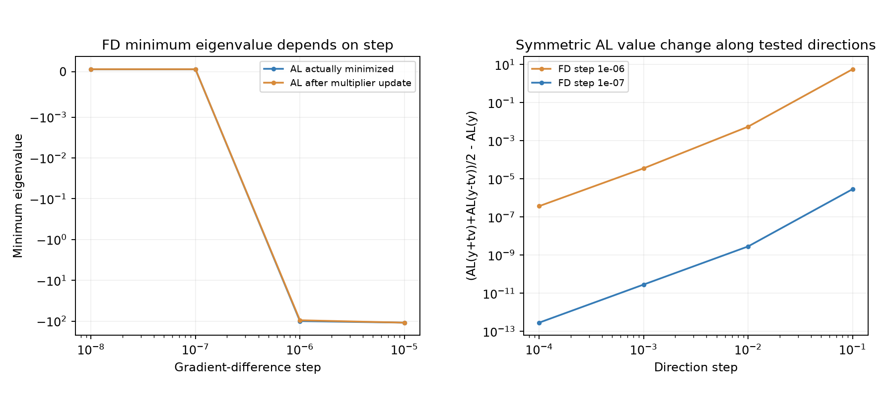
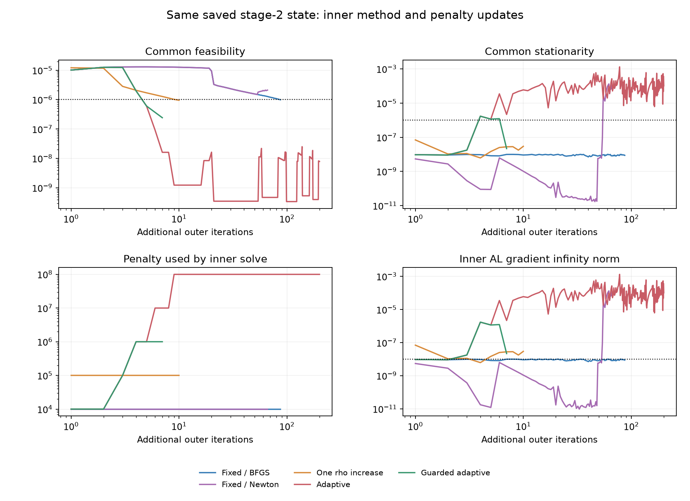

# 第2段階の未収束を切り分け、不要なペナルティ増加を修正した

2026-11-15。出発点5581585。事前計画はd5ee010、追加対照の計画は2df3c18。
調査の後、本体ALの増加条件を7065fd4で修正した。

**こちらのAL実装に、制約・相補性が許容値に入った後もrhoを増やす問題を確認した。**
同じ第2段階の保存点から、既存の自動増加は200回追加でもKKT未達だったが、
「制約・相補性が許容値内ならrhoを増やさない」という条件を一つ加えると7回で到達した。
両者の最初の5外側の点・乗数・使用rhoは完全一致し、5回目の次rhoの判断から分かれた。

ただし、第3段階はこの修正だけでは未収束だった。論文の最終数値再現が直ったとは言わない。
第2段階のKKTと、最終平滑化問題のKKT、原選言制約の実行可能性を分けて報告する。

## 1. どのALを解いたか、更新式に誤りがないか

対象は`fidelity/R-expanded`の第2段階100外側終了点。
N=37、eps=.12、p=2.4、rho=1e4、残差倍率を外し、速度は正の量で除した表現を使う。
100回目の内側が使った乗数は99回目終了のlambda/muで、保存終了点の乗数は更新後の100回目である。

両方を元のログから再構成し、値・勾配・乗数の更新が一致することを確認した。

| 評価 | 勾配の無限大ノルム |
|---|---:|
| 100回目が解いたAL（更新前の乗数） | 8.35571e-9 |
| 更新後のLagrangian | 8.35571e-9 |
| 更新後の乗数で定義される次のAL | 4.55556e-5 |

ALの更新式から、内側を解いたALの勾配と、更新後Lagrangianの勾配が対応する。
これは制約残差も小さいという意味ではない。次のALは別の乗数を使うので、勾配が再び生じる。
「内側の小さい勾配」と「AL外側が解決したこと」の混同や、更新前後を取り違えた評価ではなかった。
全勾配はJacobianとの積でも別に確認した。再構成データは`reconstruction.json`。

## 2. 鞍点と断定する証拠は得られなかった

解析勾配の中心差分からHessianを作り、4刻みで比較した。以下は100回目が実際に解いたAL。

| 刻み | 最小固有値 | 最大固有値 | 対称化前の最大非対称成分 |
|---|---:|---:|---:|
| 1e-5 | -108.96 | 32565.65 | 1818.86 |
| 1e-6 | -99.71 | 48616.55 | 1915.87 |
| 1e-7 | 5.74425e-5 | 48939.34 | 8.19e-5 |
| 1e-8 | 5.74425e-5 | 48939.34 | 9.65e-4 |

粗い刻みの負固有値だけを見ると鞍点に見えるが、非対称成分が大きく、細かい刻みでは最小固有値の符号と値が変わる。
粗い刻みで得た最小固有方向に±1e-4/1e-3/1e-2/1e-1を試しても、元のALの有意な対称低下は確認できなかった。
細かい刻みでは正の最小固有値がほぼ一致し、対称化した行列の条件数の推定は約8.5e8。
次のALでも細かい刻みの最小固有値は約5.764e-5で近い。

これらは局所最小の形式的証明ではない。非滑らかな切替面・差分誤差もあり、
数値的な正固有値だけで真のHessianの正定値性を保証しない。
今回言えるのは、BFGSが鞍点で止まったと断定する証拠がなく、非常に悪い条件が観測されたということ。
全行列・固有値・方向・実際のAL値は`hessians.npz`と`curvature.json`へ保存した。



## 3. 同じ更新後状態から、更新規則だけを比較

変数・乗数は全て100回目終了の同じ点。物理条件・eps/p・尺度を変えていない。
各最大200追加外側・90秒。内側BFGSはgtol=1e-8・最大2000、Newtonはgtol=1e-8・最大300・H差分1e-7。
共通KKTの全残差<=1e-6で第2段階の成功とする。

| 条件 | rho | 追加外側 | 停留性 | 実行可能性 | 第2段階 |
|---|---|---:|---:|---:|---|
| BFGS・固定 | 1e4 | 87 | 8.75e-9 | 9.91e-7 | 到達 |
| Newton・固定 | 1e4 | 66まで | 1.12e-4 | 2.11e-6 | 90秒で中断 |
| BFGS・一度だけ増加 | 1e5固定 | 10 | 2.95e-8 | 9.54e-7 | 到達 |
| BFGS・既存の自動増加 | 1e4→1e8 | 200 | 1.03e-4 | 7.85e-9 | 未達 |
| BFGS・許容値内の増加を制限 | 1e4→1e6 | 7 | 2.17e-8 | 2.43e-7 | 到達 |

到達した3条件は、倍率を外した残差・物理変数でのKKTも全成分1e-6以内だった。
内側の目標1e-8と外側の目標1e-6は別なので、precision loss終了でも外側KKTが合格する場合がある。
固定Newtonの時間切れから、二階情報が一般に無効だとは言わない。今回の刻み・予算で中断した結果である。

固定BFGSは、先行100回に87回追加すると到達した。第2段階100回の上限だけから収束不可能とは言えなかった。
rhoを一度10倍にする対照は10回で到達したが、結果を見て別のrhoを試す探索はしていない。
ペナルティの増加には効果がある一方、無条件に増やすと停留性を悪化させる具体例になった。



## 4. 増加条件に何が不足していたか

既存規則はV=max(feas,comp)が前回の1/4へ減らなければrhoを10倍にする。
追加5回目では、V=6.06422e-7で制約・相補性は合格だが、停留性が1.15683e-6と僅かに残った。
規則はまだrho=1e6→1e7へ増やし、その後1e8まで上げた。
最終的に制約は非常に小さくなったが、停留性が約1e-4で止まった。

追加対照では、増加条件へV>tol_feasを加えた。他の数値・内側・初期状態はそのまま。
最初の5回のy/lambda/mu/使用rhoは既存規則と完全一致し、5回目の次rhoだけが異なる。
rho=1e6を維持した対照は、そこから2回でKKTに到達した。
これは目標許容値を緩めた結果ではなく、同じ許容値に対する増加の判断を修正した結果である。

本体の`src/auglag.rs`へ同じ条件を反映した（7065fd4）。

```text
V > tol_feas かつ V > shrink * previous_V のときだけ rho を増やす。
```

既に制約・相補性が合格し、停留性だけが残るときは、不要な増加を抑える。
これは独自実装の修正で、著者の更新則を特定したものではない。

## 5. 第3段階には別の停滞が残った

元のadaptiveは第2段階で未達だったため、計画どおり後続段階の試験をしなかった。
修正版が第2段階を通過した後、同じ修正規則で第3〜13段階へ進める条件付き試験を行った。
各段階KKTへ達するまで進め、未達なら次へ行かない方式である。

第3段階は200外側・約23.61秒で上限停止。
制約残差3.69e-8、相補性2.04e-10に対し、停留性5.67e-5で未達だった。
初期の内側が最大反復で未収束の間にrhoは1e6→1e7→1e8へ増えており、
今回の「制約許容値に入った後の増加を防ぐ」修正が効く前に高いrhoへ達していた。

したがって修正は必要な改善の一つだが、全段階の再現を解決する十分な修正ではない。
次はこの第3段階の同じ開始点で、内側が未収束のままペナルティを上げる影響と、
段階間にlambda/mu/rhoを持ち越す影響を切り分ける。論文が軌道の持ち越しを述べる一方、
乗数とrhoの具体的な扱いは未確認なので、再現上の差として検査する。

## 6. 本体の回帰確認と、過去の数値との扱い

cargo testは11件全て通過。記録した追加5回目のKKTで不要な増加を防ぐ回帰条件と、
相補性が未達のときは従来の進捗規則を維持する条件を追加した。
releaseビルドも成功。

標準の本体CLIで、tau1/seed0、tau3/seed0、図1を修正前後で一度ずつ比較した。
入力・物理条件・初期軌道は完全一致し、この3件の最終軌道・目的値・原制約違反は全て同じだった。
今回の修正が効く状態に至らない経路もあり、標準3件の再現が改善したとは主張しない。
全入力に対する非退行性を保証する試験でもない。

900本の再評価はしていない。既存900本や過去の診断結果は修正前のバージョンの測定として保持し、
新しい本体の成功率へ読み替えない。
今回の粗い第2段階の目的値約1.3915 hも、論文の最終時間や原実行可能な解の性能とは比較しない。
原制約復元は今回は行っていない。

## 7. 保存と独立照合

- `curvature.py`、`reconstruction.json`：更新前ALと更新後Lagrangian/ALを正しい乗数で再構成。
- `curvature.json`、`hessians.npz`：差分精度・方向・実際の値の全記録。
- `cases/*/outer.jsonl.gz`：5条件の全状態・使用rho/次rho・停止理由。
- `follow-guarded/`：第3段階で止めた後続試験。`follow-skipped.json`は元規則の未達による中止。
- `verify.py`：570外側のAL更新・使用rhoの判断・両KKTを再評価し、元Jacobianでも停留性を確認。
- 修正対照の最初の5状態の完全一致、行列の固有値と固有方向、細かい刻みのHessian、全方向サンプルも再計算。
- `native/before,after/`：本体CLIの3対の出力とコマンド・バイナリ/ソースのhash。
- `cargo-tests.log`、`rust-validation.log`：11テストと、6継続出力＋6本体出力の元Rust照合。
- `analyze.py`は橋渡し出力のinitメタデータを実際の保存開始点へ補正する。解・状態・計算には変更しない。

最初のRust照合はmanifest.jsonも入力に含めてしまったため、入力選択で停止した。
対象を12の解JSONへ明示して再実行し、全て一致した。初回エラーも保存している。

Python環境・Rustブリッジはfidelity実験と同じ。新規実行は既存結果の上書きを拒否する。

```bash
python3 experiments/2026-11-15-stage2/curvature.py
python3 experiments/2026-11-15-stage2/continue_al.py
python3 experiments/2026-11-15-stage2/continue_al.py --guarded
python3 experiments/2026-11-15-stage2/analyze.py
python3 experiments/2026-11-15-stage2/verify.py
```

本体の前後パイロットは、それぞれの版をreleaseビルドしてからpilot.py before/afterを実行する。
analyze.pyとverify.pyは保存された状態だけを使い、新たな求解はしない。
