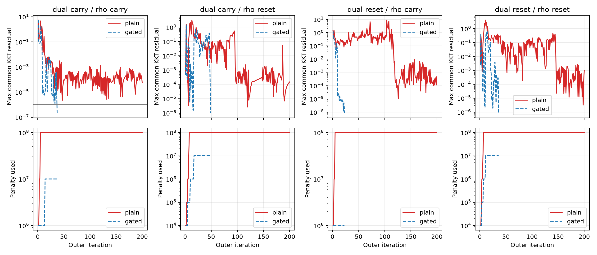

# 第3段階の停滞は改善したが、精度条件だけの本体適用は見送る

2026-11-15。基準713eaf1、事前計画303a7c1、追加の本体確認計画fb5da5d。

**内側が未収束のままrhoを増やす処理が、第3段階の停滞に影響していた。**
同じ開始軌道で乗数・rhoの持ち越しを変える8対照では、増加前に内側勾配の精度を要求すると、
4条件すべてが既定の共通尺度のKKTへ到達した。要求しない4条件はすべて200外側で未達だった。
乗数やrhoを初期値へ戻すだけでは解決せず、両方を持ち越しても精度条件を加えると到達した。

ただし、これで全体の解法が直ったわけではない。
後続の第4段階は再び停留性が残り、本体の自作L-BFGSへ同じ条件を加えた3例は原制約違反が悪化した。
このため、**今回の追加条件は実験用に残し、本体srcには適用していない。**
前回の「制約許容値達成後にrhoを増やさない」修正7065fd4は維持している。
論文の数値再現・100本ずつの成功率の再現は未達成のままである。

## 比較したもの

入力は前回の`stage2/follow-guarded/stage03-start.json`。
図1相当の同じ座標・物理条件・N=37、eps=.072、p=2.88、Rの残差/変数尺度を使う。
保存済みの原実行可能な良解から第1・第2段階を経た点なので、入力だけからの新規再現ではない。
それ以前の初期解生成や求解の費用は、今回の計測時間に含めない。

lambda/muを持ち越す/両方0へ戻す、rhoを1e6から持ち越す/1e4へ戻す、
内側精度条件を加える/加えない、の2×2×2。
全条件で初期の原始変数と近似制約は完全一致している。
内側は同じRust関数・解析勾配を使ったSciPy BFGS、gtol=1e-8、最大2000反復。
各条件の上限は200外側・60秒で、今回は時間切れはなかった。

基準のrho増加条件は、V=max(feas,comp)>1e-6、かつ前回Vの1/4へ減っていないこと。
追加条件は、**実際に解いた内側ALの勾配の無限大ノルム<=1e-6**である。
1e-8は内側の要求精度、1e-6は増加を許す判定で、solverのsuccessフラグだけでは判断しない。
乗数の更新式・頻度は変更せず、未収束の内側出力にも従来どおり乗数更新を行う。
これは特定の独自AL実装の対照であり、すべてのinexact ALで必要な条件だと主張しない。
著者のAL設定・許容値・持ち越し方法を特定した結果でもない。

## 第3段階の結果と尺度上の限界

| lambda/mu | 初期rho | 精度条件なし | 精度条件あり |
|---|---:|---|---|
| 持ち越す | 1e6 | 200回未達、stat=5.67e-5 | 37回到達、stat=2.16e-7 |
| 持ち越す | 1e4 | 200回未達、stat=1.45e-4 | 49回到達、stat=9.73e-7 |
| 0へ戻す | 1e6 | 200回未達、stat=4.84e-4 | 23回到達、stat=7.79e-7 |
| 0へ戻す | 1e4 | 200回未達、stat=1.04e-3 | 36回到達、stat=8.50e-7 |

到達は**事前指定の共通KKTで全成分<=1e-6**という意味。
共通KKTは元の二乗速度表現へ乗数を戻し、既存の変数尺度で停留性を測る。
物理変数へ戻して同じ1e-6を要求すると、到達4点の停留性は7.77e-6〜3.50e-5で、4点とも未達。
有限許容値の判定は尺度で変わるので、物理単位でも同じ精度に達したとは書かない。
`paper_units_kkt`という保存名も、著者がその判定を使ったことを意味しない。
許容値は著者の記載から確認できていない。

全持ち越し・精度条件なしの200状態は、前回の第3段階と点・乗数・rho・次rhoまで完全一致した。
同条件と精度条件ありの最初の2状態も完全一致し、2回目の次rhoの判断から分かれる。
基準は1e6→1e7へ増やすが、追加条件は内側未達のため1e6を保つ。
したがって今回の第3段階の差は、開始軌道や許容値の変更ではなく、この判断の変更で生じた。
精度条件なしは全て1e8に達し、ありは1e6または1e7で停止した。

詳しい残差・時間・物理変数での停留性は[matrix.md](matrix.md)。
グラフも共通KKTを示しており、原制約の実行可能性を示すものではない。



## 第4段階では別の停滞が残った

事前指定どおり「乗数0・rho=1e4へ戻す・精度条件あり」が第3段階を通過した場合だけ後続へ進めた。
他の条件の目的値を比較して勝者を選んではいない。
軌道だけを引き継ぎ、各段階で乗数0・rho=1e4へ戻す方式である。

第4段階（eps=.0432、p=3.456）は200外側・約41.72秒で上限停止した。
共通KKTはstat=6.14239e-5、feas=3.78169e-7、comp=2.94582e-9で、停留性が残る。
第5〜13段階へは進めていない。

rho増加は追加条件に反していない。
第3・7・15外側で内側勾配がそれぞれ1.07e-8、3.83e-7、3.79e-7まで小さくなった時点で、
rho=1e4→1e5→1e6→1e7へ増えた。その後は内側精度不足により1e7を維持したが、解けなかった。
最後のBFGSはprecision loss、内側勾配6.14e-5で停止している。
「未収束のとき増やさなければ全段階が解ける」という十分性は、この対照で否定された。
この粗い段階の目的値は論文の最終時間と比較せず、原制約復元も実施していない。

## 本体へそのまま加えると原制約が悪化した

第3段階の8条件を確認した後、追加計画を保存し、自作L-BFGSを使う本体でも一度ずつ比較した。
本体srcのコピーを一時ディレクトリでコンパイルし、変更はrho増加前に
`res.gnorm.is_finite() && res.gnorm <= o.tol_stat`を加える一点。
両版のコンパイラ設定、入力、初期軌道、標準の残差尺度・10/30外側・2000内側は同じ。
図1、tau1/seed1、tau3/seed1を各60秒上限で実行し、全て時間内に終了した。

| 入力 | 変更前の原制約違反 | 精度条件を加えた原制約違反 | 最終rho：前→後 |
|---|---:|---:|---:|
| 図1 | 2.96e-7 | 2.16e-2 | 1e8→10 |
| tau1/seed1 | 1.39e-6 | 9.06e-3 | 1e8→1e3 |
| tau3/seed1 | 1.57e-6 | 1.31e-2 | 1e8→10 |

KKTは変更前後とも3例全て未達。変更後の短い時間は制約違反を伴うので性能改善に数えない。
図1の目的値は1.958805→1.391384 hと下がるが、原制約違反が約0.0216あり、採用できる改善ではない。
原制約は混合単位の既存監査指標であり、純モードで再積分した電池監査とは区別する。

厳しい精度条件だけを足すと、標準設定ではrhoを低い値に保ったまま実行可能性の改善も進まない。
事前基準の「原違反が1e-6以上悪化」に3例とも該当したため、本体適用は見送った。
第3段階の診断と本体では尺度・初期点・内側法・予算が複数異なるので、
この差をL-BFGSとBFGSの違いだけへ帰すこともできない。

## 確認・保存と次の対象

`verify.py`は全1145外側について、AL値/勾配、乗数更新、両尺度KKT、rho判断を保存点から再計算した。
各最終点の停留性は元のJacobianと乗数の積でも独立に確認。
8条件の同じ原始変数・制約、明示したdual/rhoの相違、条件付き試験のリセットと停止条件も検査した。
計画に掲げた入力同一性の独立照合は、求解後に保存したinitial.jsonから実施した。
元のRust評価器で9診断出力と本体前後6出力を照合し、全て保存値と一致した。
これは読み戻しの一致であり、粗い段階や本体候補が原実行可能だという意味ではない。
本体srcは変更せず、従来のcargoテストは今回は再実行していない。

全精度状態は`cases/*/outer.jsonl.gz`と`follow/stage04/outer.jsonl.gz`、停止理由は各`result.json`。
本体候補の差分・ソース・コマンド・バイナリhash・3対の出力は`native/`に保存した。
保存時にコンパイルログの末尾の空行だけを整理した。
`provenance.json`は依存ソース、環境、評価ライブラリのhash、
`human-notes.tar.gz`はGit外の人間向け文書、`artifact-index.json`はこの実験の保存物一覧。
旧結果・900本の測定は書き換えていない。

次に固定して調べる対象は、**第4段階でrhoを増やす前後の、同一の内側AL部分問題**である。
同じ変数・乗数・rhoで内側法を比較し、反復不足、条件の悪さ、値の差が識別できない停止を分ける。
その上で、内側精度の達成と実行可能性の進捗を両立する更新にする。
現時点では、単一の精度条件や乗数リセットで本体全体が直るという証拠はない。
今回確認したのは独自実装の停滞の一因であり、論文のアルゴリズムの欠陥の証明ではない。

再実行にはfidelity実験と同じNumPy/SciPy環境と2本のRustブリッジを使う。

```bash
rustc --edition=2021 --crate-type cdylib -O experiments/2026-11-14-reproduction/bridge.rs -o /tmp/uav-fidelity-original.so
rustc --edition=2021 --crate-type cdylib -O experiments/2026-11-14-reproduction/bridge-speed.rs -o /tmp/uav-fidelity-speed.so
python experiments/2026-11-15-stage3/run.py
python experiments/2026-11-15-stage3/verify.py
python experiments/2026-11-15-stage3/analyze.py
python3 experiments/2026-11-15-stage3/native_pilot.py
```

run.pyとnative_pilot.pyは既存出力の上書きを拒否する。再求解する際は別の出力先を準備する。
verify.pyとanalyze.pyは保存点だけを読み、新たな求解はしない。
