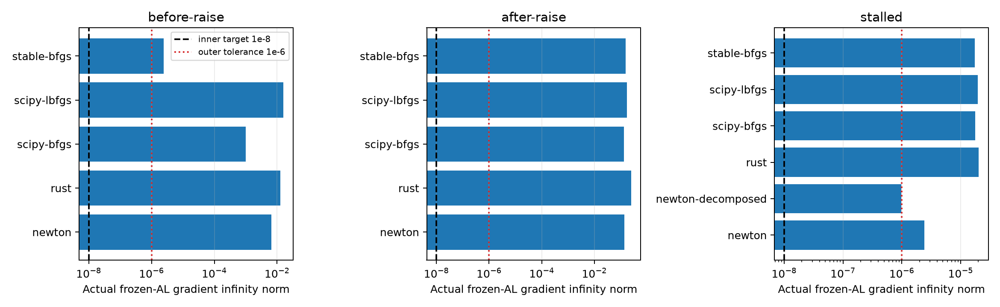
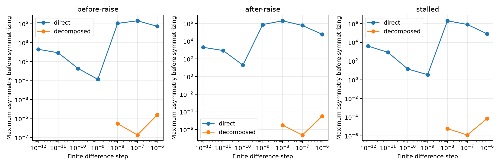

# 第4段階の内側精度と、PHRの切替をまたぐ差分Hessian

2026-11-15。基準f6fc84a、事前計画039eec5、追加の曲率診断計画41e3142。

**第4段階で使った診断用Newtonの二階情報に、改善できる点が見つかった。**
AL勾配をそのまま差分すると、不等式ペナルティの活性・非活性の切替をまたぎ、
大きく非対称な行列を得ていた。ペナルティ由来の曲率と、固定乗数の制約由来の曲率を分けると、
差分刻みへの依存を大幅に減らせた。

この二階情報に置き換えた診断用Newtonで、第200外側の同じ内側ALを再求解すると、
内側勾配は6.14e-5→9.76e-7となり、乗数を一度更新した点は**第4段階の共通尺度KKT**を満たした。
ただし内側の目標1e-8は未達で、物理変数に戻した停留性も3.51e-5ある。
粗い第4段階の点であり、最終問題のKKT・原実行可能性・論文の数値再現を達成したとは扱わない。

本体のL-BFGSはこの差分Hessianを使っていないため、「本体のバグを直した」とも言わない。
今回は本体srcを変更していない。値の計算だけを変える対照も実施したが、停滞を解決できなかった。

## 固定した3つの内側AL

前回の`stage3/follow/stage04`の全精度状態を使った。図1相当・N=37・R尺度、eps=.0432、p=3.456。
保存済みの良解から始めた経路の途中の点なので、入力だけから解いた再現ではない。

| 名前 | 開始点 | 固定乗数 | rho |
|---|---|---|---:|
| before-raise | 第15外側終了 | 第15外側終了 | 1e6 |
| after-raise | 同じ点 | 同じ乗数 | 1e7 |
| stalled | 第200外側終了 | **第199外側終了** | 1e7 |

最初の対はrho以外を完全に一致させた。最後は、元の第200外側が実際に解いたALである。
終了時に更新した乗数を使うと別のALになるため、更新前の第199回の乗数へ戻した。
求解前に値・勾配と第15/200外側の乗数更新を再構成し、一致を確認した。
内側の比較中は、乗数・rho・eps/pを一切更新していない。

## 最初の15対照では目標精度に達しなかった

自作L-BFGS、SciPy L-BFGS-B、SciPy BFGS、既存の差分Newton、値を因数分解したBFGSを比較した。
全て同じ数学的AL・解析勾配で、gtol=1e-8。
quasi-Newtonは最大2000、Newtonは最大300。SciPy/Newtonは各45秒、Rustは2000反復上限。
全条件が時間切れなしで終了した。
自作L-BFGSには新しいC ABIから同じPython評価を渡しており、Rの残差尺度も他の条件と同じである。

stalledの同じ開始点の結果は以下の通り。

| 内側法 | 出力の内側勾配 | 反復 | 停止理由 |
|---|---:|---:|---|
| 自作L-BFGS | 2.03e-5 | 3 | line search |
| SciPy L-BFGS-B | 1.95e-5 | 1 | 相対的な値の減少量 |
| SciPy BFGS | 1.76e-5 | 1 | precision loss |
| 差分Newton、刻み1e-7 | 2.41e-6 | 300 | 反復上限 |
| 因数分解した値＋BFGS | 1.75e-5 | 1 | precision loss |

通常のBFGSは3問題とも2000回の上限ではなくprecision lossで止まったので、
事前指定の追加8000回は行わなかった。単に反復上限を増やせば解決するという結果ではない。
因数分解したBFGSはbefore-raiseでは1.00e-3→2.47e-6へ改善したが、
after-raiseでは改善せず、stalledでも1e-8に達しなかった。
そのため事前指定の外側継続は行わず、`follow-skipped.json`を残した。

値の因数分解では、目的値は時間変数の差、等式の二乗差は(h-h0)(h+h0)、
PHR不等式も同じ活性区分では二乗差を因数分解して、long doubleで加算した。
勾配と制約は元のRustのままで、単に最後に定数を引いただけの実装ではない。
事前照合で同じ点の勾配が完全一致し、通常値とは定数差であることと方向差分を確認した。
それでもstalledが直らないことから、この値の評価方法の変更だけでは十分でなかった。
厳密計算ではなく、制約値自体の丸めも残るので、値の丸めの影響を完全に排除したとも言わない。

全15対照と追加1対照の数値・時間は[comparison.md](comparison.md)。
時間には評価履歴の記録費用を含み、過去の初期解生成費用は含めない。



## 差分の刻みがPHRの切替をまたいでいた

不等式のAL勾配にはmax(0,mu+rho*g)が現れる。
この切替の近くで座標ごとの中心差分を取ると、列ごとに異なる活性区分を混ぜた行列になる。
単純に対称化しても、正確な局所Hessianになるとは限らない。

実際の差分サンプルで活性集合を比較したところ、stalledでは以下の切替を観測した。

| 刻み | 切替をまたぐ変数方向 | 切替をまたぐ不等式 |
|---:|---:|---:|
| 1e-6 | 97 | 48 |
| 1e-7 | 95 | 43 |
| 1e-8 | 61 | 35 |
| 1e-9 | 0 | 0 |

1e-7のHessianの最大非対称成分は8.12e5、1e-9では3.44まで下がった。
さらに刻みを小さくすると差分で丸めが増幅し、1e-12では3.93e3へ増えた。
「刻みをもっと小さくすればよい」という単調な改善ではない。
最も近い切替面までの座標方向の一次推定距離は、stalledで約1.96e-9、
after-raiseでは約1.31e-12だった。入力点ではmu+rho*gが厳密に0の行はなかった。
これらは局所的な一次推定であり、厳密な切替距離や誤差境界ではない。

初回の追加解析は別ディレクトリの同名curvature.pyを読み、引数不一致で停止した。
ローカルファイルを明示して読み込むよう修正し、解析だけを再実行した。
最初のエラーログも保存し、求解・状態の再試行はしていない。

## Hessianを分解する診断

切替面上でない点では、ALのHessianは次のように計算できる。

```text
a = lambda + rho*h
b = max(0, mu + rho*g)
H_AL = H_L(a,b) + rho*J_h^T J_h + rho*J_g(active)^T J_g(active)
```

H_Lだけを、a,bを固定したLagrangianの解析勾配から差分した。
ペナルティ由来の項は元のJacobianから直接作る。
活性集合を固定するのはこの二階情報の計算だけで、元の目的関数・勾配・制約を変更していない。
切替面上では通常Hessianが存在しない場合があり、この式を無条件に適用できるとはしない。

stalledの分解Hessianは、H_Lの刻み1e-6/1e-7/1e-8で最大固有値約4.86137e7、
最小固有値約-2.26e-6となり、最大非対称成分は7.02e-5/1.23e-6/5.88e-6へ減った。
before-raiseでは最小約3.45e-6・最大約4.86e6で、正の近似行列の条件数推定は約1.41e12。
after-raiseでは最小約-0.220・最大約4.86e7だった。
高いrhoで強い曲率と非常に弱い曲率が共存するため、内側にとって厳しい問題になっている。

これらは差分と浮動小数点の推定値であり、特にstalledの小さな負固有値から鞍点とは断定しない。
そもそも勾配が0の点でもない。最初の粗いHessianに基づくNewton方向も、
局所の二次予測と実際の値の変化が合っておらず、正しいNewton方向としては使えなかった。
通常値・因数分解した値・勾配の線積分と予測は`direction-checks.json`に保存した。



## 二階情報だけ変えた追加Newtonは共通尺度KKTに届いた

最初の15対照の結果を見た後、追加計画をコミットし、stalledだけを一度比較した。
既存のtrust-region Newtonで、Hessianだけを刻み1e-7の分解形へ置き換えた。
通常値・解析勾配、gtol=1e-8、最大300、45秒、trust-regionの受理規則は同じ。
小さい予測減少のとき勾配ノルムを用いる、以前からの診断用の規則も維持した。

約0.55秒、17反復でstuck停止。内側勾配は9.75674e-7で、要求1e-8へは未達だった。
しかし更新前の第199外側の乗数から、一度だけ元のAL式で乗数を更新すると、
第4段階の共通KKTは次の値となった。

| 指標 | 値 |
|---|---:|
| 停留性 | 9.75682e-7 |
| 実行可能性 | 3.78170e-7 |
| 相補性 | 2.84060e-9 |
| 双対非負性違反 | 0 |

全て事前の共通許容値1e-6以内。元のJacobianと乗数の積でも確認した。
この状態は`cases/stalled/newton-decomposed/one-update-state.json`へ保存した。
第200外側の出力を同じALから別の内側法で作り直した比較であり、
第200外側終了の更新済み乗数から17外側を追加したわけではない。

物理変数での停留性は3.51246e-5で、同じ1e-6では未達。
また原制約違反は約0.0264あり、粗い近似問題のKKTが原制約を保証しない点も残る。
新しいNewtonを、事前指定のstable-bfgsに代えて外側継続へ採用することはしていない。
第5段階以降と原制約復元は今回は実施していない。

## 検証・保存と次の作業

16出力のAL値・解析勾配・固定乗数・仮の一回更新の両尺度KKTを再評価した。
内側勾配と元表現の停留性は、Jacobianとの積でも独立に照合。
分解Hessianの再構成と、実際のAL勾配の方向差分との相対差約2.7e-5〜2.9e-5も確認した。
この有限刻みの方向照合は、小さい固有値の符号を保証する精度証明ではない。
元のRust評価器でも16の解JSONが保存値と一致した。原実行可能性の合格とは区別する。

各条件の入力・出力・全評価呼出しの値と勾配ノルムは`cases/`に保存し、
SciPyの受理点は`accepted.jsonl.gz`にも記録した。Newtonの差分試行点やRustの受理点を
全て保存したものではない。全体の評価ログは334879呼出し、全行列・固有値も保存した。
分解Newtonでは、別途6426の勾配評価と18のJacobian構成がある。
これらは`hessian_gradient_calls`と`hessian_jacobian_calls`で区別し、呼出し回数だけで速度を比較しない。

次は、この二階情報を使う診断用ALを、今回保存した第4段階KKT点から後続段階で検証する。
最終問題まで通るか、必要な充電を保つか、原制約へ戻したときにどうなるかを別々に確認する。
本体のL-BFGSへ取り込む前には、内側問題の尺度・前処理と限定比較も必要である。
診断の修正を著者のMATLAB実装の欠陥と読み替えず、100本ずつの再現は未達のまま記録する。

再実行はfidelityと同じPython環境と評価ライブラリを使用する。

```bash
rustc --edition=2021 --crate-type cdylib -O experiments/2026-11-15-stage4-inner/callback.rs -o /tmp/uav-stage4-callback.so
python experiments/2026-11-15-stage4-inner/support.py
python experiments/2026-11-15-stage4-inner/run.py
python experiments/2026-11-15-stage4-inner/curvature.py
python experiments/2026-11-15-stage4-inner/decomposition.py
python experiments/2026-11-15-stage4-inner/run_decomposed.py
python experiments/2026-11-15-stage4-inner/switches.py
python experiments/2026-11-15-stage4-inner/verify.py
python experiments/2026-11-15-stage4-inner/analyze.py
```

求解・初期照合・行列解析は既存の結果の上書きを拒否する。別の出力先で再実行すること。
検証と集計は保存点を読み、新たな求解を行わない。
環境・依存ソースのhashは`provenance.json`、Git外文書は`human-notes.tar.gz`に保存した。
