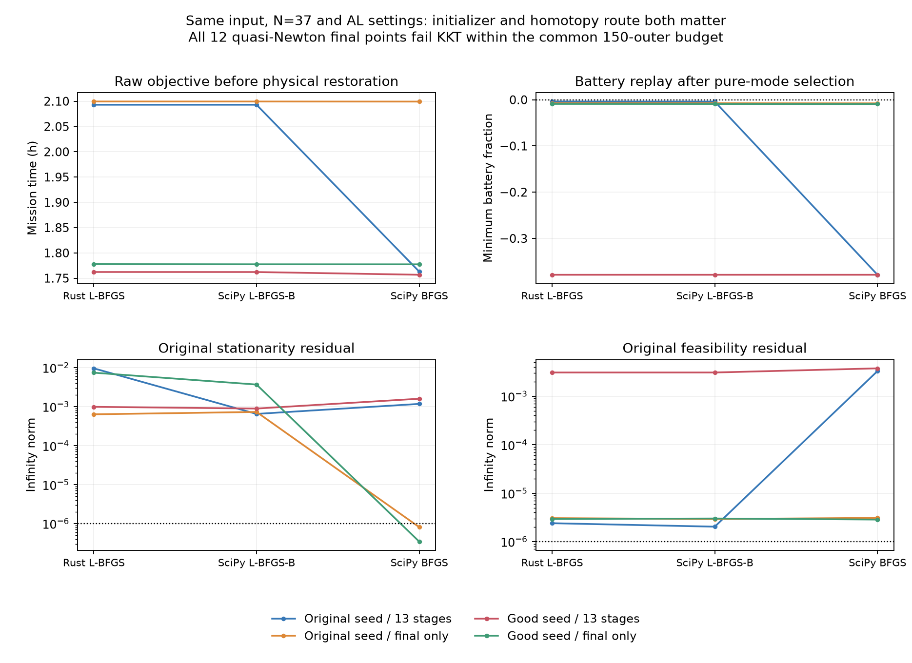
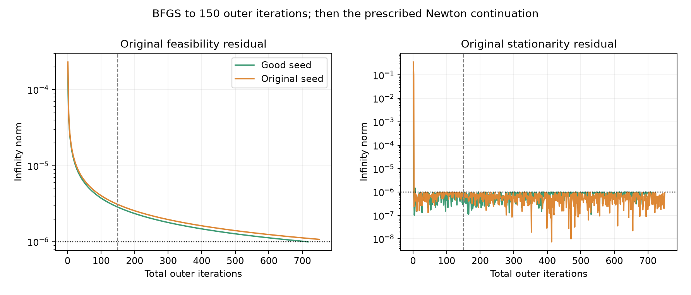

# 良い初期解からなら、良い目的値のKKT解と原制約復元へ進めた

2026-11-15。出発コミット7b049e0。計画は`PLAN.md`（c5e6793）、
元の初期軌道から直接開始する追加対照は65d0fb7で実行前に保存した。
本体src・物理条件・N=37は変更していない。

**保存済みの良い原実行可能解から最終平滑化問題へ直接進めば、約1.77817 hで元表現KKTへ到達した。**
その点の純モード電池不足も、約3.08秒の費用で修復し、原制約を満たす約1.77903 hの解を得た。
一方、同じ良い初期解でも粗い13段階を通すと、3実装とも必要な充電を失った。
元の初期軌道からの直接開始では、原制約復元後も約2.10047 hだった。

これにより、良い目的値の最終平滑化KKT解が存在しないために再現できていない、という説明は退けられる。
今回の入力では、初期軌道の充電選択・平滑化を通る経路・最後の精度がそれぞれ影響した。
著者の初期化・MATLAB実装・各100本の分布を再現した結果ではなく、数値再現の未達は維持する。

解釈の補足：[「論文のやり方でも下がらない」と読む前の再点検](INTERPRETATION.md)。
良い原実行可能点も粗い平滑化問題には実行可能とは限らず、目的値の低下と原実行可能性を分ける。
再現を優先する次の作業は、初期化改善の前に、残差尺度と段階内の求解精度の相違を点検する。

## 1. 初期点と比較条件

良い初期点は`../2026-11-14-resume/fixed-modes/default-fig1-fixed-modes.json`。
独自実装の出力を以前に修復した、約1.857480834 h・純モード最低電池0.020263の解である。
著者の解や未公開データではない。使う前に原制約・電池を再検査し、元Rustでも照合した。
全精度のRust変数への変換と逆変換、タスク・端点・モデルの一致も確認した。

内側は前回と同じ自作L-BFGS、SciPy L-BFGS-B（境界なし）、SciPy BFGS。
Rustの同じAL値・解析勾配・正の量で除した速度制約、rho=1e4固定を使った。
初期乗数は0。モード・領域・タスクの担当時点は最適化中に固定していない。

- 直接開始：最終eps=.0005・p=12を最初から使い、最大150外側。
- 13段階：eps=.2・p=2から、各10外側・最終30外側、合計150外側。

各内側最大2000反復・gtol=1e-6。他の探索・停止設定も前回と共通。
各条件120秒、順次実行し、時間切れ・再試行はなかった。
直接開始は最終問題を150回、13段階は最終問題を30回しか解いていない違いがあるため、
直接開始の30外側時点も`checkpoint30.json`へ保存した。30回では直接開始もKKT未達だった。

追加対照は元のRust初期軌道をuav_initialから全精度で保存して使った。
前回の標準初期軌道・13段階の3条件も再利用し、初期点×段階×3内側の比較にした。
再利用した初期変数・乗数・rhoと、新しい直接開始のものが一致することも検査した。

## 2. 同じ150外側での比較

以下は最終平滑化点の値。元制約へ復元する前なので、負の電池を持つ目的値は改善成功とは数えない。
KKTは速度の乗数を元の表現へ戻し、停留性・実行可能性・相補性・双対非負性を全て1e-6で判定した。

| 初期点・経路 | 自作L-BFGSの時間[h] | SciPy L-BFGS-B | SciPy BFGS | 純モード電池・復元 |
|---|---:|---:|---:|---|
| 元の初期点・13段階（前回再利用） | 2.093058 | 2.093053 | 1.762961 | 前二者は小さい電池不足、BFGSは必要な充電を失う |
| 元の初期点・直接開始 | 2.099492 | 2.099431 | 2.099311 | 最低電池約-0.0075〜-0.0077、3条件とも原制約復元に成功 |
| 良い初期点・13段階 | 1.762198 | 1.762156 | 1.756727 | 3条件とも最低電池約-0.3786、固定分岐では復元不能 |
| 良い初期点・直接開始 | 1.777780 | 1.777472 | 1.777399 | 最低電池約-0.0089〜-0.0092、3条件とも原制約復元に成功 |

12条件の150外側終了点は、全て最終KKT未達だった。
良い初期点・直接開始のBFGSでは停留性3.44e-7、実行可能性2.85e-6で、残ったのは主に実行可能性だった。
元の初期点・直接開始のBFGSも停留性8.09e-7、実行可能性3.09e-6だった。



## 3. ニュートン法の追加継続

計画どおり、直接開始のBFGS保存点を、最終問題とrho・許容値を変えずに一度だけ継続した。
過去に使った診断用ニュートン法で、差分ヘッセ行列刻み1e-8・内側最大300、
追加最大600外側・300秒。結果を見て刻みや上限を変えていない。

| 初期点 | BFGS外側 | 追加外側 | 停留性 | 実行可能性 | 最終時間[h] | KKT |
|---|---:|---:|---:|---:|---:|---|
| 良い初期点 | 150 | 567 | 9.64211e-7 | **9.9999483e-7** | 1.778173413 | 達成 |
| 元の初期点 | 150 | 600 | 9.42344e-7 | 1.0757573e-6 | 2.100080552 | 未達、上限停止 |

良い初期点の相補性は7.56e-11、双対非負性違反は0。
合計717外側で、BFGS約19.65秒＋ニュートン約38.76秒＝約58.41秒だった。
元の初期点は合計750外側、約67.48秒で、許容値を僅かに上回ったまま止めた。
これは許容値到達が不可能という証明ではなく、事前上限内では未達という結果である。

時間には保存済み初期解の生成費用を含まない。
良い初期解は以前に独自ソルバー約12.10秒＋後処理約0.006秒で生成したもので、
58.41秒だけを論文の計算時間と比較しない。今回のNewton使用も論文のL-BFGSとは異なる。



## 4. KKT点と、原制約を満たす点を区別して確認する

最終平滑化KKT解でも、純モードへ戻した電池最低値は約-0.005411だった。
そのため、各出力について担当時点・モード・領域を固定し、原CC-CV・速度・領域・上下限で
位置・時間・電池を一回ずつ再最適化した。
旧復元のFixedBranchと同じ内部電池余裕1e-8・IPOPT設定で、各5秒・1500反復。
選択を変える探索は行っていない。

| 出力 | 復元前[h] | 復元後[h] | 増加秒 |
|---|---:|---:|---:|
| 良い初期点・自作直接開始 | 1.777780208 | 1.779030001 | 4.50 |
| 良い初期点・SciPy L-BFGS-B直接開始 | 1.777472195 | 1.779030001 | 5.61 |
| 良い初期点・BFGS直接開始 | 1.777399120 | 1.779030001 | 5.87 |
| 良い初期点・KKT到達後 | 1.778173413 | 1.779030001 | **3.08** |
| 元の初期点・各直接開始 | 約2.0993〜2.0995 | 約2.1004732 | 約3.53〜4.19 |
| 元の初期点・追加継続後 | 2.100080552 | 2.100473221 | 1.41 |

良い初期点から直接開始した3実装とKKT到達後の出力は、復元すると同じ時間へ到達した。
これは固定した分岐の同じ目的値への到達であり、全モードを含む大域最適性の証明ではない。
KKT到達後の復元点は、原制約違反4.17e-17未満、電池最低値約1.0063e-8。
原制約NLPの固定分岐KKTもstat<8e-13、feas<1.2e-15、comp<9.48e-9、dual=0で合格した。
元Rustの原制約評価・密な電池履歴でも照合した。

**1.77817 hの平滑化KKT点と、1.77903 hの原実行可能な復元点は別の点・別のKKT判定である。**
後者を平滑化ALのKKT成功として数えず、出力のmetrics.convergedはfalseにした。
論文の読取値約1.8932 hより小さい原実行可能解は得られたが、
入力の読取誤差・N・初期化・解法が異なるため、論文の性能を再現または上回ったとは主張しない。

## 5. 粗い13段階を通すと失ったもの

良い初期点から13段階を通した3実装は、最初の充電前にタスク1・2・3を担当する分岐へ進んだ。
このモードと担当時点のままタスク座標を厳密に復元するには、
r0→a1→a2→a3の距離だけで16.436329 km必要だが、純放電の上限は14.4 kmである。
三角不等式と電池容量から2.036329 km不足するので、固定した分岐の連続復元は不可能。
IPOPTのInfeasible_Problem_Detectedだけを根拠にしていない。
各出力の担当時点・モードと下界は`prefix-certificates.json`に保存して再検査した。
別の担当時点や充電の選択へ変えた全問題の実行不能性を主張するものではない。

同じ良い初期点を使った直接開始では、3実装とも原制約復元に成功した。
さらに、最終問題へ使った反復数が違っても、担当時点とモードの選択が既に復元不能であるという
幾何的な違いは、最後の外側回数を増やすだけでは修正できない。選択を変える必要がある。
粗い段階の影響がある具体例だが、どのeps・pなら全入力で良いかは今回評価していない。

## 6. 次の修正対象

この対照では、良い目的値のKKT解と原実行可能解を同じ入力・Nで構成できた。
一方で、良い初期点を与えるだけ、粗い段階を省くだけ、ライブラリを交換するだけでは十分でなかった。
したがって、次は**保存済みの良い解を使わず、入力から良い充電の選択を持つ実行可能な初期軌道を作る**手順を検証する。
不要な充電を減らす原制約での初期化と、必要な充電を失わない段階移行が修正候補になる。
今回の近い数値を出すために、N・物理係数・近似係数を調整する方針には戻らない。

初期軌道と段階移行の効果を図1以外の固定例で確かめ、その後に各100本を再評価する。
著者のコードがなく、MATLABそのものも未実施のため、著者の実装が同じ問題を持つとは断定しない。

## 7. 保存・検証・再実行

- `controls.py`：良い初期点の6条件と事前指定した継続。`default_control.py`：元の初期点の追加3条件と継続。
- `runs/*/initial.json`、`stage*-start/end.json`、`outer.jsonl.gz`：全精度状態・乗数・候補・停止理由。
- `newton/`、`newton-default/`：追加継続、親状態、反復数と時間、全精度チェックポイント。
- `restore.py`、`restored/*/solver.json`：原制約復元の全生出力。11件のうち8件成功、3件失敗も保持。
- `verify.py`：今回の全2517外側のAL更新・元表現KKT、原Jacobianとの独立な勾配積、復元8点を再検査。
- `prefix-certificates.json`：復元不能な選択の幾何的下界。前回のBFGSを含め4件を別に再計算。
- `seed-tests.log`、`seed-rust-validation.log`：原実行可能な初期点と往復変換の検査。
- `rust-validation.log`：11未復元出力と8復元出力をRustで照合。未復元点の読み戻し一致と実行可能合格を区別する。
- `summary.json`、`comparison.csv`：前回3条件の再利用を明記した集計。

Python環境とRustブリッジは前回library-traceと同じ。既存の実験ディレクトリへの上書きは拒否する。
新規ディレクトリで順に次を実行する。NumPy/SciPy/CasADiの既存環境は再現実験のENVIRONMENT.mdを参照。

```bash
python3 experiments/2026-11-15-warm-start/test_seed.py
python3 experiments/2026-11-15-warm-start/controls.py
python3 experiments/2026-11-15-warm-start/restore.py
python3 experiments/2026-11-15-warm-start/default_control.py
python3 experiments/2026-11-15-warm-start/restore.py --default-only
python3 experiments/2026-11-15-warm-start/analyze.py
python3 experiments/2026-11-15-warm-start/verify.py
```

analyze.pyとverify.pyは保存された結果だけを使い、求解は行わない。
