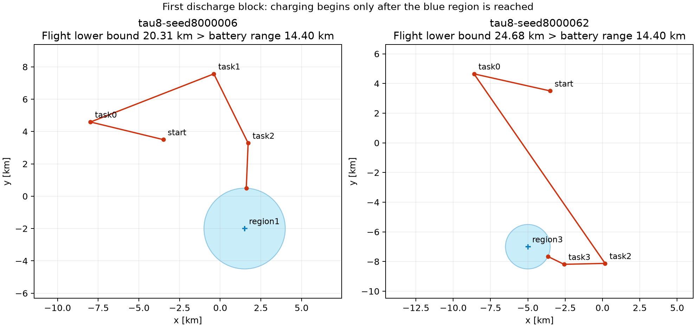

# 未達2点は、選択された分岐のままでは原実行可能解にならない

2026-11-17。計画/コード/入力固定 `b085b09`。[計画](PLAN.md)。新規求解0。

**両点とも、現在のタスク訪問stampと充電/放電モードを固定した分岐は実行不能と証明できた。**
初回充電までに必要な飛行距離の下界が20.310 km・24.684 kmあり、満充電の航続距離14.4 kmを超える。
充電領域内で端点を動かせる自由を含めても超えるので、単に今の軌道の電池が不足しているだけではない。
**割当を変えないまま精度・反復を詰めても、この分岐から原制約の解は得られない。**
これは原問題全体や平滑化問題全体の実行不能の証明ではない。

各図は固定タスクを通って最初の充電領域へ入る最短折れ線。領域中心へ飛ぶ長さではなく、最も近い境界点までの距離を使っている。[PDF](infeasible-flight-blocks.pdf)。

## 分岐の距離下界

放電ではc=0で、電池はzeta*sだけ減る。速度制約から放電時間は飛行距離/v_d以上であり、途中で充電しないブロックの距離は最大でもv_d*(e_max-e_min)/zeta=14.4 km。
端点が半径rhoの領域にある場合、固定点からの距離はmax(0,中心までの距離-rho)以上、両端が領域なら両半径を引く。
訪問順の固定タスク間距離も加えた保守的な下界で判定した。実際の現在位置や領域中心間の距離をそのまま下界にはしていない。
数値/座標丸めに対して1e-6 kmの余裕を要求した。添字は0始まり。

| case | 放電区間 | この間のタスク順 | 距離下界 km | 航続距離超過 km |
|---|---|---|---:|---:|
| tau8-seed8000006 | 0〜21 | 0→1→2 | 20.310164 | 5.910164 |
| tau8-seed8000006 | 23〜35 | 5→3→6→4 | 15.896579 | 1.496579 |
| tau8-seed8000062 | 0〜20 | 0→2→3 | 24.683978 | 10.283978 |
| tau8-seed8000062 | 30〜38 | 6→4→7→1 | 14.638736 | 0.238736 |

それぞれ最初のブロックだけで不可能性を証明でき、後半にも別の違反がある。
元の原初期点には16充電区間あり、選択は最終4区間/5区間へ変わっている。元の充電位置で放電に変わった区間は15/13（新しい位置で充電になった区間もあるため、区間数の純減とは異なる）。

## どの段階で生じたか

初段終了時は両例とも最小zによる候補選択が全区間放電となり、その割当では必要距離が53.248/59.207 km。
これは**候補選択上の放電**であり、実際のcが0だったという意味ではない。粗い平滑化問題の途中点に、原実行可能な分岐を要求できるわけでもない。
その後、1例目は第3段階で4充電区間、2例目は第4段階で5充電区間となるが、今回の距離下界違反は第13段階まで残った。

最終段階では、元の充電位置で現在は放電を選ぶ区間における非選択候補の最大の正規化微分シェアでも4.43e-37/2.30e-32以下だった。
局所微分が現在の選択へ強く偏っている観測であり、「もう分岐変更できない」との数学的証明ではない。
Gは中間未収束でも外側10回で次へ進む診断経路なので、この挙動を著者の厳密な段階収束の結果や論文の欠陥と同一視しない。

## 最大残差だけを見ると見落とすこと

全精度y/scaleから別のPython実装で672制約行を再計算し、全26段階の保存KKTの実行可能性・相補性と2e-8以内で照合した。停留性は再計算していない。
最終672行はRustの保存版評価器でも全行照合し、最大絶対差7.11e-15だった（[結果](native-model-check.json)）。

- seed8000006の最大不等式違反は区間24の時間下限。30秒に対して約1.375秒短い。最大等式違反は電池ダイナミクスで、元尺度0.00452022。
- seed8000062の最大実行可能性違反は電池ダイナミクス、元尺度0.00945860。不等式では時点21の電池下限が0.00046614不足。
- 同例の最大相補性違反は区間2の時間下限。下限から2.614秒離れた点に正の乗数が残っている。

これらの小さい時間/電池違反だけを射影しても、分岐全体の航続距離不足は解消しない。
最終点の放電選択区間にも合計272.4/368.8秒のcが残り、c=0として純モードで電池を再計算すると最小値は−0.4103/−0.7140。
保存電池変数の最小値−0.000314/−0.000466より不足が大きい。充電/放電の選言が満たされない点を、電池変数だけで実行可能と読まない。
各区間の保存eを使って評価した放電選択区間の局所的な余分の電池増加は計0.5074/0.7177だが、途中充電の非線形性があるため、これを純モード再計算との差と等置しない。

## 比較対象と限界

seed8000062の原初期点は原監査を通る一方、Gは原実行不能な割当へ移った。
seed8000006の原初期点は電池が0.002301不足しており、初期点そのものを実行可能と数えない。
最終返却点は両例とも16充電区間を持つ補助経路の原実行可能点で、今回も独立監査を通った。
距離下界を満たすことは必要条件であって十分条件ではない。

4単体検査、独立コードによる全30点の区間被覆/タスク順/領域端点/距離下界、672制約行、26段階のKKT成分との照合が通過。
返却点のタスク座標は原入力と最大1e-9 km以内の表現差があり、独立検算では各点自身の保存座標を使って確認した。過去の成果物は変更しない。
[検算](verification.json)、[段階別表](points.csv)、[制約全行](final-constraints.csv)、[詳細](summary.json)、[電池診断](energy-detail.json)。

次は成功対照にも同じ分岐下界を当て、途中に不可能な候補割当が現れても最終で回復するかを確認する。
それを見ずに、途中の下界違反だけで一律停止する規則は入れない。新たな900件や予算調整は行わない。
