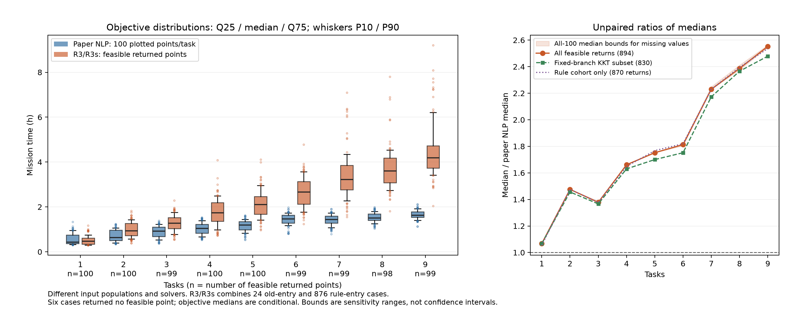
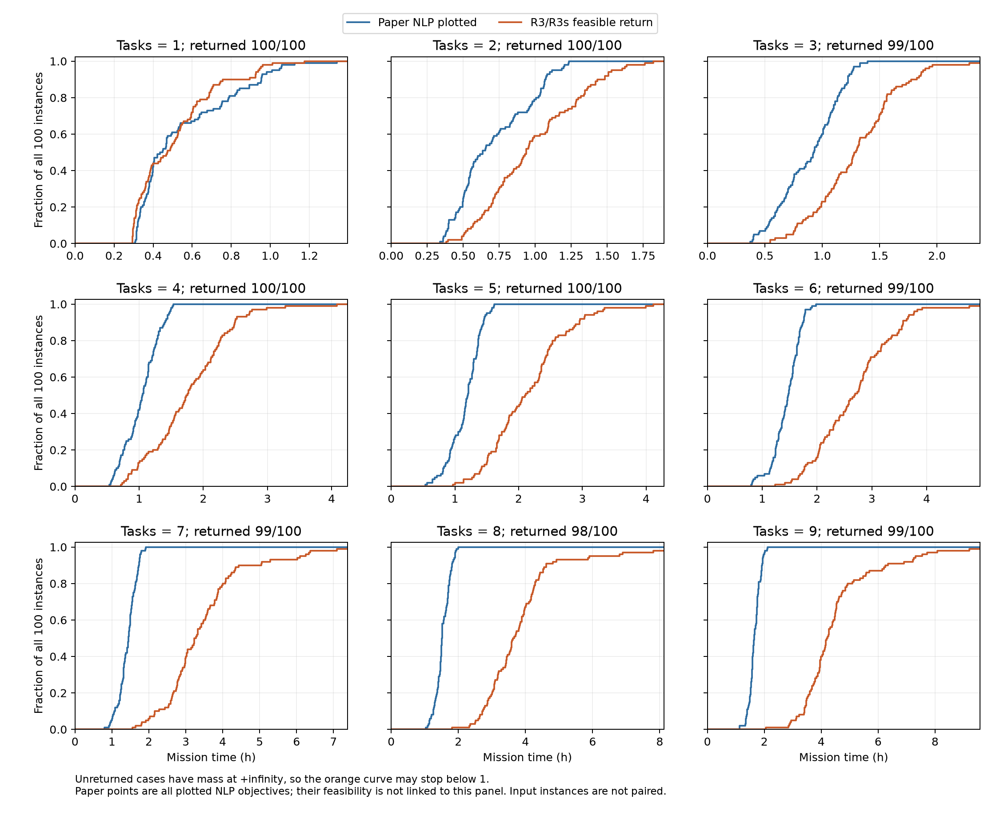

# 固定900と論文図3：多タスク側の目的値分布には大きな差が残った

2026-11-17。基準b127bee、比較条件/コード/入力hashを9520db2へ保存してから集計した。
保存済みデータだけを使い、新しい求解や元結果の上書きは行っていない。

## 結論

**原実行可能な返却点を894/900件得られたが、図3のNLPの目的値分布は再現していない。**
中央値の比はタスク数1で1.07倍、7/8/9で2.23/2.39/2.55倍。
固定分岐KKTを通る返却点だけでも多タスク側の差が残り、返却なし6件の扱いだけでは説明できない。
ただし著者と入力集団・初期化・N・実装等が一致しないため、同じ問題での解法の優劣や最適性ギャップとは解釈しない。



## 対象と目的値の意味

- 手元はR3sの固定900件、各タスク数100件。旧R3の24件と、外側停滞の打切り規則入り876件の混合集計。
  894件の原実行可能返却点を主対象とし、そのうち固定分岐KKT付き830件も別に集計した。
  AL終点の共通KKT863件とは点が異なるため、863件を返却点の証明数へ読み替えない。
- 目的値は`selected_hours`のミッション時間[h]。全894点の`metrics.objective`と`solution.s`の和を照合した。
  `metrics.seconds`は求解時間であり、この比較に使っていない。選択ファイルのhashも元のoutcomeと一致した。
- 返却なし6件は`cases.csv`の900行に欠測として残した。0や成功点へ置き換えていない。
- 参照は[既存の図3読取CSV](../../data/paper_fig3.csv)のNLPの目的値900点、各タスク数100点。
  [抽出手順](../2026-11-14-paper-figures/REPORT.md)でPDFからの再生成が一致した版を使用。
  表示桁数は保存値の桁数であり、描画データと軸換算の読取精度を保証するものではない。
  異なるパネル間で問題例を対応づけられないため、論文の違反点を目的値から選別していない。
  **論文はNLPの全描画点、手元は実行可能返却点**という条件差がある。

## タスク数ごとの中央値

| tau | 返却/100 | 固定分岐KKT | 論文NLP h | 手元 h | 比 | 差 分 |
|---:|---:|---:|---:|---:|---:|---:|
| 1 | 100 | 100 | 0.442941 | 0.472632 | 1.067 | 1.78 |
| 2 | 100 | 96 | 0.634938 | 0.937019 | 1.476 | 18.12 |
| 3 | 99 | 95 | 0.927175 | 1.277214 | 1.378 | 21.00 |
| 4 | 100 | 94 | 1.050165 | 1.744195 | 1.661 | 41.64 |
| 5 | 100 | 94 | 1.202770 | 2.107206 | 1.752 | 54.27 |
| 6 | 99 | 93 | 1.475475 | 2.674389 | 1.813 | 71.93 |
| 7 | 99 | 89 | 1.447910 | 3.228281 | 2.230 | 106.82 |
| 8 | 98 | 88 | 1.512035 | 3.608810 | 2.387 | 125.81 |
| 9 | 99 | 81 | 1.641130 | 4.189810 | 2.553 | 152.92 |

比は「中央値どうしの比」であり、各問題例の比の中央値ではない。
タスク数1は分布が交差し、平均は手元0.5091 h・論文0.5480 hと逆の大小関係になる。
従って中央値だけで全ての目的値が悪いとは言わない。一方、多タスク側は四分位範囲/ECDFでも大きくずれる。
全分位点・平均・Wasserstein-1[h]・ECDF最大差は[summary.json](summary.json)、主表は[by-tau.csv](by-tau.csv)。
分布距離は条件付き894点と論文描画点の記述量で、仮説検定のp値や大域最適性ギャップではない。

## 差の解釈を変え得る要因の確認

**固定分岐KKTを通る830件だけでも差が残る。**
タスク数7/8/9の中央値比は2.173/2.366/2.479倍。
証明がない64返却点を混ぜたことだけで多タスク側の差を説明できない。
ただしKKTは固定した分岐の停留性であり、訪問順や充電分岐全体の良さを保証しない。

**返却なし6件だけでは差を説明できない。**
欠測に任意の非負の目的値があると仮定した全100件の中央値の範囲は、
タスク数8で3.59247〜3.64582 h（論文比2.3759〜2.4112）、9で4.17744〜4.20531 h（2.5455〜2.5624）。
これは未知値の感度範囲で、信頼区間や、失敗例で実際に解が得られたという主張ではない。
返却なしを+∞の失敗として扱う100件の中央値は範囲の上端になる。

**旧24件の混在だけでも差を説明できない。**
規則入り876件中の返却870件だけで見ると、タスク数7/8/9の中央値比は2.230/2.396/2.536倍。
旧入口と規則入りは入力集団が異なるので、この行から打切り規則の効果は推定しない。

G経路の採用数はタスク数7/8/9で10/0/0件。返却点の多くが補助経路によることと、
現在の目的値が長いことは併存するが、この集計だけで因果関係を決められない。
原初期軌道・初期化・AL・復元の目的値を同じ入力の中で比較する必要がある。



橙は返却なしを+∞として各タスク数100件を分母にしたECDFなので、有限範囲では1未満で止まる。
青は図のNLP全描画点。著者の成功率との直接比較ではない。
SCIP900点・Juniper899点の目的値統計もJSONへ保存したが、主比較はNLPとした。
SCIPの多タスク側は10時間上限の最良実行可能解であり、大域最適値を基準にしたギャップとしない。

## 検証・保存・再確認

6単体テストが通過。独立の順序統計/線形補間で分位点を、ECDFの積分でWasserstein距離を検算し、
全900行の件数/欠測/目的値、9群、補助の論文手法の統計も一致した。
PNG/SVGの箱ひげ・中央値比とECDFを作成し、PNG2枚の見切れ/凡例/分母を目視確認した。
入力の1,916ファイル（900case結果、894返却点、113既存batch index、9参照ファイル）は前後でhash一致。
元の数値出力と論文読取値を変更していない。

NumPy/SciPy/Matplotlib環境で、保存済み結果を変更せず再検算できる。

```bash
python experiments/2026-11-17-r3s-paper-comparison/test_metrics.py -v
python experiments/2026-11-17-r3s-paper-comparison/verify.py --check-only
```

実行版/環境/コマンドは`execution.json`/`launch-record.json`、入力hashは`source-index.json`、
成果物hashは`artifact-index.json`。human文書とREADME/ROADMAP/WORK_LOG/TESTINGのsnapshotも保存する。

## 次の優先順位

まず保存した同じ900入力内で、原初期軌道→初期化→AL→返却点の目的値を照合し、長い時間がどの段階で決まるかを分ける。
各段階の原実行可能性/KKTも合わせ、実行不能な点の短い目的値を改善とは数えない。
その上でG経路stage01の時間切れ219件を少数例で診断する。
入力分布・訪問順・N・著者の未公開設定との差は依然未分離で、今回の差を論文の誤りの証拠とはしない。
