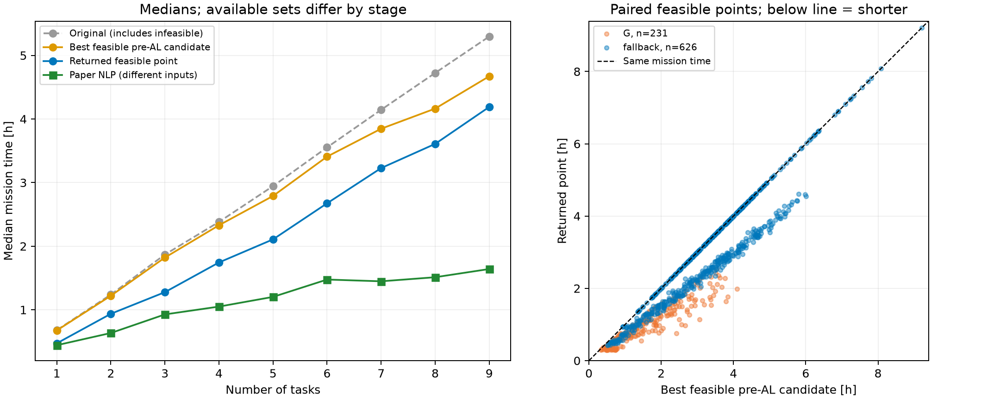

# 900入力のどの段階で長い目的値が決まるか

2026-11-17。[事前計画](PLAN.md)、計画・入力固定コミット `20c51e3`。
R3/R3sの同じ900入力と保存された4,541点を調べた。新規求解・数値設定の変更はない。

**初期化後から返却までほぼ短縮しない集団が、多タスク側で大きい。**
両端に原実行可能点がある857件では、最短の前処理候補から591件が1秒超短縮し、266件は差1秒以内、1秒超の増加は0件だった。
特に、修復後の初期化NLPが受理された202件は全て差1秒以内で、返却時刻との差は −0.00001469〜+0.00000808秒。
一方、原初期点が実行可能な624件では591件が短縮している。**「ALは全く時間を減らせない」との説明は、この900件では成立しない。**
どの初期化・探索の選択が論文との差を作るか、その修正効果までは未確定。

左の線は各段階の利用可能集合ごとの中央値であり、線同士の差を対応あり短縮量とはしない。
右は同じ入力で両端が実行可能な857組。図のPDF版は [stage-objectives.pdf](stage-objectives.pdf)。

## 入力と実行可能性

原初期軌道が原制約監査を通ったのは624/900、通らなかったのは276/900。
後者276件の行き先は、G経路から返却37件、補助経路の修復・初期化受理202件、構成点のみ返却31件、修復不受理で返却なし6件。
修復不能6件を原問題自体の実行不能とは扱わない。

前処理baselineは、実際の採用経路でALより前に得られた原実行可能点の最短時間。
Gなら原点のみ、補助なら原点・構成点・受理済み初期化を候補とする。
これは実際のAL開始点と別であり、[cases.csv](cases.csv)にはG/補助の実開始時間も記録した。
Gが実行不能な原点から返せた37件には実行可能baselineがなく、対応あり短縮率へ混ぜない。
857対応組 + この37返却点 + 返却なし6件 = 全900件。

Gと補助は別の開始点から走る経路である。G終点→補助入口を一つの連続した改善として集計しない。
原入力のmetricsは保存テンプレートの値が残り得るため、目的値は `sum(solution.s)` で再計算した。
AL終点は全精度の `result.objective` を使い、9桁丸めのexportと区間数に応じた誤差内で一致することを確認した。

## タスク数別

時間はh。前処理最短と返却の中央値は異なる利用可能集合。対応あり短縮/同等は差1秒を閾値とする。

| tau | 原点実行可能 | 前処理実行可能組数 | 前処理最短の中央値 | 返却数 | 返却中央値 | 短縮/同等 |
|---|---:|---:|---:|---:|---:|---:|
| 1 | 96 | 98 | 0.67542 | 100 | 0.47263 | 96 / 2 |
| 2 | 93 | 96 | 1.22085 | 100 | 0.93702 | 89 / 7 |
| 3 | 84 | 89 | 1.82123 | 99 | 1.27721 | 80 / 9 |
| 4 | 77 | 95 | 2.32916 | 100 | 1.74419 | 74 / 21 |
| 5 | 69 | 92 | 2.78984 | 100 | 2.10721 | 65 / 27 |
| 6 | 67 | 95 | 3.40863 | 99 | 2.67439 | 63 / 32 |
| 7 | 49 | 95 | 3.84709 | 99 | 3.22828 | 47 / 48 |
| 8 | 48 | 98 | 4.16395 | 98 | 3.60881 | 43 / 55 |
| 9 | 41 | 99 | 4.67198 | 99 | 4.18981 | 34 / 65 |

9タスクの65同等件は、初期化受理47件・構成点のみ11件・原点保持7件。
原点が実行可能な41件は、34短縮・7原点保持である。
8タスクの55同等件は初期化受理45・構成点5・原点保持5、7タスクの48同等件は38・8・2。
修復後の原制約初期化が受理される202件のうち、189件は最後の復元、13件は保存証明を採用している。
全900における「同等」266件は、この202件と原点保持33件、構成点保持31件に分かれる。

857対応組の短縮率中央値は23.15%、時間差中央値は−1305.39秒（約21.76分）。
経路別はGの231組全てが短縮、補助626組が360短縮・266同等。
これらは同じ入力内の記述統計であり、Gと補助の対象は選別されているので解法同士の因果的性能比較にはしない。

## 初期化受理202件の補足診断

事前集計で「返却時間が初期化時間と同じ」集団を見つけたため、軌道も同じなのかを追加確認した（計画後の探索的診断）。
[initialization-pairs.csv](initialization-pairs.csv) に全202対応を保存した。

- 返却までの時間変化は最大でも約15マイクロ秒。AL終点の時間は初期化から −2.818〜+3.183秒の範囲。
- 返却点のモード列とタスク訪問stampは202件全て初期化点と同じ。
- ただし対応する位置は最大1.165 km、個別区間時間は最大117.07秒変わっている。目的値が同じでも軌道全体の不変や変数の停滞とは言えない。

この集団では、最終のミッション時間を実質的に前処理で得ており、後続AL/復元がさらに短くしたとは数えられない。
固定分岐KKTは局所的な証明であり、この分岐での大域最適性や他の訪問順・充電選択での改善不能までは示さない。
前処理の局所解への依存は具体的に観測できたが、それが原問題の構造・分岐選択・初期化NLPの局所性・ALの探索のどれによるかは、介入した比較が必要。

## ALの見かけの短さと証明の範囲

保存したGのAL終点900点と補助595点について、原残差と純モード電池監査も記録した。
9桁丸めexportの原残差が1e-6以下なのはGで1点、補助で0点。
厳密なタスク座標一致等も要求するbranch監査は両者とも通過0だが、丸めによる不一致も含むので、**これを全精度AL点の原実行不能件数とは数えない**。
原制約の実行可能性は別点の受理済み復元268+549点、および返却894点で確認した。
KKTを満たすことと、原問題に返せることと、時間が短いことを区別する。

特にtau8/9のG終点の中央値1.935/2.246hは、返却点中央値3.609/4.190hより短く見える。
しかし両サイズともG復元受理0であり、粗い段階での時間切れも含む。これを原実行可能解の優れた目的値と比較してはいけない。
全tauのG/補助のAL時間・段階・共通/物理KKT・原残差は [points.csv](points.csv) に保存した。

## 検証と限界

- 入力10,748ファイルのSHA-256を固定し、集計と独立検算の前後に照合。前回分布比較の900行と返却時間/採用経路/点種を全件照合。
- 4単体テスト（古いmetricsを無視、秒換算/分類、欠測baseline、非有限時間）通過。
- CSVを別コードで読み戻し、900件・段階の件数/平均/中央値・対応あり差/経路別件数を独立の順序統計で確認。
- 追加の202対応を生の初期化/返却ファイルから再読し、時間差・座標差・区間時間差・分岐の一致も検算。結果は [verification.json](verification.json)。
- 図PNGを目視確認。新規求解0、KKTの数値再計算0。KKTは既存の検証付き保存結果を引用する。

[前回の分布差](../2026-11-17-r3s-paper-comparison/REPORT.md)は解消していない。
論文の入力集団・初期化・N・解法が異なるため、今回も論文の欠陥や最適性ギャップとは断定しない。
保存点から「どの集団の時間がどこで決まるか」は絞れたが、修正の有効性を検証した段階ではない。

次は予定どおり、規則入り876件中のG stage01時間切れ219件を保存ログで診断する。
特にtau8/9では補助への依存が全件なので、Gの初期段階の未達と、前処理の分岐への依存を分ける。
訪問順の因子比較は既にR2c-2と旧本体900件で実施済みである。新しい900件をすぐ解き直さず、まずGの未達要因と既存の分岐・時間内訳を確認してから、少数固定例への一因子介入を計画する。
