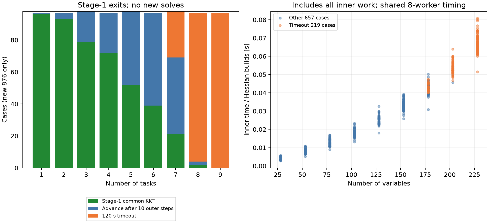

# Gの初段時間切れ219件：段階予算と内側計算の診断

2026-11-17。[事前計画](PLAN.md)、計画/コード/入力固定 `f2f5683`。
規則入り876件の219時間切れを主対象、残り657件を対照とした。旧入口24件は別集計。
全900件・6,982内側記録を読み、新規求解・KKT再計算・予算変更は行っていない。

**Gは大きい問題で、内側300反復を繰り返す費用のため、外側10回を終える前に段階期限120秒へ達していた。**
219件は外側4〜9回（中央値7回）で終わり、全件に内側の反復上限到達があり、`stuck`は0件。
ただし対照657件にも全件で反復上限到達があるので、「300反復到達そのものが時間切れの原因」とはしない。
現行Gは未収束でも外側10回が終われば次段階へ進む一方、期限切れなら停止する。この制御と、サイズに伴う内側費用の増加が組み合わさっている。

右の時間/構築回数は内側処理全体の平均であり、Hessianだけの所要時間ではない。8並列時の記録を使った記述統計。
[PDF](stage01-diagnosis.pdf)、[全900件](cases.csv)、[内側6,982記録](inner.csv)、[集計JSON](summary.json)。

## どのサイズで止まるか

規則入り876件のみ。初段KKTは全13段階のKKTとは別の件数。

| tau | 対象数 | stage01時間切れ | 初段KKT | 10外側で次段階へ | 時間切れの外側中央値 | 時間切れ以外の段階秒中央値 |
|---|---:|---:|---:|---:|---:|---:|
| 1 | 97 | 0 | 96 | 1 | — | 2.44 |
| 2 | 97 | 0 | 93 | 4 | — | 8.44 |
| 3 | 98 | 0 | 79 | 19 | — | 20.01 |
| 4 | 97 | 0 | 72 | 25 | — | 34.35 |
| 5 | 98 | 0 | 52 | 46 | — | 56.35 |
| 6 | 97 | 0 | 39 | 58 | — | 80.47 |
| 7 | 98 | 29 | 21 | 48 | 9 | 107.53 |
| 8 | 97 | 93 | 2 | 2 | 7 | 115.59 |
| 9 | 97 | 97 | 0 | 0 | 5 | — |

初段KKT454・10外側進行203・時間切れ219で合計876件。
先行24件は初段KKT11・10外側進行5・時間切れ8で、主対象の219へ混ぜない。
7タスクは同じ178変数でも29件が期限切れ、69件は通過する。8タスクの203変数でも4件は通過するため、変数数だけで成功/失敗が決まるわけではない。
9タスクは228変数で規則入り97件全てが初段に留まる。これは多タスク側が補助経路へ依存する具体的な理由の一つ。

## 内側の計算と残差

219件の完了した内側計算は1,445本。そのうち1,420本が300反復上限、25本が内側収束。
別に219本が実行途中で期限切れとなった。内側収束が一度でもあるのは16件、最後の完了内側が収束したのは15件。
終了時の共通KKT不合格は、停留性204、実行可能性219、相補性219、双対符号0（重複あり）。
中央値は停留性0.07484、実行可能性0.001454、相補性0.001451。
15件は停留性を満たしても実行可能性・相補性が残るため、内側だけの収束を初段KKT達成へ数え替えない。

rhoの最終値は1e4が204件、1e5が12件、1e6が3件。1e8に達した例は0。
この段階の失敗を、以前診断した最終段階のrho=1e8での丸め限界と同じ原因とは説明できない。
rho増加には内側勾配∞<=1e-6が必要で、反復上限後も勾配が大きい内側1,420本ではこの条件を満たさない。
ただし、内側精度やrho更新規則を変えれば改善するかは未検証。

Hessian構築は219件で計464,304回。コード上、1構築に `1+2*n_variables` の勾配評価を数えるため、178/203/228変数では357/407/457評価が必要。
全記録でこの式とカウンタが一致した。計数されたHessian用勾配評価は計193,623,628回、1件当たり中央値886,123回。
これは手元の診断Newtonの実装費用であり、密Hessianを作らない著者L-BFGSの実装費用を測ったものではない。
これには他の評価が含まれず、Hessian/固有分解/探索の時間内訳も記録されていないため、**Hessianだけが壁時計の何%を占めるかはまだ不明**。
内側処理時間/構築回数の中央値は対象0.05678秒、対照0.01698秒だが、サイズ・幾何・並列実行時間が交絡しており、因果的な速度比ではない。

対象219件の段階時間の和は26,287.86秒、規則入り876件の初段時間の和の48.63%を占める。
これは各ケースで測った時間の加算で、8並列のジョブ全体の壁時計でも、CPU秒でもない。

## 中断点の扱い

219件全てで、返されるGの外側状態は最後に完了した外側点のままで、時間切れとなった内側の受理済み点は採用されない。
その内側に217件では少なくとも1ステップの受理があり、合計34,699受理ステップ、内側時間の和1,913.89秒（約31.9分）が記録される。
この不採用は実装どおりであり、ファイル欠損や状態破損ではない。途中点を採用してもKKTが通るとは限らず、現行の採用規則を変更して救済件数へ数え替えない。

## 事前規則で選んだ3代表の生トレース

対象を外側完了回数・変数数・IDでソートした先頭/中央/末尾。各例の最初と最後の内側ログ6本（計約2.87MB）をそのままコピーし、読取前にhashを固定した。
初段の最初の内側は3例とも300ステップを受理し、その全てで負の固有値を含む。探索は非凸性に対処しながらAL値を下げており、試行点を受理できず止まる型ではなかった。

| case | 完了外側 | 最後の中断内側の受理数 | 中断内側の勾配∞：入口→最後 |
|---|---:|---:|---:|
| tau9-seed9000035 | 4 | 284 | 1.2922 → 0.001406 |
| tau8-seed8000006 | 7 | 99 | 0.07915 → 0.62773 |
| tau8-seed8000062 | 9 | 14 | 0.0001546 → 0.001194 |

6本全てで受理点のAL値は増えず、gradient fallbackによる受理は0。それでも勾配ノルムは単調に下がるとは限らない。
したがって「受理点を戻せば収束」「反復を増やせば直る」とは言えない。
[代表トレース集計](representative-traces.csv)、[選択と元保存先](representative-selection.json)、[コピーのhash](representative-source-index.json)。

## 今わかったことと次の検証

初段時間切れの**直接の仕組み**は、実装と全件ログの対応から説明できた。
内側計算は進んでいるが、特に大きい問題では現行予算で初段KKTにも外側10回にも届かず、Gが停止する。
ここを直せば、補助経路に頼らず探索できる機会が増える可能性がある。ただし、8タスクで初段を通った4件も最終的にはGで返せていないため、初段通過だけで目的値分布が改善するとは言えない。

次は保存した3代表の状態で1反復の費用を分解計測する。Hessianの差分評価/行列積・固有分解・探索のどこが支配的かを、解を動かさず確認する。
その計測に基づき、同じ総予算を使う少数例の一因子比較を計画する。内側反復枠を変える場合も、KKT・到達段階・原実行可能返却点・目的値・費用を同時に判定する。
900件の解き直し、時間切れからの恣意的な段階進行、論文との差を埋めるためだけの予算追加は今回していない。

## 検証

4単体検査（対象分類、KKT重複、差分カウンタ、rho増加の精度条件）通過。
入力2,933ファイルのhash照合、900件の原集計とのID対応、全6,982内側記録の生ログ再読、rho更新・中断点不採用・サイズ別集計を別コードで検算した。
追加の代表トレース6本も生点と照合。結果は [verification.json](verification.json)。図PNGを目視確認した。
修正効果、著者の実装との一致、論文の目的値分布の再現はいずれも未達。
