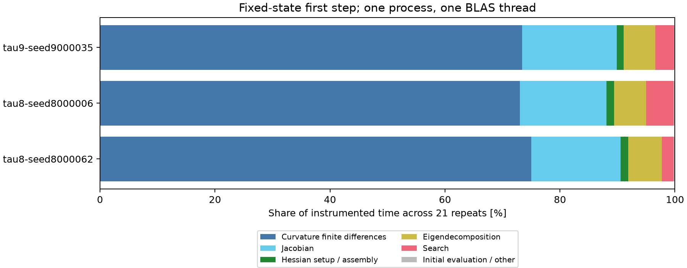

# 初段の1反復では、曲率の中央差分が73〜75%を占めた

2026-11-17。[事前計画](PLAN.md)、計画/入力/コード固定 `30ff21e`。
前回の3代表について、最後に中断した内側の入口を固定し、最初の受理までを再生した。
**主な費用は曲率用の勾配の中央差分であり、固有値分解ではなかった。** 次の改修対象は勾配評価の経路とする。
この結果は選択した3状態の1反復の費用内訳であり、900件の速度向上・KKT成功率・目的値の改善を測ったものではない。

[PDF](step-profile.pdf)、[集計JSON](summary.json)、[検算](verification.json)、[次の比較案](NEXT.md)。

## 測定方法と、元コードとの一致

tau9-seed9000035の外側5回目、tau8-seed8000006の8回目、tau8-seed8000062の10回目の内側入口を使用。
どれもstage01・eps=.2・p=2で、信頼領域半径は元コードと同じ1から開始する。
無変更Newtonをcallbackで最初の受理直後に止め、計測版も同じ1ステップだけ実行する。各回、元の入口へ戻す。
初回評価、Hessian前処理、Jacobian、曲率の中央差分、Hessian組立、固有値分解、探索、残余を分離した。
探索には試行点の評価・信頼領域部分問題・受理判定を含む。

各状態で3組warmupと21組測定、合計72組（63計測+9warmup）。組内の無変更/計測版の実行順を交互にした。
3ケースは別プロセスで直列実行し、OpenBLAS/OMPを1スレッドに固定。NumPyとSciPyの両BLASが実際に1スレッドであることも確認した。

- 元のHessianと計測版Hessianはbitwise一致し、非対称度も一致した。
- 72組全てで、実行時assertにより無変更版/計測版/保存済み最初の受理点を照合した。
- 保存した3受理点の変数ベクトルyは、今回の計測版と完全一致（最大差0）。AL値・勾配∞・予測減少・比率・半径・固有値も許容誤差内で一致した。
- 測定中に入力yを変更していない。測定結果を次の反復や返却解へ採用しない。完全求解0、返却点変更0。

## 測定結果

時間は21回の中央値ms。比率は各区間の21回の時間和/計測版の全時間和であり、中央値の比や各回比率の平均とは別。

| case | 変数数 | 無変更1反復 | 計測版1反復 | 曲率の中央差分 | Jacobian | 固有値分解 | 探索 |
|---|---:|---:|---:|---:|---:|---:|---:|
| tau9-seed9000035 | 228 | 38.035 | 37.856 | 73.44% | 16.43% | 5.45% | 3.26% |
| tau8-seed8000006 | 203 | 31.260 | 31.207 | 73.03% | 15.09% | 5.59% | 4.78% |
| tau8-seed8000062 | 203 | 30.487 | 30.481 | 75.03% | 15.50% | 5.83% | 2.04% |

Hessianの前処理/Jacobian/中央差分/組立を合わせると89.40〜91.89%。
固有値分解は5.45〜5.83%で、この部分だけの高速化では主な費用は残る。
探索の試行回数は各例で7/9/4回と一定で、元の信頼領域の拒否・半径縮小も再生されている。
計測版中央値/無変更中央値は0.9953/0.9983/0.9998。近いが、これを速度改善や計測負荷ゼロの証拠とはしない。

## 改修候補

曲率の中央差分は各座標で `m.eval(..., rho=0)` の勾配だけを使う。
一方、R版の評価ラッパーは、目的値/制約取得と重み付き勾配取得のためにnative評価を2回呼び、未使用のAL値も組み立てている。
そのため、まず**この差分ループ専用に勾配だけを取得する経路**を比較する価値がある。
差分幅・Hessian式・固有値分解・反復予算を変えずに、重複する計算を省ける可能性がある。
ただし、倍率変換・乗数の重み・モデル内のh/gキャッシュも含めた一致確認が必要であり、まだ改修も効果測定もしていない。

[NEXT.md](NEXT.md)に、全差分点の勾配・Hessian・内部状態・受理点の一致を先に確かめ、同じ状態で費用だけを比べる案を記した。
これが通っても120秒のGで最終段階に進めるか、目的値が短くなるかは別の少数例の介入実験が必要。

## 限界と検証

3例は前回の事前ソートで選ばれた時間切れ例で、全サイズや全反復の代表標本ではない。
今回の1プロセスと過去の8並列は実行条件が異なり、過去の段階時間の何%を削減できるかへ直接換算しない。
また、著者のL-BFGSの費用を測ったものではなく、手元の診断Newtonの計算経路の診断である。
KKT/原実行可能性の新規評価、著者の目的値分布の再現は行っていない。

3単体検査（区間時間の加算・二重計上の拒否・負時間の拒否）が通過。
入力73ファイルと数値評価ライブラリ2本のhashを固定・照合した。
独立コードで63計測行の非負性/加算/中央値/比率、保存3状態/受理点/Hessian行列とBLASスレッド数を確認した。
全72組の数値一致は実行時assertの記録、独立した保存点照合は3点である。図PNGを目視確認した。
最初の起動はthreadpoolctlがPythonパスになく測定前に停止し、既存キャッシュをパスに追加して再開した。数値コード/条件は変更していない。
